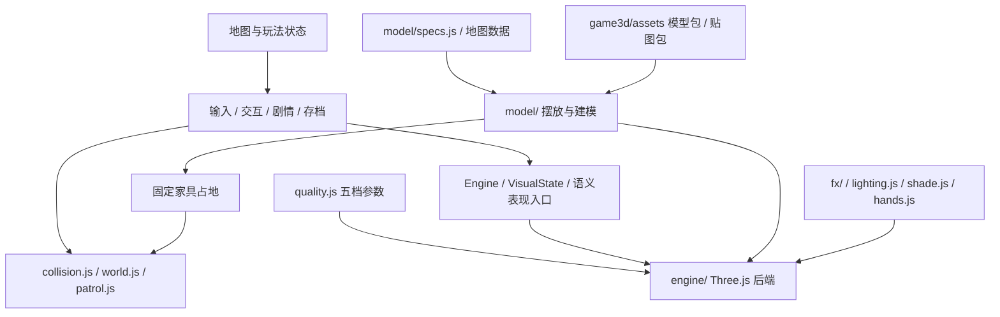

# 3D 代码审查与分层重构

本报告最初描述 PR #7 的最终路线：**保留本地 Three.js，各档画质共用玩法和碰撞**。没有第二套引擎、引擎选择控件或动态远程依赖。PR 期间提出过的双引擎镜像方案已根据产品确认移除。之后 PR #8 在「超精细」之上加了第五档「真实」，PR #11 把模型换成 Blender 脚本建模的模型包、贴图换成离线生成的贴图包；下文按当前代码（main `13c1c79`）写，第 1 节保留 PR #7 时的审查结论。

## 1. 审查结论

原先渲染设备初始化在 `render.js`，帧绘制在 `main.js`，场景生命周期在 `world.js`，人物建模混在剧情和巡察逻辑里。画质参数散落各处，旧设置只接受 0/1/2；提高画质会改变实体树木布局。模型顶点直接生成碰撞还会使分段数影响家具占地。

重构将渲染调用收进 `Engine`，设备和表现实现保留在 Three.js 后端。游戏层用普通数值 `VisualState` 表示受伤、闪光、巡察红光等反馈，不再直接访问 `THREE` 或 `GLR`。保留最新提交的类型化数组、压缩顶点、分块剔除、场景缓存、写实模型及恐怖氛围。静态家具占地从建模尺寸和变换推导，既能跟模型对齐，也不会因画质改变。

这仍是普通脚本项目，保留全局兼容入口；没有声称已迁移成 ES 模块、完整 ECS，或可以零成本替换引擎。

## 2. 文件与依赖边界

| 文件 | 职责 |
| --- | --- |
| `quality.js` | 五档只读参数表（含每档用哪一档模型）、旧值归一、持续低帧率提示。 |
| `engine/api.js` | `Engine` 场景/相机/画质/绘制入口，普通数值反馈 `VisualState`；为旧表现代码映射 `GLR` 数值属性。 |
| `engine/three.js` | WebGL 设备、相机、世界/手持物离屏目标、后期、设备能力和窗口尺寸。 |
| `engine/scene.js` | 静态场景生命周期、灯光、相机同步、绘制和菜单拍照；切档时保留动态状态。 |
| `engine/presentation.js` | 精灵、路人、巡察造型、交互标记；游戏代码只调用语义函数。 |
| `model/props.js` | 常见小物件的摆放（模型见 `tools/blender/assets/props.py`）。 |
| `model/specs.js` | 房间主题、灯光布局、固定植物数量；建筑分派表在 `model/building.js`。 |
| `model/assets.js` | 模型包：开局按画质同步读一档并解压，换画质时后台读、读好重建；读不到时在菜单提示重试，游戏中读失败继续用已有的一档。 |
| `model/materials.js` | 共享材质；颜色图、高度图来自贴图包（流畅缩到 256，超精细和真实最大 1024），浮雕法线由高度图现算。 |
| `model/kit.js` | 图元、材质批次、解析占地记录；`Kit.asset` 摆放模型：并进大网格，或重复多的用 `InstancedMesh`（按 24 米分格），室外流畅到精细档把一格里只有一两件的稀疏合批。碰撞代理统一取最细一档（L0）。分段数量不参与碰撞生成。 |
| `model/room.js` | 网格房间生成、每件家具的占地 `R.foot`、特殊设施附加碰撞。 |
| `model/spiral.js` / `spiral.js` | 钟楼建模 / 旋梯层数与通行逻辑分别管理。 |
| `hands.js` | 第一人称的手和手电、手机、雨伞；有模型时用模型包里的，换画质时换成那一档并释放旧的。 |
| `tools/blender/`、`tools/textures/` | 离线生成模型包（Blender 5.2 的 bpy）和贴图包（numpy + Pillow）；运行时不需要。 |
| `collision.js` / `world.js` | 圆与矩形距离、共用 240 Hz 移动细分、沿墙滑动、场景切换。 |
| `patrol.js` | 0.25 米导航网格、身体余量与路径。 |
| `main.js` | 游戏固定步进、HUD、音频与界面生命周期；调用 `Engine.draw`。 |

`index.html` 按依赖顺序加载本地普通脚本：基础/地图 → 配置与引擎定义 → 模型 → 世界与碰撞 → 表现与玩法 → 启动。函数定义可引用稍后加载的模块，但启动要等所有脚本加载完。模型包和贴图包由 `model/assets.js`、`model/materials.js` 在页面解析时按画质插入，后面的脚本运行时已经读好。新文件必须加入入口；无需 npm、CDN 或模块服务器。

## 3. 单一引擎的选择

| 路线 | 对项目的影响 | 结论 |
| --- | --- | --- |
| 保留 Three.js，抽离入口 | 继续使用现有模型、材质和效果；本地体积不增加第二套引擎；各档共享状态与碰撞。 | 按用户确认采用。 |
| 双引擎或场景镜像 | 额外维护材质/光照/深度/手持物/资源释放的映射，需校准画面；增加本地包和切换状态。 | 不纳入交付。 |

## 4. 五档画质与绘制

| 参数 | 流畅 | 均衡 | 精细 | 超精细 | 真实 |
| --- | ---: | ---: | ---: | ---: | ---: |
| 像素比上限 | 1.4 | 1.4 | 1.4 | 2 | 2 |
| 场景分辨率倍率 | 0.55 | 0.70 | 1 | 1 | 1 |
| 模型档 | L3 | L2 | L2 | L1 | L0 |
| 材质贴图 | 256 | 512 | 512 | 1024 | 1024 |
| 圆柱/杆分段倍率 | 0.6 | 1 | 1 | 1.75 | 2.6 |
| 草丛实例上限 | 0 | 4200 | 9000 | 14000 | 20000 |
| 雨丝 / 黑蛾 | 500 / 50 | 900 / 80 | 1500 / 120 | 2200 / 180 | 3000 / 220 |
| 日月阴影 | 无 | 无 | 2048 | 4096 | 4096 |
| 手电阴影 | 无 | 无 | 1024 | 2048 | 2048 |
| 顶灯实时阴影 | 无 | 无 | 无 | 最近一盏，单面 512 | 最近一盏，单面 1024 |
| 深度接触遮蔽 | 无 | 无 | 无 | 八向邻域采样 | 更强 |
| 离屏多重采样 | 无 | 无 | 无 | 最高 4 倍 | 最高 8 倍 |
| 室外稀疏合批 | 有 | 有 | 有 | 无 | 无 |

「真实」另有：方块全换成圆角盒、圆柱和杆全平滑；物理材质和一层暗淡的环境反射；灯管、手电光斑、亮窗的辉光；按所在空间生成的混响，有方位的声音用 HRTF 立体定位。切回其它档位时这些都恢复原样。

实际尺寸服从显卡限制；画布总像素上限约 500 万。超精细缺少 WebGL2 多重采样能力时采用后期边缘平滑；缺少深度纹理能力时关闭接触遮蔽。它是轻量接触阴影，不是光线追踪或完整全局光照。

绘制顺序：世界颜色/深度 → 手持物独立透明目标 → 后期合成、色调和 SAN/受伤效果 → 屏幕。手持物不清除世界深度，因此不会使接触遮蔽失效；近墙时也不会被墙切成半截。没有后期的调试模式使用清深度的手持物叠加。

五档都使用相同的玩家半径、家具占地和室外实体植物布局；只改变模型档、树冠、草、材质和视觉分段。240 Hz 是每个 60 Hz 游戏更新内的移动细分，**不会让异象抽取、SAN、时钟或体力每秒执行四倍次数**。大位移另按最大步长细分。超宽屏会缩短相机近平面，使四角留在角色碰撞圆内。

## 5. 切档与资源所有权

- 替换静态场景网格，重建窗光/光斑；不调用会重置游戏状态的 `doEnterRoom`。
- 保留 `S`、`AN`、`ROAM`、`PAT`、`SP`、开门状态，以及同学的位置、堵门和计时。现有天气实例保留；新天气实例使用新档位数量。
- 材质保持稳定引用；贴图尺寸变化时交换并释放旧贴图。
- 人物、异象小件、水杯和巡察服饰按细节缓存，标记共享几何体；房间释放不销毁共享资源。场景中的引用在切档时更新。
- 模型包按档留在内存里（解开后 L0 约 10 MB、L3 约 1.5 MB）；实例化用的几何体每件模型每个材质组一份，所有房间共用、不随房间销毁，换画质时清掉。手电、手机、雨伞随画质换成那一档的模型，旧的释放。
- 贴图包换到更细的一档时后台读，读好后整批换贴图并释放旧的。
- 开局模型包读不到时停在菜单、显示「重试」，不进入缺家具和碰撞的场景；游戏中换画质读包失败时继续用已有的一档。连续换画质时只应用最后一次，迟到的包不会再重建一次。
- 室外与最近三个房间保留 CPU 场景数据，离场释放几何缓冲，重返时重用；开门只重建门扇。缓存同时检查当前地图对象，避免新开游戏复用旧地图状态；切档清空旧缓存。
- 离屏目标、被淘汰的网格和不再使用的阴影图会释放；同学、路人、巡察和痕迹离场时释放各自的非共享资源。
- 低帧率建议不打开剧情选择框，不自动修改画质。进入场景/切档预热 5 秒后，10 秒窗口平均不足 24 FPS 才提示；暂停、面板、后台与超过 5 秒的停顿不会触发。

## 6. 碰撞与审查能力

家具的解析投影、附加设施和墙格共同参与角色圆形碰撞；身体靠近角落时不会漏掉四点探针之间的角。被旧存档放进物体时，只允许降低重叠程度的移动，不再整段绕过碰撞。坐姿允许位于椅子内，防卡位不会把坐着的玩家挪开。

巡察者按 0.25 米细网格规划；车库怪物也检查身体范围。模型审查器加入可达性和同学坐姿检查，使用与玩家一致的圆形站立判定。扫描仍是抽样与包围形体检查：零候选不等于所有动态画面或完整通关路线都得到证明。

## 7. 验证与边界

运行 `python -m unittest discover -s tests -v`。`test_engine.py` 覆盖五档参数、切档状态、室外布局、资源释放、实际超精细和真实渲染、旧设置、断网资源启动、低帧率建议、超宽屏相机和游戏层依赖边界；`test_assets.py` 覆盖模型包读取失败与重试、触屏旧设置的开局档位、手持物换档、连续切档和压缩包完整性；`test_asset_batching.py` 覆盖室外稀疏合批的画面等价和绘制预算。`test_model.py` 验证紧凑顶点、隐藏面、缓存、单独门扇、曲面/新图元、低档预算和远处人影；`test_geometry.py` 覆盖全校审查、占地、座位、巡察路径、手持物和可达性；操作/存档/剧情回归继续保留。

`tools/engine_compare.py --before <旧检出目录>` 在固定机位记录截图、绘制量与软件 WebGL 采样；证据见[性能对照数据](引擎性能对照.json)和[截图](../pictures/引擎重构/)。软件环境不代表独显、核显或手机帧率，超精细和真实默认不开。完整自然通关、实体手机与 Safari 未在本轮验证。

本地依赖和普通脚本结构继续支持直接打开文件的使用方式，模型包、贴图包也是普通脚本，`file://` 下照样能读。管理策略禁止 `file://` 的浏览器里，对应测试会明确跳过并写明原因；另用禁网浏览器从打包资源启动并实际渲染，验证没有在线资源依赖。遇到受管浏览器限制，可通过本地 HTTP 服务运行，不能把被策略阻止的检查记作通过。建模开销见[建模统计](建模统计.md)。
