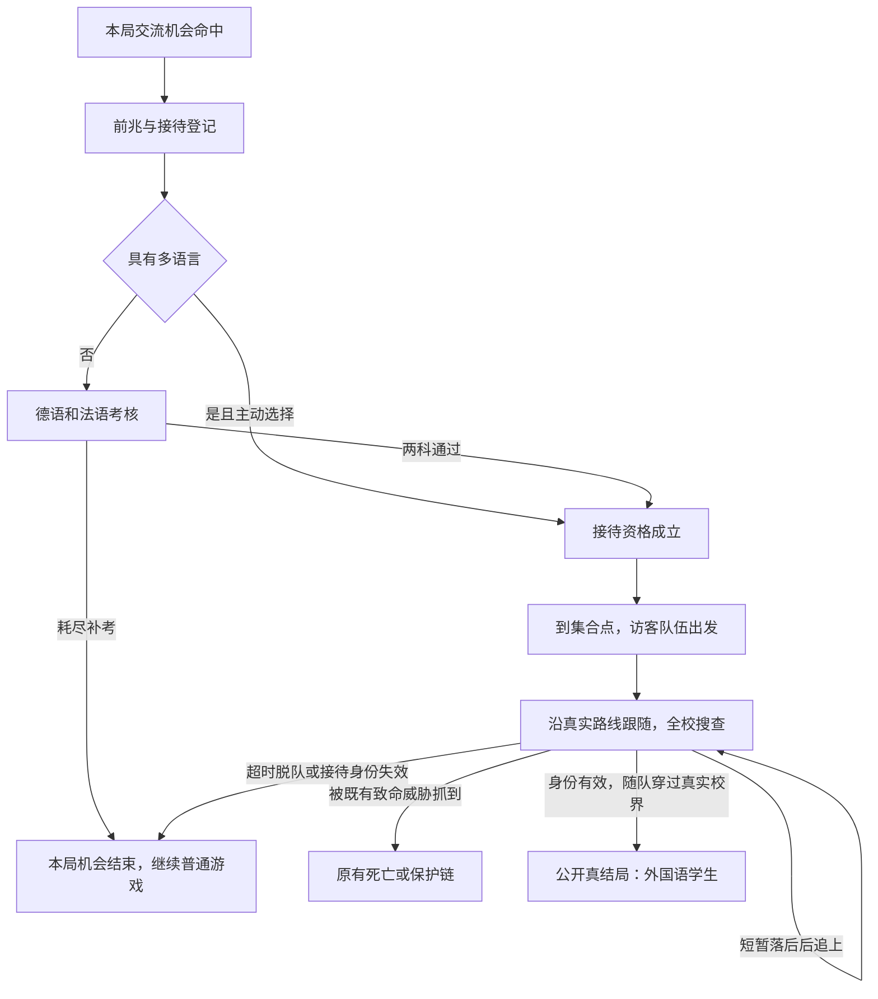

# 校园直通、翻越受伤与国际交流

> **状态：已审核待实施（v0.2 真人审核通过，2026-11-05）。仅确认设计方案，游戏功能尚未实施。**
> 创建：2026-11-04。依据 [`main@0098480`](https://github.com/wd-fz/wd-fz.github.io/commit/00984806bcdfa94928dc0fa072b9fb756000c818)。
> v0.2 追加核对：[`main@e2532e2`](https://github.com/wd-fz/wd-fz.github.io/commit/e2532e2204ba64a6b7c57f3a92b8a6fa602f4bc0)，PR #42 的初稿已合入；本次新增小刀与隐藏假结局《管制刀具》（第 16 节），CG 见 10.3。初稿入库不等于功能已实施或整份计划已确认。
> 用户明确要求：“写计划。初稿待确认，根据现有 main，后续可能还有新提交，待真人确认计划”；随后明确“新开一个计划文稿”。本稿不改写、不替代既有楼梯、教室、电梯或感官计划。
> **实施前置条件：已于 2026-11-05 完成真人审核；实施前仍须复核届时 main 与在途 PR，并定稿第 14 节列出的实施参数。** 历史初稿建议如与第 14 节真人确认结果冲突，以确认结果为准。审核通过不等于授权本次实施代码。
> 本文包含内部彩蛋与路线条件；“公开真结局”与“公开全部触发攻略”分开处理，详见第 11 节。

## 1. 本次需求与确认边界

| 用户明确提出的需求 | 本稿对应内容 |
| --- | --- |
| 楼梯、连廊都能直接通过，不要传送 | 第 3 节：复核已有楼梯，重做两条连廊，贯通建筑与室外坐标 |
| 体力掉得太快，需要调整 | 第 4 节：降低跑步消耗，保留跑空恢复机制，结合新路线校准 |
| “超清晰”和“真实”光影有彩斑条纹，要修 | 第 5 节：对应当前“超精细”与“真实”两档，先复现再定位 |
| 教室外走廊的外侧是栏杆，可以看到外面 | 第 3 节：教学楼开放走廊、真实校园外景、栏杆与楼板一致 |
| 添加翻越、受伤机制、跳楼死法及 CG，同步成就 | 第 6、10、11 节：翻越输入、落地伤害、恢复、死亡演出和事实记录 |
| “假正常”不应第二天 100% 出现，改成 30% | 第 7 节：说明当前原因，单次抽取、结果持久化 |
| 添加彩蛋特殊事件“国际交流” | 第 8 节：事件调度、接待资格、跟随离校、全校搜查 |
| 隐藏天赋“多语言”，像武大子弟，可以与其叠加；触发概率 15% | 第 8 节：独立附加天赋；15% 的指代待确认，不擅自锁定 |
| 有多语言时能选择接待并免考试；没有则通过德语、法语考试，提示隐晦 | 第 8 节：接待分支与双语资格考核；“免考试”的范围待确认 |
| 跟紧外国友人，不能掉队，通过全校搜查后获得公开真结局“外国语学生”，新作结局 CG | 第 9、10 节：连续跟随状态机、成败条件、独立分镜 |
| 新道具小刀；巡察者抓到玩家后 1 秒内，从背包切到手上并使用，提前切不算；触发隐藏假结局“管制刀具”，规划 CG | 第 16 节：抓取窗口、切出与使用的先后判定；第 10.3 节：专属假结局 CG |

本次范围为 3D 游戏。真实通行、碰撞、体力、受伤、事件、天赋、CG、成就和存档需要一起设计；不把新计划自动转为改代码任务。旧 2D 不在本稿范围。

## 2. main 现状、证据与并行改动

### 2.1 本次实际核对的代码

以下是 `0098480` 的现状；不是旧计划最初立项时的现状，也不是对未来 main 的承诺。

| 对象 | 当前证据与行为 | 本次需要推进 |
| --- | --- | --- |
| 普通楼梯 | `content/stairwell-layout.js` 已有 7 座梯井：教学楼西／东、行政、实验、南北宿舍、车库。教学西梯接天台，东梯至 5F；宿舍层间距 3 m，其余 3.2 m | 复用已有 `StairWorld`，检验通行与空间关系，不另建重复楼梯模块 |
| 楼梯衔接 | `modules/stairwell/stairwell.js` 的 `moved/enter/exit` 已按门槛自动换空间；`fx/stairwell-view.js` 在梯间附加相邻层几何预览 | 对齐整栋建筑、室外、连廊和开放走廊；核对相邻实体、光照、声音、碰撞是否连续，不以静态几何预览代替真实场景 |
| 连廊 | `map.js:linkFloor` 为 5×24 格封闭长廊；`interact.js:useLink` 仍调用 `enterRoom` 与预设落点，玩家交互进入／离开 | 重做为实际有长度、可停留、能往返的连续连接 |
| 连廊拓扑 | `link1` 连接 `admin2↔lab2`；`link2` 连接 `lab2↔teach2`。室外建筑位置与室内各自的局部布局分开定义 | 保留这两条关系，重新测量四个端口及外部桥体位置，不能只删黑屏而保留跳点 |
| 跑步 | `input.js:updatePlayer` 跑步 −17／运行秒，非跑步恢复 +11／运行秒；≤6 疲惫，恢复到 35 才能再跑 | 满状态约 5.5 秒即进入疲惫，确实偏短；提出较宽松候选值并实走校准 |
| 体力上限与补给 | `domain/player-stats.js` 上限为 `40+0.6×SAN`；士力架现已提供 30 运行秒免消耗和 1.5 倍步行／奔跑速度 | 保留已合入补给效果；降低消耗，避免新增受伤把普通跑图再次压成几秒 |
| 高画质 | `quality.js` 档 3“超精细”：AO 0.38、4×采样；档 4“真实”：AO 0.5、8×采样并开启更强材质／辉光效果。`engine/three.js` 还有深度 AO、色差、色调映射；`shade.js` 管阴影 | 彩斑条纹为用户报告，本轮未在真实 GPU 复现，不能先断言是阴影、AO 或显卡问题 |
| 假正常 | `systems.js:advanceGameTime` 在跨到第 2 天时，只要 `fn.note && !fn.on && fn.n===0` 就直接 `fn.on=true`，没有概率判定 | 这是正常走到第二天通常必出的直接原因；改为单次 30% |
| 隐藏天赋 | `modules/wuda-kid/wuda-kid.js` 独立模块，不占 `S.talent`；新局 3%，有本机菜单入口，读档不重抽，速通不发放 | 多语言采用独立附加属性，可与普通天赋、武大子弟三者同时生效；不擅自复制菜单入口或速通规则 |
| 伤害与死亡 | 有 SAN、体力和 `VisualState.hurt`；后者是画面效果，不是伤势。`story.js:kill` 接药丸／免疫、预知梦、死亡记录与演出。虚空迷宫有自己的坠落规则 | 新增校园物理受伤，接入现有致命处理；不把视觉受击值当生命值，不替换特殊空间规则 |
| 结局与成就 | `story.js:ENDINGS`、`death-archive.js`、`domain/achievement-rules.js`、`speedrun.js`、局后记录分别消费结局与死亡事实 | 增加《外国语学生》及新死法；所有列表、可信证明、CG 回放、路线统计一起适配 |

### 2.2 已合入与未合入分开

- [学生会检查、请假条与真实楼梯教室改造](学生会检查、请假条与真实楼梯教室改造.md)及[SAN 感官计划](SAN提示移除与感官恐怖深化.md)已有实施进入本稿基线。继承已交付功能和验证记录，但不把历史测试算成本稿的验收。
- 截至本次读取，[PR #41](https://github.com/wd-fz/wd-fz.github.io/pull/41)仍开放，主题为电梯直通、新天赋、新结局与恐怖氛围；其进度还涉及教室第二次重修、开局 CG 和 SAN 视觉重做。它的内容**未视为本稿 main 的既有实现**。
- 与[电梯直通、新天赋、新结局与恐怖氛围](电梯直通、新天赋、新结局与恐怖氛围.md)重叠的接口：教学楼尺寸／门位、普通门槛、电梯、后处理、巡察、成就路线集合。新稿确认前先核对 PR 状态；确认后实施也必须再核对，不能覆盖另一条分支刚完成的内容。
- 本稿不冻结“教室六间还是四间”、普通天赋数量、公开真结局总数。布局从届时权威配方读取，结局集合从稳定 ID 构建；不要把旧数量写死在新功能里。

## 3. 连续校园：楼梯、连廊与开放走廊

### 3.1 玩家体验

从教室出来，沿外侧栏杆走廊看见真实校园；走进楼梯、上下转台，或走上连廊进入另一栋楼，全程可停、回头、倒退和跑动。普通连接不要求“走连廊／上楼／下楼”选项，不黑屏、不瞬移落点、不自动转向。走过实际距离就花实际运行时间。

“没有传送”落实为世界坐标连续：允许内部空间 ID 改变，但转换前后世界位置、脚高、朝向、速度和镜头必须连续。建筑普通出入口也要纳入，否则从开放走廊落到室外时仍会产生两个互不相接的校园。电梯直通与在途计划共用门槛契约，避免各做一套；特殊剧情传送门／异空间的世界规则不在此处直接取消，范围仍列入第 14 节确认。

### 3.2 先定整栋空间，再接桥

建议由一份版本化布局提供 `building → floor → corridor / stair / bridge / outside` 的刚性变换、标高、边界、开口和表面 ID。碰撞、导航、镜头、声音、地图、巡察和物件引用同一份数据，渲染网格不反过来决定权威位置。

| 连接 | 端点 | 必须解决 |
| --- | --- | --- |
| 连廊① | 行政楼 2F ↔ 实验楼 2F | 端口方位、宽度、楼板标高、桥下净空、外观桥体和室内通路一致 |
| 连廊② | 实验楼 2F ↔ 教学楼 2F | 教学楼重修后的端点、转角、与栏杆走廊的接合，禁止保留旧教室坐标硬接 |
| 既有 7 座梯井 | 按 `STAIR_LAYOUT` 枚举全部端口 | 首末层、半层平台、天台、车库室外出口连续；天台与楼下不同平面尺寸须实际对齐 |
| 教学楼开放走廊 | 教室外的公共走廊 ↔ 校园外景 | 外侧立面、栏杆、楼板、可落地表面与室外同一坐标；不出现墙内的另一个校园 |

旧连廊 5×24 格不直接当成新桥物理尺寸：实际测绘两端间距，必要时调整桥体或建筑端口并记录布局变化。教学东梯是否延伸到天台另行确认，不借本稿擅改现有拓扑。

### 3.3 开放走廊的建模与功能

- 修改的是**走廊外侧连续实墙**：改为可见栏杆、必要立柱和真实空隙；教室门墙、厕所及结构端墙保留各自用途。逐层标记外侧边界，不能批量把所有 `#` 变成栏杆。
- 栏杆建议约 1.1 m 高，碰撞覆盖身体半径；普通走跑不会自动穿过，主动翻越按第 6 节执行。栏杆外的楼板厚度、檐口、下层平台、地面均有真实承托关系。
- 外景至少呈现对应方向的真实建筑、天空、地面、桥体及可见人物／威胁。远景可降低细节；可抵达的表面、碰撞和 NPC 位置不能用背景贴图假造。
- 走廊能看到外面，也可能被外面看到：巡察与搜查依真实视线、遮挡和高度判断，栏杆不当实墙；实体楼板、立柱与封闭门正确遮挡。预兆与可躲位置需一起校准，避免开启外景后出现全校无条件锁定。
- 低画质可简化杆件和远景细节，不能换成封闭墙、少一段栏杆或改变翻越点。雨、风、脚步混响跟随敞开空间，声音字幕仅使用真实方位信息。

### 3.4 状态、流式加载与巡察

预取相邻块不触发探索计数、回访、检查、自动存档或成就；身体跨明确门槛后才提交一次进入事实。巡察与访客沿同一三维路径推进，在屏／离屏使用同一状态，不能在桥两端复制实体、用固定倒计时代替过桥距离，或在加载时跳到玩家面前。

先完成“教学 2F—连廊②—实验 2F”的双向原型，同时验证桥下地面。加载失败应显式暂停整个相关模拟并提供重试，不能只冻结玩家让追逐继续，也不能用隐形墙或无提示回传伪装成功。模型缓存可回收，权威表面和导航不能随网格卸载消失。

## 4. 体力改造：先让基础移动够用

### 4.1 候选数值，待试玩确认

以下都用**实际游戏运行秒**，不随 20 分钟自然日的游戏分钟倍率变化。暂停、失焦和菜单不扣体力、不恢复、不推进补给时长。

| 参数 | 当前 main | 初稿建议 |
| --- | ---: | ---: |
| 普通奔跑消耗 | 17／秒 | **8／秒** |
| 不跑时恢复 | 11／秒 | **12／秒**，步行与原地均可恢复 |
| 疲惫阈值 | ≤6 | 保留 ≤6 |
| 疲惫解除 | ≥35 | **≥30**；保留上下阈值，防跑走抖动 |
| 体力上限 | `40+0.6×SAN` | 首轮保留公式，先独立评估消耗变化 |
| 走／跑速度 | 21／36.4 内部单位／秒 | 保留，不能靠加速掩盖体力问题 |
| 士力架 | 30 秒免消耗、速度 ×1.5 | 保留；仅免移动类体力成本，不减免伤害 |
| 普通上下楼／连廊 | 按基础移动 | 不另加爬楼、桥上奔跑倍率 |
| 主动翻越成本 | 无 | 暂定一次 8 点，提交翻越时扣一次；不足不能开始 |

以未受伤、未用补给、SAN 不变、满体力起跑估算：SAN=100 从 100 到 6，由约 5.53 秒增至 11.75 秒；SAN=30 上限 58，由约 3.06 秒增至 6.5 秒。恢复 6→30 约 2 秒。以上是公式推算，**不是实际试玩成绩**。

### 4.2 必须校准的交互

实际有位移才扣奔跑体力；顶墙、按住跑步不移动、穿空间门槛时的坐标原点变化都不能误扣或误加脚步距离。触屏满推和按住 Shift 跑空后保持一致，不每帧在跑走之间切换。

低 SAN、轻伤、重伤、士力架到期分别测完整楼层往返、两座连廊、到课返程和国际交流跟随路线。受伤惩罚采用速度／动作限制，不再叠一层加倍体力消耗；跟随路线不能强制要求抽到补给才能完成。保留旧存档剩余体力，再按上限裁剪；规则版本变更应记录，旧速通与新规则不混排。

## 5. 高画质彩斑条纹排查

“超清晰”暂按当前界面的“超精细”理解。问题目标是保留高画质本来的清晰度和真实照明，同时消除非预期彩斑、条纹及移动闪烁；不能把所有高档效果关掉后宣称修好。

### 5.1 复现矩阵与证据

固定教室白墙、走廊地面、连廊栏杆、楼梯踏面、室外日光和手电墙面六组机位。对比五档画质、亮度默认、颗粒开／关、感官扭曲开／关、静止 10 秒与慢转头 10 秒；分别在正常状态、低 SAN、假正常和死亡／结局回放取样。记录浏览器、GPU、WebGL 版本、DPR、渲染尺寸、采样数与场景状态。

本轮仅代码盘点，尚无本缺陷的新截图或真 GPU 复现。原有无头软件 WebGL 截图只能作布局对照，不能证明用户设备不存在问题。

### 5.2 排查顺序与修复边界

1. 单变量隔离 AO／深度贴图、多重采样 resolve、阴影、法线／粗糙度、环境反射、辉光、色差和颗粒；分别保留原始颜色、深度与最终画面。先判断条纹跟随屏幕、表面 UV、灯光还是相机移动。
2. AO 核对近远平面、深度精度、采样尺寸、MSAA 与深度 resolve 的浏览器支持；无效深度不可参与计算。检测能力后才能启用，降级须记录原因。
3. 阴影检查 bias／normalBias、阴影相机范围、重复共面几何和自阴影；材质检查切线、UV 接缝、纹理过滤与色彩空间，后处理检查是否重复做 sRGB／色调映射。
4. 区分预期的低 SAN 边缘色差与非预期条纹；预期效果也不得覆盖路线可读性。与在途 SAN 视觉重做合并验证，不能留下两套全屏处理重复执行。
5. 修复由复现证据决定。必要的设备降级只作用于有问题的效果，不改变碰撞／光照语义；记录失败组合并复测画质切换、窗口调整和上下文重建。

验收：同机位 A/B 与动态视频中目标缺陷消失，高光、暗部、颜色不整片丢失；五档几何一致；至少 PC 真 GPU 与一台原问题设备或等价可复现设备通过。没有真实设备结果时明确保留“真机待验收”。性能与资源销毁一起检查。

## 6. 翻越、受伤与校园坠落

### 6.1 翻越是主动动作

建议键鼠使用可改键的独立“翻越”，默认空格；触屏只在准星附近有合法目标时显示翻越键。过场的空格跳过、选项确认、输入文本和普通交互通过输入上下文互斥，不因操作菜单误翻栏。首版是越过障碍的动作，不顺便加入任意连跳、攀墙或二段跳。

- 翻越点来自表面／栏杆配方，有稳定 ID、进入方向、身体扫掠路径和退出区域。支持低障碍、教学楼走廊栏杆、连廊及天台设计为可翻的护栏；不可翻的位置由实际结构说明，不能模型看似一样却随机失效。
- 地面另一侧可落脚时显示“翻越”；外侧悬空时明确显示“翻过栏杆 · 外侧悬空”，建议按住 0.6 秒提交，松开可取消。风险反馈直接可读，彩蛋的隐晦提示不适用于身体危险。
- 动作建议约 0.8 秒，身体与手部沿可碰撞轨迹移动；开始前检查高度、净空、门扇、人物与落点，过程中再做扫掠碰撞。不能将玩家瞬间放到另一侧，也不能穿过上方楼板。
- 提交时扣一次体力；开始前失败不扣，已提交后的中断不重复扣。悬空退出转入实际下落，不强制吸附到最近楼层；有实体承托才落地。翻越期间无无敌帧，追逐与世界时间照常推进。
- 追逐或同伴跟随时可以选择翻越，但不会因此把访客吸到玩家身旁、解除已成立的追踪或自动获得离校资格。普通校界仍有既有规则，新的物理动作不能绕开结局证明。

### 6.2 受伤状态的候选方案

建议新增独立 `injury`（0–100），与 SAN／同化／违规／体力分开；`VisualState.hurt` 只消费受伤事件做短反馈。以下为游戏调参草案，不是现实伤害标准。

| 伤势 | 候选效果 | 恢复途径 |
| --- | --- | --- |
| 0–24：轻微擦伤 | 可正常行走、奔跑和翻越；短暂疼痛反馈，不持续遮挡视野 | 脱离危险后原地休息，或使用急救用品 |
| 25–59：受伤 | 走／跑速度 ×0.9，翻越稍慢；不额外提高体力消耗 | 急救用品；不因换层／读档清除 |
| 60–99：重伤 | 步行 ×0.8，不能奔跑和翻越；仍能移动到安全点 | 急救用品先解除重伤；路线附近必须有可达补给 |
| 100：致命 | 调用既有 `kill` 与保护链，只结算一次 | 由原有药丸、免疫、预知梦／死亡规则处理 |

建议轻伤休息：连续 20 运行秒不受威胁、无移动后，每秒恢复 1 点，仅将轻伤恢复至 0；中重伤不靠挂机完全消除。新增普通急救包候选为使用 4 秒、减少 40 点伤势，受攻击／主动移动可中断，成功时才消耗；固定补给与有限随机补给并用，不允许靠随机掉落决定能否继续游戏。确切摆放、数量和效果在确认后 M0 定稿。

现有士力架恢复移动能力但不治疗伤势；食物、SAN 恢复道具不自动变成治疗。原有超自然即死规则继续走原链，不全部降为扣伤势。新伤势首批只由校园真实落地冲击及明确的新物理伤害源产生，不把日常贴栏杆、上台阶和碰门都变成扣血。

### 6.3 落地、死亡与救回

采用连续脚高／垂直速度与身体扫掠；统一世界重力，按**实际落地冲击**和承托面结算一次。小台阶和楼板接缝有容差；轻、中、重、致命的冲击分档在白模中校准，不在本稿凭楼层编号决定死亡。中途落到下层走廊／雨棚会截断下落并重新计算后续过程，不能越过中间楼板直落地面。

校园致命坠落新增死因 ID 候选 `campus_fall`，显示名“跳楼”，覆盖从楼体、天台或连廊坠落的致命结果；不复用迷宫 `void_fall`。动作发生、受伤和死亡事实分别记录来源与事件 ID，避免同一次落地每个小步累计伤害。是否将非主动坠落显示为“坠落”、主动翻栏显示为“跳楼”，列为命名确认项。

药丸／天生免疫先按既有优先级处理，再把身体恢复到最近合法安全表面并清零下落速度、解除会立即再次致命的伤势；保留原有救回后追踪处理，不额外奖励。真实死亡才解锁死因档案，保护成功只记救回。没有安全承托时回到记录的最后安全平台，不能反复在空中救回又死亡。

暂停、保存和恢复必须覆盖翻越中途、悬空和落地前一刻。保存动作阶段、速度、事件 ID、已结算标记与安全锚点；坏档可明确纠偏，正常读档不能免费落地、刷新药丸或跳过伤害。特殊空间继续使用原坠落／重生规则，通过明确的空间物理策略切换，不双重扣伤害。

## 7. “假正常”由必出改为 30%

### 7.1 概率定义

推荐定义为：**每局仅对第二天的假正常机会抽取一次，命中率 30%；第三天以后不继续补抽。** 当前进入第二天仍检查原有前置条件；未命中则正常进入第二天，纸条可以保留为气氛线索，不播放“颜色回来了”等成功专属台词。

建议新局初始化时预先生成独立事件种子及隐藏结果，存入模块状态；到第二天条件满足时才消费结果。也可在首次判定时写入结果，但必须保证读取判定前存档仍得到同一结果。不要在 `tick`、每次切层、打开菜单、读档或每次暂停恢复时调用随机数。

建议状态为 `unavailable / pending / missed / queued / active / completed`，附 `rulesVersion, rolled, selected, consumed, scheduledDay`；不只用 `fn.n===0` 同时表示“还没开始”和“抽取失败”。原有四次选择、笑值和对应死法不因概率调整顺便更改。

### 7.2 中断、旧档与事件冲突

- 命中时若正处于死亡、结局、检查、电梯演出或强制交互，排队到合法时机，不重复抽取。不能为保持 30% 而强行打断致命处理。
- 与国际交流独立抽取；两者命中时可先完成假正常，再开放交流的接待窗口，访客尚未生成时不计时离开。若最终不允许同局两事件，须重算概率并获得确认，不能暗中用 `else if` 改变边际概率。
- 旧档已经开始／完成假正常：保留原进度，不抽签取消。旧档仍在第一天：首次迁移确定结果并持久化；已经过第二天机会而未发生的旧档默认不补抽。旧档缺字段时的稳定种子由迁移 ID 确定，不能每次从旧文件读入都重新取随机数。
- 用可注入随机源验证 `<0.30` 边界、一次抽取、读档稳定、跳时间跨天和互斥排队；分布抽样仅作辅助，不拿某一局发生／未发生当成概率正确的证明。

## 8. “国际交流”与隐藏天赋“多语言”

### 8.1 15% 的指代尚未确定

原需求的“触发概率为 15%”位于事件与天赋描述之后，存在三种读法：国际交流 15%、多语言 15%、二者各自 15%。**本稿不把其中一种写成用户已确认。**

为便于评审，草案建议：国际交流每局一次机会、15%；多语言新局独立 15%。这意味着二者自然同时出现约 2.25%，但没有多语言仍可通过考试走路线。两处都采用 15% 是建议，须在第 14 节确认后才可实施；如果 15% 只指其中一项，另一项的概率需要随确认补齐，不能隐藏默认值。

### 8.2 多语言的身份、叠加与隐藏

- 独立模块 ID 建议 `multilingual`，保存 `active, origin, rulesVersion, hintSeen`，不占 `S.talent`，不进入普通天赋选择／随机池，不改变武大子弟原有 3% 与菜单规则。
- 普通天赋、武大子弟、多语言四种隐藏组合均合法：都无／仅武大／仅多语言／二者都有。随机流各自稳定；不得用 `else if` 互斥发放。隐藏天赋不改变“若干种普通天赋通关”成就的分母。
- 新局确认开始时抽一次，返回选择页不会反复抽；读档按存档恢复，不把本机后来开启的天赋补进旧局。旧档默认无多语言，不追溯随机发放。
- 提示使用内心独白和语境，例如“这两种发音，我以前都听过”“那行接待说明好像没那么难懂”；不弹“获得多语言／免考试路线已解锁”，但可用选项本身必须可见、可操作，不能要求读不可见文字。
- “和武大子弟一样”暂只明确为隐藏附加天赋与可叠加，不自动理解为复制同一个三击校名入口。建议首版无常驻菜单强制入口，调试可定点验证但标记非可信局；如需独立彩蛋入口，由真人确认后设计。
- 速通草案：多语言不随机发放，接待路线可通过两场资格考试完成；是否为交流事件设独立固定事件种子的挑战类别，在第 14 节确认。普通局按最终概率自然触发，不能因为选择结局目标就强制刷出事件。

### 8.3 事件调度与“免考试”

建议交流机会放在**第二天白天**，每局至多一次，初始化时预抽并保存；精确出现时刻在内部配置，窗口随强制流程顺延。前兆可以是公告上新贴的双语纸、行政楼的陌生交谈和接待登记，不在 HUD 写“特殊事件已触发，快去逃脱”。主动接触之后，玩家需要知道集合位置与必须跟随的要求。

“免考试”有两个层次，不能混为一个布尔开关：

1. **外语接待资格考核**：有多语言时，主动选择“我可以帮忙接待”直接通过；没有天赋时必须通过德语、法语两项考核。
2. **当天普通学校考试**：草案建议接待被正式接受后，获得覆盖接待任务时段的校方豁免，并将当天相关考试记为 `excused`，不算满分、不扣缺考分；脱队失败后的未来义务恢复，但已经正式豁免的场次不倒扣。用户的“免去考试”是否也指这一项，待确认。

两种取得资格的方式最终得到同一接待身份：有天赋省略资格考试；无天赋通过德语和法语后也能接待、跟随离校。不会把无天赋者锁在不能到达真结局的死分支。考试豁免不自动免学生会检查／讲台登记，也不解除既有永久追踪；如果接待需要覆盖检查，使用单独的官方外出许可，并在定稿时说明。

### 8.4 德语、法语考试草案

两科都通过，顺序可选；建议各 3 道情境选择题、至少答对 2 道通过。题目围绕接待时确实用到的集合、方向、跟随和离校表达，中文语境与外语短句一起出现；不使用与接待无关的冷僻语法筛玩家。正式文本需具备相应语言能力的人复核，不能未经校对宣称准确。

题型示意（非最终题库）：德语“Bitte bleiben Sie bei der Gruppe.”与法语“Restez avec le groupe, s’il vous plaît.”均考查“请跟着队伍”。集合纸条／对话中提供可回看线索；提示隐晦意味着不明说逃生结果，不意味着必须现实掌握两门语言才能玩。

建议每科一次补考机会，已通过的科目保留；失败消耗时间并留下合理反馈，不直接即死、不突然开全校搜查。题目、答案顺序、作答与补考次数随存档保存，读档不换一套更容易的题。第二次失败则本局该交流接待机会结束，原有其他逃脱路线仍可继续。题数、及格线与重试次数均属待确认建议。

## 9. 跟随离校与全校搜查

### 9.1 明确状态机

所有阶段均有唯一事件 ID 与幂等转换；结束卡、成就、记录和 CG 只能从合法成功态进入，调试直接调用不构成正常通关。

### 9.2 访客队伍与跟随判定

建议 3 位有独立外观的访客与 1 位带队者，步行经过教学楼开放走廊、连廊、行政区与校门；最终路线根据 M0 布局和在途教室／电梯改造定稿。人物不是漂浮标记，有脚步、转头、短对话及转角停顿，楼梯与门槛使用同一三维导航。角色作为正常访客表现，不把外语或国籍本身当成恐怖来源。

候选跟随规则：队尾可达路径距离 ≤5 m 为跟上；>5 m 开始落后提示，持续 >9 m 达 6 运行秒或长时间走上不同支路才判脱队。使用路径距离、楼层和可见性共同判断，不只用二维直线距离；同一墙两侧很近不算同队，正常转角短暂看不见不算失败。

带队者正常速度建议不高于未受伤玩家步行的 90%，关键路口有限等候，搜查逼近时有可预判的短时加速。不能强制无休止奔跑，也不能因玩家停住就永久暂停队伍；落后时给回头、招手、脚步和字幕，避免只靠隐藏计时器突然失败。具体阈值以键鼠、触屏和轻伤实走调整，重伤玩家在集合前能获得一次正常急救机会。

跟随失败不把玩家传回集合点：队伍沿路线继续离开，本局机会失效，保留当时位置、伤势、时间及仍然有效的搜查／追踪；如果还有其他逃脱路线则继续游戏。保护成功后也按真实距离重新判定，不能免费瞬移回队尾。

### 9.3 全校搜查具有真实空间规则

触发时机建议为队伍正式出发：广播宣布名单核对，全校分区进入搜查状态，而不是只有校门前刷一个敌人。教学、行政、实验、宿舍、连廊／室外均进入区域调度；实际搜查者按当前可达区域巡查，离屏也沿路径推进。

优先复用现有唯一巡察者与报警／调查目标系统，增加事件来源 `international-search`；如需要多方向封路，草案建议至多另设 2 名事件搜查员，拥有独立实体 ID、路线和感知，不复制 `PAT` 单例。是否增加这两名、覆盖顺序与难度在真人确认后定稿；严禁通过“全校搜查”每帧直接读取玩家真实位置。

接待身份只解释为什么玩家能随团通过正常岗位，不提供无敌：离队、被单独盘问、主动异常行为或此前已成立的追踪会产生风险。搜查基于视线、声音、名单核对或已有无线情报；新情报携带采集时间和空间坐标，不能加载后变成实时雷达。门口和连廊需留可读绕行／跟随节奏，不生成无法躲避的包围圈。

事件结束清理的是本事件临时搜查请求与搜查员；独立来源的缺席责任、永久追踪、网络报警照常保留。暂停、死亡、保护、读档、新局、回菜单均要清理或恢复恰当状态。已有怪谈、假正常、检查不在同一帧争抢选项；排队与优先级按场景明确记录。

### 9.4 通关证明

必须同时满足：本局合法交流事件、通过接待资格、队伍仍有效、未被判定脱队、玩家与队伍都从规定实体出口穿过校界。不能在校门按一下“跟上”就结束，也不能从别的缺口翻出去碰到结局触发器。

到安全侧后提交 `international` 结局证明，再触发《外国语学生》CG、结局卡、成就与局后记录。公开真结局标记为真；它可以为玩家留下叙事疑问，但不能在结算时反悔成假结局或隐藏结局。

## 10. 新 CG：跳楼、《外国语学生》与《管制刀具》

### 10.1 死亡 CG：从实际坠落接续

独立演出 ID 建议 `campus_fall`。物理坠落由模拟负责；只有致命结果已经确认并经过保护链后，才开始死亡 CG。分镜从实际落地前记录接续，不能演出里重新掷骰决定死活，也不能从一楼事故跳到固定天台镜头。

| 段落 | 分镜草案 | 声音／反馈 |
| --- | --- | --- |
| 失去支撑 | 手离开栏杆，楼层边缘向上滑出画面；接实际建筑方向与高度 | 衣料、呼吸骤停、短促风声 |
| 坠落记忆 | 栏杆与窗框掠过，身体尝试抓住空处；从合法姿态回放片段，不额外推进伤害 | 风声加重，校园声音远去；弱化晃动设置使用平稳构图 |
| 收束 | 接触前切向地面阴影／歪倒视角，再黑场；不展示血腥冲击 | 一次克制的碰撞声，避免爆音 |
| 档案 | 显示本次死因与一句记录，进入原死亡／惊醒流程 | 标准死亡界面音量与跳过逻辑 |

候选总长 5–7 秒；低楼层致命情况缩短坠落段，不凭空增加楼层。档案馆建立隔离舞台，完整、跳过、停止回放与回菜单都不改本局坐标、伤势、道具、成就或搜查状态。

### 10.2 公开真结局 CG：《外国语学生》

独立结局 ID 建议 `international`，档案卡 `end:international`。新作约 18–22 秒实时 3D 演出，复用本次人物外观和校园出口，另做镜头、动作和声音，不直接套用《先辈》跟跑片段。

| 时间草案 | 分镜 | 叙事作用 |
| --- | --- | --- |
| 0–4 秒 | 镜头从刚才实际跟随的位置接入，队尾的人回头确认玩家还在，队伍越过校门 | 承接玩家操作与“没有掉队”的结果 |
| 4–9 秒 | 搜查者停在校内，门禁核对的是接待名单；广播在门后断成几截 | 表明通过了规则，不是敌人突然消失 |
| 9–15 秒 | 外面恢复日常色彩与环境声，访客自然交谈；有人递回临时接待证 | 让同行者是有行动的角色，并给离校落点 |
| 15–20 秒 | 证件上的学校名称略显陌生，玩家回望，队伍轻声催促继续前行；落标题《外国语学生》 | 留余味，但明确本次成功离校 |

有多语言／通过考试两种资格只在细小对白上区分，真结局价值一致。提供字幕、跳过、音量／弱化晃动支持；跳过仍一次性结算，回放不解锁、不触发新的搜查、不污染普通考试进度。

### 10.3 隐藏假结局 CG：《管制刀具》

独立 ID 建议 `controlled_knife`，结局标记 **`fake:true, secret:true, true:false`**，档案卡 `end:controlled_knife`。正常触发后才揭示名称；这是没有逃出校园的彩蛋假结局，不是击败巡察者或获得另一条真逃生路线。触发条件与恢复规则见第 16 节。

新作约 14–18 秒实时 3D 分镜，沿用实际抓取位置、巡察者姿态与玩家手中小刀接入。基调为怪谈式的突然转折：威胁停止点名，转而机械地办理“违禁物品登记”。不复用普通 `grip` 死亡 CG，也不加入刺杀操作或血腥伤口。

| 时间草案 | 分镜 | 声音与叙事 |
| --- | --- | --- |
| 0–3 秒 | 玩家完成使用动作，小刀刚抬起，压住头顶的手忽然停住；巡察者视线从玩家移向手中物品 | 抓取噪声骤停，只有布料摩擦和一次金属轻响；不追加第二轮操作窗口 |
| 3–7 秒 | 巡察者把小刀收进透明物品袋，另一只手递来早已填好玩家姓名的登记单 | 平直一句“管制刀具。”；纸张轻响，字幕可读，不依靠大声突吓 |
| 7–11 秒 | 镜头被带过一扇看似校外办事窗口的门，门外短暂透入正常日光；登记单盖章，刀被锁进柜子 | 日常环境声出现，让人短暂以为被带离学校 |
| 11–16 秒 | 柜门合上的形状接成课桌抽屉；镜头拉回自己的座位，登记单压在课本下，窗外仍是校园 | 上课铃接住关柜声；姓名后只剩“留校”，落标题《管制刀具》与“假结局”标签 |

尾句候选：“东西被收走了。你还在这里。”回到座位是明确的剧情循环，属于假结局过场，不拿它替代普通楼梯／连廊的连续通行。

按第 16.5 节一次性提交没收与结局事实，再播放；跳过直接到同一假结局卡，选择“……再睁开眼”才恢复普通游戏。手中模型、物品袋、登记单、柜门和匹配转场都需制作；所有画质保留关键物件和字样。弱化晃动保留镜头叙事、减少身体摆动，静音时有字幕和动作信息。

档案馆回放使用隔离舞台：不消耗背包物品、不更新时间／追踪／伤势、不授予成就、不调用真正抓取窗口。完整播放、跳过、停止、回菜单与重复回放均回收模型、音频和输入锁；不能把“回放结束”接到真实 `fakeWake()`。

## 11. 成就、积分、档案与公开信息

### 11.1 新条目草案

沿用现有可信 `gameFact` 流水和成就纯规则。成就只记录经历，不增加伤害减免、体力或触发率。名称、档次及精确条件均为初稿建议；表中条件供开发验收，不能复制成玩家攻略。

| ID 候选 | 名称候选／档次 | 内部判定 | 公开范围 |
| --- | --- | --- | --- |
| `n.bridge_walk` | 一路相通／普通 | 同一局自然走完两条连廊，四端口有有效步行穿越事实 | 名称公开，条件不展示 |
| `n.vault` | 换一条路／普通 | 首次完成一次合法翻越并回到承托面 | 名称公开，条件不展示 |
| `n.first_aid` | 还能走／普通 | 真实受伤后成功使用一次急救用品 | 名称公开，条件不展示 |
| `e.campus_fall` | 楼层之外／精英 | 亲历新死因，保护未拦截，档案可信解锁 | 名称公开，不显示危险操作攻略；不另奖励死亡积分 |
| `e.end_international` | 《外国语学生》／精英 | 合法路线证明对应新公开真结局 | 结局与成就名称公开 |
| `e.exchange_together` | 一个都没少／精英 | 真实完成该结局，全程未进入脱队警告、未靠保护恢复跟随 | 名称公开，具体判定隐藏 |
| `h.multilingual` | 多语言／隐藏 | 正常新局拥有隐藏天赋；调试发放不计 | 未发现前不显示，Wiki 不列概率／入口 |
| `h.exchange_exam` | 两种回答／隐藏 | 无多语言，两科合格后走完交流结局 | 不公开双语考核攻略 |
| `h.hidden_stack` | 书包里的两种准备／隐藏 | 武大子弟与多语言同局自然或经获准正式入口生效 | 不公开叠加获得方法 |
| `h.end_controlled_knife` | 《管制刀具》／隐藏 | 真实巡察抓取后，在同一 1 秒窗口完成背包切出与使用，获得可信假结局事实 | 触发前不显示名称、条件或 CG 占位；不计真结局成就 |

`bridgeCrossed / vaultCompleted / injury / treated / exchangeQualified / exchangeFollow / ending / death` 等事实带 `runId, eventId, source, legitimate` 或由可信适配层补全来源。调试局、Mod 局、档案回放、“全部解锁”与直接调用结局不得计为正常达成；新增事实不让表现层直接写存储。

为保留多语言的隐晦提示，开局仅在内部记录这两项新隐藏天赋成就（`h.multilingual`、`h.hidden_stack`），名称揭示与通知建议延至本局结算；不在抽中那一帧用成就弹窗揭底。既有武大子弟的提示规则不在本稿中改写。

### 11.2 现有集合、积分与兼容

- 给《外国语学生》登记公开真结局 ID、CG 档案、成绩卡、路线回放与速通路线入口。若《放学》先合入，保留其 ID 与记录；不能按当前“四条路”把新主线覆盖回旧集合。
- 推荐保留现有“四条路／五条路”等历史成就的固定集合与已解锁状态，新设无数字标题“新的出校名单”收录实施时的公开路线集合并带版本；不悄悄撤销旧玩家已获得的集合成就。是否改现有名称或扩充集合交由真人确认。
- “七种活法”等普通天赋集合按届时可选天赋定义处理；多语言和武大子弟都不占普通天赋集合的名额。
- 新结局使用同类真结局基准积分；具体时间阈值待自然路线校准。翻越、受伤、治疗和死亡默认不单独给可刷积分；隐藏天赋本身也不加积分。
- 上一项“真结局基准积分”仅适用于《外国语学生》。《管制刀具》为隐藏假结局：可记发现和 CG 档案，不发通关积分／评级，不停表登记成功，不加入公开真结局集合或普通天赋通关计数；对应隐藏成就建议 `score:false`，防重复触发刷分。
- 假正常未抽中不扣探索／事件分；接待任务中的考试豁免记为中性 `excused`，不伪装答题成功或缺考。旧记录按原规则版本展示，不能重新计算成新路线成绩。

### 11.3 公开真结局与彩蛋保密

本仓库的 `docs/plan/` 是可含剧透的开发文档，并非访问控制。实施后玩家可在公开真结局列表／CG 档案看到《外国语学生》的名称与按产品规则显示的占位；Wiki 可以承认这条公开真结局存在、介绍新增翻越与受伤基本操作，但不直接列出国际交流的抽取时机、15% 配置、多语言获得方式、德法答案、隐藏成就条件或内部路线坐标。

《管制刀具》的名称、1 秒窗口、抓取后切出顺序、道具取得位置及隐藏成就条件不写入玩家 Wiki 或未发现的档案占位。小刀拾取后的名称和正常操作说明可以显示，不在道具说明里写“被抓后使用可解锁结局”；其未发现条目遵循隐藏物品的展示策略。

剧情提示可以隐晦，操作与失败反馈必须清楚：考试是否通过、接待是否成立、是否落后、受伤能否翻越都要能理解。不能用“彩蛋”解释没有任何前兆的失败。玩家文档等实施后再更新，本轮不把提案写成已上线玩法。

## 12. 数据、接口与旧档迁移

建议沿用当前模块清单、纯规则／应用／表现分层，新增能力通过显式契约发布；不在 `input.js`、`story.js`、渲染循环各维护一套伤势或事件进度。

| 数据／接口 | 建议所有者与要点 | 迁移／中断行为 |
| --- | --- | --- |
| 空间布局、表面与端口 | 共享版本化布局；连续世界姿态由一份权威状态导出 | 旧 `link1/link2` 点映射到同侧最近合法通路；教学楼重修若已完成先用其迁移版本，不能重复偏移 |
| 翻越／坠落／伤势 | 移动纯规则提供候选轨迹、碰撞和冲击；应用层一次性提交，表现只读 | 旧档伤势为 0；保存动作进度、速度、承托面、安全锚点与已结算事件；禁止读档清空伤势 |
| 体力参数 | 单一版本化配置，由移动应用调用 `PlayerStats` | 旧剩余值保留并裁剪；旧成绩不回写，新局记录规则版本 |
| 假正常／交流抽取 | 事件调度模块，独立可注入随机流或稳定派生种子 | 抽取结果、是否消费与排队原因持久化；读档、预知梦不重新刷本局事件机会 |
| 多语言 | 独立附加天赋模块与只读资格接口 | 保留三天赋叠加；旧档默认无；禁用模块后保留其不透明数据，恢复模块时不重抽 |
| 小刀／巡察抓取窗口 | 物品状态记录真正手持，抓取应用记录 `captureId`、剩余时间、抓取前手持快照和切出／使用序号 | 旧档无小刀、不自动补发；窗口读档不重置为 1 秒、不改写“提前拿着”的快照；详见第 16 节 |
| 隐藏假结局 | 单次结局证明、没收事务、独立恢复策略 | 保存提交／恢复标记，读档不会重复没收、跨日或解锁；不复用垃圾桶专属标记和台词 |
| 考核与考试豁免 | 交流资格拥有两科试题、作答和补考；学校考试保存豁免来源／场次 | 读档不重复开卷；已结算场次不因重新接待倒扣或重复奖励；不清除学生会的其他责任 |
| 同伴与搜查 | 稳定实体 ID、路径段、世界姿态、跟随宽限和来源化调查请求 | 在连廊／楼梯中恢复原进度；暂停不累计落后；死亡／新局清理，恢复失败不伪造成功 |
| 结局／档案／成就 | 从带来源的路线完成、保护与死亡事实消费 | 同一事件幂等；跳过和回放不重复解锁；导入旧数据不凭名称推测新路线已完成 |
| 地图与录像 | 版本化空间／高度轨迹，记录连廊、楼层、翻越与队伍关键事实 | 旧平面轨迹仍可读；不把不同楼层相同 x/y 连成穿墙线；新旧榜单按规则版本区分 |

模块缺失或损坏状态时采用可解释恢复：先校验并迁移，再构建碰撞／画面，最后允许自动存档；不能因为新房间暂未注册先拒绝整份旧档。恢复失败保留原始存档，不覆盖唯一副本。交流模块关闭时，不应遗留永久考试豁免、永不结束的搜查或无法关闭的选择框；保留其他系统已成立的事实。

## 13. 确认后的实施顺序与验收

### 13.1 阶段划分

**所有实施项均未开始。** 当前仅完成初稿，不把历史 main 的通过结果勾到本计划下。真人确认后，先完成 M0 的新主线核对；重大差异回写本稿，影响已确认玩法时再交真人确认。

- [ ] **M0 基线与规则定稿**：记录新 main SHA 和开放 PR；复测楼梯／连廊、教学楼外墙、体力与光影；确认第 14 节；冻结空间变换、桥体剖面、受伤数值、概率机会和事件互斥表，准备旧档样本。
- [ ] **M1 连续通行原型**：教学 2F—连廊②—实验 2F、对应外景及桥下地面；接现有楼梯。完成动态人物、三维碰撞、保存／恢复和双向真实输入，先证明无传送再美术精修。
- [ ] **M2 全校接通与开放走廊**：连廊①、教学各层外栏杆、相关普通出入口、天台和车库边界；巡察导航、声音、地图与录像同源更新。高画质问题可在 M0 起独立排查，此阶段在新栏杆／室外同框场景复验。
- [ ] **M3 体力、翻越和受伤闭环**：候选体力数值实走，翻越扫掠、下落、伤害、急救、死亡保护、旧档迁移；新死因、死亡 CG 和相关成就一起交付，不只做动作外观。
- [ ] **M4 事件与资格**：假正常 30% 的单次判定、国际交流机会、多语言叠加、双语考核、考试豁免与持久化。此阶段不以直接调用结局代替未实现的护送路线。
- [ ] **M5 跟随、搜查与结局**：真实队伍、脱队判定、全校搜查调度、校界证明、《外国语学生》新 CG、公开结局列表和可信成就／记录。完成有天赋、无天赋两条正常路线。
- [ ] **M5b 小刀与隐藏假结局**：物品取得／手持状态、巡察抓取 1 秒窗口、独立切出与使用输入、提前装备否决、保命链、存读档、《管制刀具》CG／隐藏成就／假结局恢复。可在抓取和手持接口定稿后独立于交流路线实施；本稿确认前不启动。
- [ ] **M6 综合验收与文档**：全校穿模和高度审计、五档画质、连续长局、主线差异再核对、真 GPU／真人／触屏验收；同步 Wiki 公开部分与内部彩蛋禁泄漏检查，记录仍未完成的项目。

### 13.2 自动与脚本验收矩阵

| 主题 | 最低验收要求 |
| --- | --- |
| 连续通过 | 两条连廊四端口与所有既有楼梯端口双向覆盖；跨口除正常移动外的世界位移误差目标 <1 cm、角度误差 <0.1°；中途倒退、跑步、贴栏转弯不切镜、不回弹 |
| 真实输入 | 仅起点可布置，通行、翻越、跟随阶段使用 WASD／触屏；记录输入与世界轨迹，不能逐帧写位置后声称自然通过 |
| 开放空间 | 站在教学楼走廊能看见对应真实外景；可见人物与声源跨门槛不换位置；室外观察楼体与从楼内看出去相符 |
| 几何与跌落 | 增补身体／头部三维扫掠、楼板上下表面、栏杆缝、桥下净空；满速、低帧率、斜向翻越、中途受阻、跨楼板落地；所有画质承托和伤害一致 |
| 体力 | 公式与实际秒表对齐；无移动不消耗；低 SAN、触屏满推、跑空恢复、士力架到期和轻重伤组合；不出现跑走抖动 |
| 保护／CG | 药丸优先于免疫、救回合法落点、不在空中循环致死；完整／跳过／档案回放／回菜单均一次结算且不污染本局 |
| 光影 | 固定机位原始颜色／深度／最终图及动态对比；单效果隔离；五档、DPR、窗口重建、WebGL 能力降级无异常日志与资源增长；真实 GPU 另验 |
| 假正常 | 0.30 边界、跨天一次、未命中不补抽、命中排队、旧档已开始保留、读档稳定；原笑值和四次事件回归 |
| 多语言／概率 | 最终确认的 15% 对象及机会测试；与武大子弟四组合、普通天赋叠加、读档／菜单不刷、旧档无天赋、调试／速通策略 |
| 考试 | 德法都需通过；题序／次数保存，有天赋仅省规定考核；接待考试豁免与缺考、检查、已有追踪不混淆；失败不即死 |
| 跟随与搜查 | 路径距离、转角宽限、跨层、门堵塞、加载、正常脱队、保护后落后；搜查真实移动、视听遮挡、旧报警不清除、在屏离屏一致 |
| 成功证明 | 真实资格＋有效跟随＋队伍和玩家过校界才完成；单独翻出、直接调用、调试预览均不能伪造正常结局／成就 |
| 小刀彩蛋判定 | 只认真实 `patrol` 抓取；在 1 秒内按先后顺序切出再使用；提前拿着后收回再切也不通过本次抓取；只有选中、只切出、超时、用其他物品、别种 `grip`、预按／自动重复均不能触发 |
| 抓取边界与恢复 | 0.999／1.000／1.001 秒边界、同帧按事件序号排序、不同帧率、移动端双击去重、背包不暂停窗口；真正暂停／读档保留剩余时长、取消预输入；超时只调用一次原保护／死亡链 |
| 假结局分类 | 真触发解锁隐藏 CG／成就，伪调用不解锁；不算死亡、不耗药丸／免疫、不算真通关、不混入速通成功／评级／公开路线集合；没收、跨日、恢复和回放均幂等 |
| 存档与生命周期 | 新旧布局／模块停用、桥中段、翻越 25/50/75%、下落中、考核中、队伍转角、搜查中、结局提交边界；无重复发奖／免试／扣伤 |
| 旧系统 | 学生会检查、考试、请假、巡察永久追踪、无线暴露、电梯、钟楼、特殊空间、预知梦、所有既有结局和普通天赋回归 |
| 架构与资源 | 模块契约／层级检查，规则无头可运行；渲染不推进 RNG／跟随／伤害；反复跨桥换层 20 次、开关画质／回菜单无持续资源泄漏 |

实施修改几何后运行现有 `tests/test_geometry.py` 与 `tools/clip_audit.py` 相关全校扫描，并补新的高度和翻越审计；现有平面扫描通过不能替代三维净空。测试名称随届时 main 调整，以覆盖行为为准。

### 13.3 真人与设备证据

至少完成：不使用调试的普通多楼层路线；低体力＋轻伤仍可返回补给的一局；无多语言、双语考试后完成交流的一局；有多语言直接接待的一局；脱队失败后继续普通游戏的一局。概率场景可为专项测试固定事件种子，但必须标注“定点验证”，不能称为自然概率统计。

PC 键鼠、手机竖屏与横屏分别验证翻越和跟随；真实设备至少覆盖 PC GPU 与 Android，iOS 兼容另记。字幕关闭／静音／弱化晃动下仍有足够提示。性能记录新旧同机位 p50／p95 帧时间、首次加载和峰值内存；软件 WebGL 只证明逻辑／结构，不替代真机性能。未完成项持续保留“待验收”，不靠截图勾完。

## 14. 真人审核确认记录（2026-11-05）

**审核状态：已审核待实施。** 本次真人审核 Q1–Q10 全部完成：3 项同意初稿，7 项修改后确认，0 项整体待定。以下确认方案优先于本文其他章节中的历史候选值或初稿描述；相关章节在实施前须依此同步校准。**本次仅批准设计方向，不授权立即修改游戏代码。**

| 编号 | 审核结果 | 真人确认的最终方案 |
| --- | --- | --- |
| Q1 | 修改确认 | 国际交流每局独立触发概率 **5%**；多语言天赋新局独立抽取概率 **15%**；两者可同时出现（独立时自然同时出现概率 0.75%）。 |
| Q2 | 原案确认 | 多语言可与武大子弟及普通天赋叠加；不新增隐藏菜单强制获取入口；速通模式不发放多语言天赋。 |
| Q3 | 修改确认 | 多语言免德语、法语资格考试；取得正式接待资格后，任务时段普通学校考试记豁免；**学生会检查也免去**。 |
| Q4 | 修改确认 | 国际交流第二天白天出现，遇强制事件顺延；德语、法语各 **5 题，答对至少 4 题合格**；每科一次补考；失败不立即死亡，**扣 SAN**。 |
| Q5 | 修改确认 | 跑步消耗 **8 点/运行秒**，不跑恢复 **12 点/运行秒**；体力 ≤6 疲惫，恢复到 ≥30 才能再跑；**体力上限与受伤状况挂钩**。 |
| Q6 | 修改确认 | 四档伤势与急救包；**行政楼增设医务室**；主动翻越栏杆，悬空翻越按住 **0.6 秒**确认；不加入自由跳跃；致命主动坠落显示名为 **「中国人能飞」**。 |
| Q7 | 原案确认 | 普通楼梯、连廊、建筑出入口全部连续通行；电梯沿用直通方案；保留剧情传送门与异空间规则；教学楼东梯暂至 5F。 |
| Q8 | 修改确认 | 国际交流触发全校分区搜查；保留原巡察者，最多增加 **3 名事件搜查员**；搜查员允许设计**概率瞬移及追逐**；跟随距离 **5 m**、警戒距离 **9 m**、脱队宽限 **4 秒**，后续试玩校准。 |
| Q9 | 原案确认 | 采用第 10.1、10.2 与 11 节的 CG、成就草案；《外国语学生》为公开真结局，但不公开具体触发攻略和彩蛋细节；保留旧成就解锁记录。 |
| Q10 | 原案确认 | 每局固定地点可拾取一把小刀；巡察者真正抓取后 **1 秒内**必须从背包切出并使用，快捷栏不算、提前切出无效；成功触发隐藏假结局《管制刀具》，小刀没收，次日原座位醒来。 |

### 14.1 已确认方向与实施参数待定的区分

以上十项**设计方向均已真人确认**，不得因下列细节未定而将整份计划退回“待真人确认”。但实施时不得擅自将下列数值当作用户已批准：

- 受伤对体力上限的扣减公式、伤势恢复与旧存档兼容细则；
- 德法考试失败扣除 SAN 的具体数值、补考失败是否额外扣除；
- 行政楼医务室的楼层、治疗方式、费用及补给规则；
- 事件搜查员瞬移概率、冷却、落点、可见性限制及与真实连续移动规则的边界；
- 其余需要真机试玩校准的碰撞、跟随和性能参数。

**执行边界：** 先复核实施时最新 main、在途 PR 与既有模块契约，消除冲突并补齐实施参数；另行获得实施指令后再修改代码、模型、CG、成就或存档。本文原先“全部待确认”“尚未收到真人确认”等表述均由本节取代，历史验证记录仍按其原日期保留。

## 15. 交付记录与后续 main 复核

### 15.0 实施进度（2026-11-05，PR #47；用户「继续全部完成」视为实施指令）

- [x] **体力（Q5）**：跑步 8／运行秒、不跑恢复 12／运行秒、跑空 ≤6 疲惫、回到 ≥30 才能再跑（`input.js` 的 `STAM_RUN`／`STAM_REST`／`STAM_BACK`）。体力上限与伤势挂钩随受伤机制一起做。
- [x] **假正常 30%（第 7 节）**：第一天熄灯拿到纸条时抽一次（`S.fn.roll`，跟存档走），第二天只在命中时开始；旧档已过拿纸条时刻、没抽过的，不补抽。原有四次选择、笑值、死法不变。测试 `test_controls` 新增 1 项。
- [x] **小刀与隐藏假结局（第 16 节、Q10）**：内部彩蛋，模块 `knife`；器材室东墙旧工具抽屉一把；巡察真正抓到（`patrol-world` 新钩子 `patrolCatch`）后开 1.000 有效运行秒窗口，身体按住（`ownsPlayerInput`）、背包打开时世界照走（新钩子 `keepSimulation`）；必须「从背包」先拿出再使用，快捷栏（`USE_SOURCE==='hot'`）、超时、抓之前已拿在手上都按原样抓死（只调一次 `kill`）；成功没收小刀、触发假结局、16 秒过场、隐藏档案卡和隐藏成就，「……再睁开眼」次日早读座位醒来（不走垃圾桶的 `fakeWake`）。测试 `test_knife` 4 项、Wiki 禁止词、内部截图 `pictures/管制刀具/`。
- [x] **翻越、受伤与校园坠落（第 6 节、Q6、第 10.1 节）**，模块 `body`：翻越点是教学楼天台女儿墙和两条连廊两侧栏杆（都是「外侧悬空」；教学楼开放走廊还没建，见下）；按住空格 0.6 秒或 E 再确认，松开取消；扣 8 体力，不够或重伤翻不动；不加自由跳跃。天台 → 致命坠落「中国人能飞」（`campus_fall`，6 秒死亡演出，药丸／免疫救回到翻越前的位置）；连廊 → 落到连廊下的室外地面、伤势 +45。伤势四档（擦伤静止 20 秒后每秒回 1；受伤走跑 ×0.9；重伤步行 ×0.8、不能跑不能翻；体力上限 − 伤势 × 0.4，**实施取值**）；急救包 4 秒、−40、动了或被锁定中断不消耗；行政楼一楼西头第一间办公室作医务室（与 C9 体检日同一间），墙上药柜每天一个急救包（**实施取值**）。成就普通「换一条路」「还能走」、精英「楼层之外」。新钩子 `moveSpeedMul`／`runBlocked`。测试 `test_body` 5 项。
- [x] **国际交流与《外国语学生》（第 8–9 节、第 10.2 节、Q1–Q4、Q8）**，模块 `exchange`：新局各抽一次——国际交流 5%、隐藏天赋多语言 15%（速通不发，可与武大子弟叠加，不占普通天赋）。第二天 09:00 起（强制流程顺延）广播来访，带队老师和三位访客在行政楼北门外等到 17:20。登记：多语言直接「我可以帮忙接待」；否则德语、法语各 5 题、答对 4 题合格、每科一次补考，不合格扣 SAN 6（**实施取值**），补考用完机会结束。资格成立后拿到当天接待外出许可（沿用请假：当天考试、学生会检查都免，Q3）。和带队老师说「出发」后队伍沿室外真实导航路线（`PatrolNav.path`，约 156 米）走向北校门，速度为步行 90%；跟随 ≤5 米、5–9 米放慢并回头招手、>9 米持续 4 秒脱队（Q8），脱队不传送不即死，本局机会结束。出发时广播名单核对，原巡察者之外 3 名搜查员在队伍前方路线巡查、看不见时每 10 秒 25% 概率瞬移到更前方（**实施取值**）；跟着队伍时不管你，单独被看见会追，追上即死（沿用抓取的死亡演出，来源 `search`）。跟着队伍到北校门 → 公开真结局《外国语学生》（20 秒演出；两种资格只在一句对白上不同），CG 档案公开卡、速通路线、通关积分。成就：精英「《外国语学生》」「一个都没少」，隐藏「多语言」「两种回答」「书包里的两种准备」（隐藏天赋相关的到本局结算才记）。测试 `test_exchange` 5 项。**偏离**：队伍只走室外（连续校园未建，见下），没有经过教学楼开放走廊与连廊；访客为静态人物模型沿路线移动。
- [x] **高画质彩斑条纹排查（第 5 节，代码加固；真 GPU 待验收）**：只在「超精细／真实」开启的屏幕空间接触阴影（`contactAO`）以前八个固定方向各取一点、只看单边深度差，斜看的平地和墙面一边近一边远，深度梯度被当成遮挡，形成跟着屏幕走的条纹并把地面整片压暗。改为四对反方向成对取样、只有两边都更近（真正的凹角）才算遮挡，采样方向每像素随机旋转；输出前加 ±0.5/255 抖动（与颗粒开关无关、三通道同值），消除 8 位输出里的暗部／辉光色带。WebGL（`engine/three.js`）与 WebGPU（`engine/webgpu-post.js`）两条一致；取样数不变（8 次）。证据：软件 WebGL 同机位前后对比（`pictures/高画质条纹排查/`），地面区域平均亮度 q3 49.1 → 54.1、q4 67.6 → 75.9（平地不再自遮），逐行亮度跳变 q3 53.6 → 50.4、q4 48.6 → 44.0；静态测试 `test_render_stripes` 2 项。**未完成**：用户设备上的真 GPU 复现与验收（软件渲染没有复现出用户描述的彩色条纹，不能声称已修好；若仍有，需按第 5.1 节矩阵在真机逐项隔离 MSAA 深度解析、阴影偏移、PBR 环境反射与辉光）。
- [ ] **连续校园（第 3 节，Q7）：本 PR 未实施。** 现状：楼梯已经是连续梯井（`stairwell` 模块）、电梯已直通；两条连廊仍是独立室内场景（进出连廊有场景切换），教学楼走廊外侧仍是实墙。要做到「不传送、看得见外面」，需要先把建筑、楼层、连廊和室外放进同一套刚性坐标（第 3.2 节的版本化布局），再让碰撞、巡察导航、声音、地图、录像和存档都改读这一份——牵涉 `map.js` 的网格房间模型、`patrol-world` 的栅格与路线、室外配方和存档迁移，是独立的大改动，不能在本 PR 里顺手做完，也不该用「把门的黑屏去掉」冒充连续。建议作为单独 PR：先做第 13.1 节 M1 的「教学 2F—连廊②—实验 2F」双向原型。本 PR 里依赖它的部分已按现状落地并写明偏离：翻越点只在天台和连廊栏杆；国际交流的队伍只走室外。

以下首轮交付清单与验证为 v0.1 历史记录，v0.2 增量见 15.1。

- [x] 独立新建本稿，覆盖本次全部追加需求。
- [x] 按 `0098480` 核对楼梯、连廊、体力、光影配置、假正常、隐藏天赋、结局和成就入口。
- [x] 区分已合入实现、开放 PR #41、本稿建议与尚未确认的概率／规则。
- [x] 给出阶段、验收矩阵、两段新 CG、成就、数据迁移和真人确认表。
- [x] 真人确认初稿（2026-11-05，Q1–Q10 全部审核通过；见第 14 节）。
- [ ] 确认后复核最新 main、更新差异与实施基线。
- [ ] 实施与自动／真人／真机验收。

实施前复核至少包含：`git diff 0098480..最新main` 的布局／楼梯／连廊／电梯、后处理、体力与天赋、事件与考试、巡察、保存与结局／成就文件；重新读取相关计划实施记录及开放 PR。已经完成的需求改为复核项，发生冲突的建议重新设计，不能照旧坐标覆盖代码。每次记录实际 SHA，不承诺初稿覆盖未来提交。

本轮不修改游戏代码、模型、玩家 Wiki、旧计划正文或旧截图；不生成假装已完成的效果图／CG。2026-11-04 本地校验：本稿相对链接、15 节编号、9 项确认表及代码围栏检查通过；`tools/check_modules.py` 通过，`test_architecture_core.py` 8 项与 `test_domain_rules.py` 7 项全部通过。提交前复查远端 main 仍为 `0098480`。

真实 GPU 彩斑复现、新路线自然通关及全校穿模验收都未执行。本轮的文档／基础检查不能用作新功能通过证明。

### 15.0a 连续校园实施方案（2026-11-05，单独 PR；用户确认「单独开 PR 做」）

基线：main `2f2f51c`（PR #47 已合并），无其他开放 PR。

**做法：门槛处坐标框架连续，不重排全校坐标。** 实测室内与楼体外壳并不重合：教学楼室内 567×198 单位、外壳 436×240；室内西端会插进钟楼；连廊② 在室外位于楼东侧，室内端口却在两栋楼西头。要按第 3.2 节把全校放进一套刚性坐标，必须先改楼体外形或重排室内，牵动室外地图、巡察栅格、录像与存档，风险远大于收益。梯井模块（`stairwell`）已用另一种办法做到连续并通过验收：每个端口是一条门槛线，两侧场景用刚性变换对齐；楼层里渲染梯井、梯井里渲染相邻楼层的预览；身体中心越过门槛线时无缝换场景，位置、朝向、速度、脚高原样换算，不黑屏、不出横幅、不自动转向。本 PR 把同一套办法用到连廊、普通出入口和开放走廊。偏离第 3.2 节「一份全局刚性布局」的部分如实记录；端口变换集中在一份版本化端口表里，碰撞、巡察、预览都读这一份。

待办与验收：

- [x] **C1 连廊①②四个端口连续**（`aeeee1d`；测试 `test_campus_link` 7 项、相关回归 245 项、穿模 0 条，见测试说明）（新模块 `campus-link`，可从清单拿掉，拿掉后回到按 E 换场景）：楼层端墙和连廊两端各开 3 格宽的门洞；门洞外 1.5 格是可走的附加区（复用 `annexAt`），侧向只到门洞宽减身体半径；越过门槛线即无缝换场景；楼层看得见整条连廊和对面那栋楼，连廊里看得见两头；巡察者沿门洞走过去（巡察栅格与路线重新生成）；桥上存读档。测试：真实输入（WASD）双向走过四个端口，跨口世界位移误差 <1 cm、角度误差 <0.1°，不出横幅、不淡入淡出；倒退、跑步、贴边过门；拿掉模块回退；截图。
- **用户决定（2026-11-05）**：C2／C3 按第 3.2 节「改楼体外形对齐室内」做（另两个选项是每栋楼单独做室外预览、或出入口只做门槛不看外面）。实测（世界单位，9 单位 = 1 米）：

  | 楼 | 室内 | 室外外壳 | 一楼门 | 备注 |
  | --- | --- | --- | --- | --- |
  | 教学楼 | 567×198 | 436×240 | 南 | 室内西端插进钟楼（钟楼 x 800–904） |
  | 行政楼 | 477×198 | 540×180 | 南 | |
  | 实验楼 | 450×180 | 540×200 | 南 | |
  | 食堂 | 558×252 | 208×80 | 室外西、室内南 | 室内约为外壳 3 倍，外壳对齐会压到宿舍 |
  | 北／南宿舍 | 396×144 | 400×100 | 北／南 | 室内门在东端 |
  | 钟楼 | 99×117 | 104×188 | 南 | |
  | 保安岗、器材室、垃圾房 | 54×72、72×54、63×45 | 112×80、168×116、112×124 | | 保安岗、垃圾房室内门朝东 |
  | 连廊①／② | 45×216（直桥，南北两端开口） | 120×104／120×164 | | 室内端口在楼的东／西端墙，室外桥是南北向；楼间距 130／190（应为 216） |

  所以「全部对齐」等于重排整个校园（楼体、道路、室外道具、巡察室外栅格、国际交流路线、雨棚／水杯等依赖外墙的异象、地图、录像与存档迁移）。分阶段做，每阶段单独验收：
  - [x] **A1 教学楼**：外壳改成室内尺寸并与一楼南门对齐；钟楼西移让位；教学楼二楼外侧走廊以外的景物从室外场景取（室外模型缓存在楼内时挂进楼层场景，不再建第二份）。随后做 C3 开放走廊和教学楼一楼南门的 C2。（`0e7a370`、`feb9557`、`7368631`、`adbf109`、`c26f5ef`）
  - [x] **A2 实验楼、行政楼与两条连廊**：外壳对齐；连廊改到楼的端头南北向接入（室内端口从端墙改到南／北墙，需在楼内开通道），楼间距等于桥长；C2 两楼一楼门。（`93eaed1`、`791fab6`、`90a79a0`）
  - [x] **A3 宿舍、食堂、小屋**：外壳与门朝向对齐（食堂需要重排周边），C2 其余出入口。用户 2026-11-05 选定：小屋室内放大到外壳；食堂、宿舍按室内尺寸、南围墙往南推（实际 106 单位、约 24 米）。（`1d87464`、`08473d2`、`e492f75`、`c49a4dc`、`b36f1a3`）
- [x] **C2 普通出入口连续**：各楼一楼的门 ↔ 室外。室内门外看得见室外，室外门里看得见门厅；越过门槛线无缝换场景。（十道门：教学楼、行政楼、实验楼、保安岗、器材室、垃圾房、钟楼、两栋宿舍、食堂；`CAMPUS_DOOR`；地下车库两处入口不在本次范围，仍按 E）
- [x] **C3 教学楼开放走廊**：走廊外侧实墙改栏杆，看得见真实校园；栏杆碰撞与翻越点。（`7368631`；外廊栏杆碰撞照旧，翻越点仍只在天台女儿墙和连廊栏杆）
- [ ] **收尾**：穿模检查（改了几何，各阶段四档 0 条）、全量回归、Wiki 与文档、成就／CG／档案／积分／速通检查结论（不新增死法、结局、事件或路线，不需要新的成就、CG 或积分事实）。

### 15.1 v0.2 追加记录（2026-11-04）

PR #42 已合入 `main@e2532e2`，与原基线相比只有初稿和目录变化，游戏代码未变；PR #41 仍开放。本次依据用户追加需求，新增第 16 节与 CG 10.3，同步成就、数据、阶段、验收和目录；不把合并文档视为同意实施。上面的 15 节／9 项检查与测试数字保留为 v0.1 的历史结果，本次校验单独记录。

v0.2 本地校验：`git diff --check`、相对链接、16 节编号、10 项确认表、代码围栏及触发顺序／时限／隐藏假结局标记检查通过。仅修改本计划和目录，未新增实现测试；1 秒内真实背包操作、CG、存读档边界与真人／真机验证均留到确认后实施。

## 16. 追加彩蛋：小刀与隐藏假结局《管制刀具》

### 16.1 用户指定的核心规则与当前代码缺口

用户要求：“添加新道具小刀，在巡查者抓到你的一秒钟之内，从背包里面切到手上并使用，提前切不算，会触发隐藏结局管制刀具，而且这是一个假结局，并为其规划 CG。”本节中的“巡察者”沿用代码名称，指同一角色。

核心条件固定为 **被真正抓到 → 1 秒内从背包切到手上 → 使用小刀 → 隐藏假结局**。不能改成巡察者靠近、发现玩家或提前使用；提前装备不能获得本次抓取的触发资格。假结局属性和独立 CG 是明确需求，其余补充细节作为初稿建议交真人确认。

`main@e2532e2` 中，`modules/patrol-world/world.js:tick` 在抓取距离、视线、锁定与预警条件满足时直接调用 `kill(...,'grip','patrol')`；`kill()` 随即处理药丸／免疫，再锁死死亡输入。`InventoryRules.select` 只改变背包选中格，`useHot()` 直接调用使用，`hands.js` 当前只管理手电／手机／雨伞表现，不能将“格子选中”或某个手部模型可见当成小刀已切出。

因此要在**巡察真实抓取成立、原死亡提交之前**增加一次短暂的抓取操作状态；新增明确的物品手持命令与事实。不能等死亡 CG 已播放、存档已删除后再撤销死亡来补触发彩蛋，也不能按 `fx==='grip'` 误接受车库黑影或车门等其他死因。

### 16.2 小刀道具与操作

建议物品 ID `small_knife`，占现有背包一格，最多携带一把；每局在一处旧工具抽屉提供固定可拾取来源，具体地点随新布局定稿。背包满则原地保留物品，正常拾取／丢弃／重新拾取与存档规则一致。旧档不补发，调试添加须保持非可信标记。

小刀有“在背包”“拿在手上”两种权威状态，动作分为“拿到手上”“收回”“使用”。查看说明、选中格子和绑定快捷栏都不等于装备。要有独立手持模型与切出反馈；其他手持物的显示／占手关系明确，不能让手机、伞和刀同时叠在同一只手中，也不顺便关闭本应持续生效的道具效果。

按“从背包里面切到手上”的严格草案，触发证明要求 `equipSource='bag'`：打开背包，在小刀操作区拿出，再独立执行“使用”；不把快捷栏直接 `useItem` 当作完成两步。快捷栏是否可作为等价的背包取出入口列入 Q10，定稿前不擅自放宽。键鼠与触屏都提供直接可点击的拿出／使用操作，无额外确认框、强制等待或长切出动画；道具使用可在背包操作区提交，画面中已是手持状态，不要求为使用先花时间关闭界面再锁鼠标。

1 秒内必须能靠正常输入完成这两步；不能给 PC 偷加缓冲而手机做不到，也不能自动帮玩家拿出或使用。正式试玩证明操作可达，做不到先改操作路径和动画，不把 1 秒偷偷延长。普通状态下使用小刀只给中性动作／反馈，不攻击 NPC、打断巡察、开门、治疗或提供保命收益；这次只新增彩蛋用途，不顺便扩展战斗系统。

### 16.3 抓取窗口、输入顺序与“提前切不算”

真实抓取仅创建一次 `captureId`，记录 `t0`、抓取前是否手持小刀、捕获者 ID、原死因及位置。进入抓取状态后身体被抓住，保留背包和道具使用输入；不给额外位移、翻越、丢弃／拾取或其他道具的逃脱窗口，也不允许用它暂停一项已经成立的其他致命结果。

初稿建议只有抓取开始时已拥有小刀、尚未手持且本局尚未完成该彩蛋时才开放机会；其余情况照旧处理巡察抓取。持刀抓到的快照永久否决**本次抓取**，随后“收回再拿出”不能洗掉提前装备。曾经查看／装备、但在抓取前已收回背包，不永久废掉整局；这次仍需在被抓后重新完成有效切出与使用。

| 情形 | 结果 |
| --- | --- |
| `capture → equipFromBag(small_knife) → useHeld(small_knife)`，均在同一次窗口内 | 触发隐藏假结局 |
| 被抓之前已拿在手上，窗口内才按使用 | 不触发；按原巡察抓取处理 |
| 被抓后只选中格子／只拿出，没有使用 | 不触发，超时走原处理 |
| 先按使用再切出；抓取前预按、长按自动重复、残留双击 | 不触发；不得把预输入缓存成被抓后的新动作 |
| 只在快捷栏点击一次，或一次回调同时假造“切出＋使用” | 严格背包草案不接受 |
| 拿出发生在窗口内，使用超过 1 秒 | 不触发；不以动画已经开始为由延时 |
| 车库黑影、其他死亡、档案回放／调试预览 | 不创建有效巡察抓取证明 |

顺序以同一权威输入／模拟事件流的序号为准：`captureSeq < equipSeq < useSeq`，而不是只查最后手持值。同一模拟帧可以完成多个真实输入事件，但必须有正确顺序；同一个原始点击／触摸不能被重复派发两次冒充拿出和使用。

计时建议采用统一的**有效游戏运行秒**：`0 ≤ equipElapsed ≤ useElapsed ≤ 1.000`，精确到 1.000 秒包含在内，超过即超时。背包、物品说明与切出动画不暂停这 1 秒、不减速；真正暂停／失焦冻结整个抓取状态并禁止操作，恢复后继续剩余时长、清空暂停期间输入。超时与输入同帧时按记录时间及序号裁决，0.999／1.000／1.001 秒分别测试，不能随帧率延长到下一帧。

不在玩家界面显示“1 秒彩蛋倒计时”或专属解锁提示；抓取本身有明确动作和声音，普通道具操作仍可用。若打开背包释放指针锁触发了通用自动暂停，需要为抓取操作区正确划分输入归属，不能因此暂停窗口或让暂停菜单继续传递物品输入。

### 16.4 与死亡、保命及存档的交接

抓取状态机建议为 `inactive → caught → endingCommitted / originalCatchCommitted`。`caught` 期间后续巡察 tick 不再发起新的抓取、重置截止时间或再次调用 `kill`。限定玩家与捕获者的位置关系；其他已有危险、计时和巡察责任仍保持权威状态，不能当作普通无敌。若其他独立致命来源先成立，取消本窗口并由该来源结算，不继续受理隐藏结局。

成功时原子提交隐藏假结局并撤销本次待处理的巡察致命结果；这不是死亡，不调用药丸／免疫、不增加预知梦死亡／惊醒次数，也不解锁“被巡察抓死”档案。未成功或超时则只调用一次原 `kill(...,'grip','patrol')`，继续药丸优先、免疫其次和现有预知梦／死亡规则。仍有其他保命道具不应提前吞掉整个彩蛋机会；优先顺序为本窗口结果确定后再进入原链。

存档保存窗口剩余时长、捕获者／原死因、抓取前手持快照、切出序号、是否已提交与输入去重标识。读档先恢复抓取输入归属与时间，再开放操作；不能重开一整秒、改成自由移动、清除提前装备快照或重复消费刀。正常关游戏不偷偷按现实离线时间判失败，但恢复时不接受关游戏前尚未成立的预输入。保存提交边界要原子化：成功后的旧 `caught` 状态不能在下一帧再执行死亡。

损坏的窗口数据不得授予结局或无敌；保留原存档并说明恢复问题，按可信捕获信息恢复原抓取处理或安全回退到明确的合法存档点。模块禁用／回滚也要清掉输入锁与挂起状态；无法确认来源时不伪造解锁。

### 16.5 假结局记录与醒来后的游戏

建议提交同一个可信 `ending` 事实：`id:'controlled_knife', fake:true, trueEnd:false, secret:true`，附捕获／装备／使用的证明。必须检查现有 `endMark`、`Speedrun.proof`、档案、成就和局后记录各自是否真的按假结局分流；不能为了提供 `legit` 就把它注册成速通成功路线。

成功后小刀被没收，建议每局仅触发一次；删除背包、手持、快捷栏上的该物品引用，记录 `confiscated`。没收和结局写入同一幂等事务，CG 播到一半退出或读档仍不重复消费、重复发奖。假结局卡明确显示“假结局”，允许继续本局；速通不登记完成，不发真通关积分／评级，后续 RTA 按既有过场计时规则继续，不因 1 秒玩法计时与 RTA 混用而停表。

醒来方案建议沿用既有假结局的“次日早读、自己的座位”，但必须给此结局独立恢复策略。当前 `fakeWake()` 写死 `RT.trashFake` 和垃圾房气味台词，不能原样调用后误封垃圾桶路线。新策略只记录本彩蛋已完成，保留物品（小刀除外）、伤势、任务及独立的缺席／报警／永久追踪事实；结束本次抓取，按原场景恢复规则给予必要落地安全窗口，不凭这段 CG 擦掉追踪责任。

剧情跨日通过统一日历／事件服务结算并保存一次，不能直接改 `S.day` 绕过假正常／国际交流的抽取消费与队伍时限；正在跟随交流队伍时，这段留校循环不自动续上资格。具体事件过期处理在 M0 定稿。醒来重建身体、相机与输入，不恢复已被没收的手持物；回放模式完全不执行这些恢复命令。

保密与验收按第 11、13 节：拾取说明不泄露时限，隐藏假结局／成就未发现前不显示；真人用背包完成一次完整操作记录，自动化覆盖边界与失败路径。**本次只补计划和 CG 分镜，不制作模型、演出或玩法代码。**
