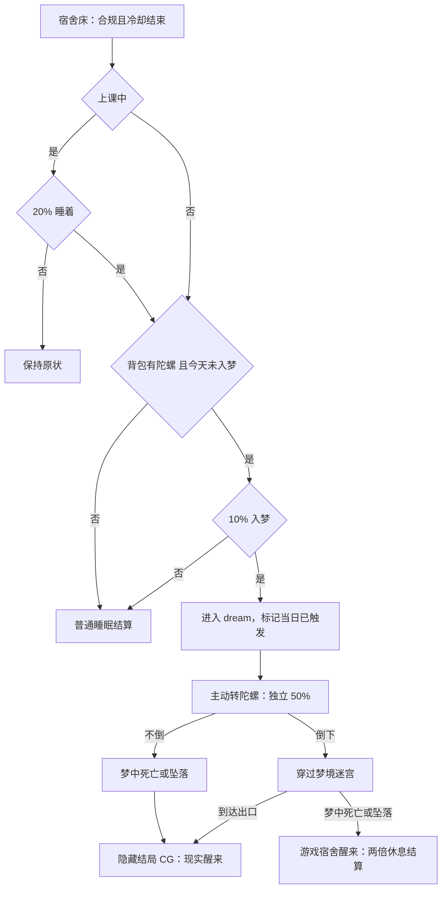

# 隐藏结局《盗梦空间》

> 2026-11-05 已实施（PR #47，模块 `game3d/js/modules/inception/`），待真人／真机验收；原文为计划初稿。2026-11-04 根据 `main@38cef0b` 制定；用户要求直接将计划合入 main。合入计划不代表玩法已实现。实施前重新核对届时 main 和进行中的 PR。本文件含内部彩蛋，玩家 Wiki 不公开触发条件。

## 1. 用户需求

上课时回宿舍有 **20%** 概率可以睡觉；实际睡觉时背包有新道具**陀螺**，以 **10%** 概率进入 dream 空间。每个游戏日最多触发一次梦境。梦里可以转陀螺，不倒与倒下各 **50%**：不倒时梦中死亡可通关，坠落直接触发隐藏结局《盗梦空间》及新 CG，最终在现实醒来；倒下时必须走完迷宫才触发该结局，梦中死亡则回到游戏继续，恢复普通睡觉两倍 SAN、增加违规，耗时为普通睡觉两倍。

本稿按原文落实这两条分支；其他叙事、数值和边界是建议，实施前可调整，不把建议写成用户已明确指定。

## 2. 现状与边界

- `game3d/js/interact.js` 中宿舍床 `b` 对应 `SAN_ACTS.sleep`：基础 SAN 26、45 游戏分钟、冷却 200 游戏分钟，当前没有上课睡觉的 20% 或梦境判定。`doSanAct` 先推进时间，再按结束时 `CampusPressure.restGain` 计算恢复，SAN 上限 100，并恢复体力、记录一次休息。
- 上课判断需使用当时课程表的权威时段，不能简单以 `needWhere==='教室'` 代替所有上课判定；考试、集合、请假和跨时段按已有规则核实。离开教室本身仍有违规／检查后果。
- 当前电梯异常空间 `lift_dream` 的虚空迷宫拥有独立坠落、SAN 与出口规则。新 dream 空间需有独立 ID 和状态，不因名字相似复用旧入口或改变原迷宫；可复用与场景解耦的几何工具。
- 隐藏结局与 CG 档案接入现有结局、成就、速通、记录及回放系统，防止被归类为普通死亡或公开真结局。视觉和 CG 实现完成后标注等待 Claude 优化审核；本轮只写计划。

## 3. 机会与概率

1. **上课时、宿舍床交互**：在现有交互合法、冷却结束等前提下，以 20% 判定本次能否睡着；不中则没有睡眠时间、SAN、体力或梦境结算，给一句含蓄反馈。非上课时间保留现有普通睡眠规则，不额外加 20% 限制。20% 暂按每次合格床交互抽取，而非每帧抽取；是否每节课限制尝试次数留待平衡确认。
2. **真正开始睡觉**：背包内持有 `top`（ID 暂定）且当天未进入过该梦境时，独立抽取 10%；没有陀螺绝不触发，仍可普通睡觉。睡着但未命中梦境按普通睡眠结算。
3. 20% 与 10% 是条件概率，不能合并成每次固定 2%；上课的一次合格交互且有陀螺时两者独立相乘为 2%。非上课普通睡眠是否也能进入梦境，原文未明确；初稿建议所有真正睡眠均可做 10% 判定，列入第 8 节待定。
4. **每天最多一次梦境**：以进入 dream 当刻的游戏日标记 `enteredDay`，即使命中后失败或跨午夜也不清除当天记录；第二个游戏日才重置。未命中 10% 不算已触发，可在当日后续合法睡眠再尝试；不把用户的“最多触发一次”误写成“每天只有一次 10% 抽签”。
5. 使用可注入玩法随机源；20%、10%、陀螺 50% 分别单独记录抽取事件。保存随机状态和已提交结果，读档／暂停／重新打开床交互不会重复结算同一次机会；新局和下一天正常产生新机会。

## 4. 陀螺与梦境流程

陀螺为可携带、占一格的新道具；建议一局一件、固定可探索位置取得，具体位置待定。背包满时保留可拾取物；丢弃后不能满足入梦条件。进入梦后仍持有但不消耗，正常道具使用只呈现转动，无现实伤害／保命作用。

梦中要实际使用陀螺，转动过程和最后不倒／倒下可辨认；关闭声音也能通过模型和字幕理解。每次梦境第一次转动时抽取一次并固定，不允许重转／读档刷结果；未转前不预先宣布分支。若未转就坠落或死亡，建议按失败醒回游戏处理，不授予结局；这是待确认的补充规则。

- **不倒**：允许继续探索；梦中死亡是通往结局的规则，发生真实坠落时立即提交结局，不要求走迷宫出口。其他梦中死亡同样触发结局；不执行现实死亡、药丸或免疫消耗。一次性提交结局证明后进入 CG。
- **倒下**：只能在玩家真实走到迷宫出口时成功，任何梦中死亡／坠落均为失败，在游戏宿舍醒来继续；不能因为到达出口附近、直接调用或提前存档伪造完成。两条分支都需要真实玩家操作，不用黑屏跳过迷宫。
- 梦境独立于现实学校的空间、碰撞与巡察；同时保存进入前位置、背包、伤势、时间和任务。梦里预加载不算现实探索，梦中视觉和声音不凭空更新现实巡察位置。暂停冻结模拟；异常退出和模块停用应有不丢档的恢复路径。

## 5. 失败醒来与时间结算

陀螺倒下后梦中死亡：在原宿舍床边合法位置醒来，保持本局继续，并**只结算一次**：

- 时间：普通睡眠基础 45 × 2 = **90 游戏分钟**；用 `advanceGameTime` 推进，保留跨日、检查、事件和压力变化，不能直接改时钟绕过日程。
- SAN：在 90 分钟结束时计算同条件下普通睡眠实际恢复 `CampusPressure.restGain(26)`，其结果 × 2，再按 SAN 上限 100 截断。不是先加两次已经截断的 SAN，也不固定写死 +52；例如结束时普通实际可恢复 20，则本次加 40（未触顶前）。
- 违规：用户未给具体数量，建议 **+15**，经 `PlayerStats.addViolation` 和现有豁免／上限规则处理；具体数值与豁免是否适用待确认。跨越检查时仍按已有责任结算，不能因睡觉自动免检。
- 体力、200 游戏分钟冷却和 `rest` 事实：建议各按一次普通睡眠处理，从最终醒来时间起算冷却；不叠加入睡时的普通睡眠奖励。保存 `settlementId` 和已结算位，防止读档、跳过和重复回调多加。

梦境成功是隐藏结局而不是失败睡眠；建议不再发失败分支的双倍 SAN／违规奖励。入梦时不要预先结算 45 分钟与 SAN，待分支结束后统一结算，以免失败变成 135 分钟或三倍收益。成功结局对学校存档及时间的处理需与既有结局框架对齐，具体保留／清档列入第 8 节确认。

## 6. 梦境场景与结局 CG

建议设计独立立体迷宫：出生处是模糊宿舍，走廊逐渐变成上下相连的教学空间；可辨认的脚印、门牌和光线提供导航，环路与高度变化提供挑战。至少一条连续可行路线通向出口，有可看清的坠落边缘；不依赖随机地图保证可通关。白模阶段验证触屏、低画质、字幕、不同高度碰撞与坠落；美术完成后交 Claude 优化审核。

新作约 18–22 秒实时 3D CG，两条成功分支分别从真实的坠落／抵达出口接入，之后共用：

| 时间 | 分镜与声音 |
| --- | --- |
| 0–4 秒 | 不倒分支：坠落的走廊一层层向上退去；倒下分支：推开出口门，门后是倒置的宿舍。呼吸与风声逐渐变轻。 |
| 4–9 秒 | 陀螺在课桌上旋转，镜头绕过它；桌面与窗外的学校逐渐虚化，广播断在半句。 |
| 9–15 秒 | 玩家在现实中的房间醒来，阳光和真实环境声回来；床头有一本普通课本，窗外没有校园广播。 |
| 15–20 秒 | 手指碰到桌上的陀螺，镜头停在它的影子上，旋转声渐弱；画面淡出并显示隐藏结局《盗梦空间》。 |

现实醒来是结局成功，不能再送回游戏宿舍冒充成功；结局卡与 CG 档案默认隐藏，真实达成后解锁。CG 支持字幕、跳过、弱化晃动，档案馆回放隔离游戏状态；完成后等待 Claude 优化审核。

## 7. 数据、成就与验证

持久化建议包括 `dreamId`、入梦日、进度／空间姿态、转动结果与是否已抽、陀螺持有快照、最终结算 ID、学校返回点与任务快照。恢复在自动存档前完成，坏档不覆盖原始存档；成功／失败切换以及跨日均幂等。旧档无陀螺、无当日梦境标记，不追溯发奖。

建议隐藏成就《盗梦空间》仅按可信结局证明解锁；可另记两条分支的内部事实。调试、Mod、档案回放和直接调用不计可信解锁。梦中失败不是现实死亡，不消耗保命次数、不写死亡档案、不删除存档；成功是否计入隐藏路线速通分类待定，不能混入公开真结局集合。

实施后至少验证：

- 概率边界 0.20／0.10／0.50，独立抽取、持有检查、每日上限、未命中再尝试、跨日与读档不重抽；统计只作辅助。
- 普通睡眠不受意外影响；上课中睡不着不产生奖励或时间；无陀螺、满背包、丢弃、旧档；课堂／考试／学生会检查跨时间结算。
- 两种陀螺结果下，坠落、其他死亡、迷宫出口、未转陀螺、重复交互、暂停／保存／关闭模块；不倒坠落立即成功，倒下坠落只回游戏并准确结算两倍。
- 90 分钟跨夜压力、SAN 上限、违规豁免／上限、冷却、结算幂等；与预知梦、药丸／免疫、虚空迷宫、巡察、其他结局互不污染。
- 从真实输入完成两条结局及一次失败；CG 全程、跳过、档案回放与返菜单；真假结局／成就／速通分类正确；PC、移动触屏、WebGL 与 WebGPU 回退、画质／性能及真人体验。

## 8. 实施前待确认

1. 非上课的普通睡眠是否也有 10% 入梦机会？建议是；20% 仅限上课时是否睡得着。用户回答只有5%
2. 每次合法交互都抽 20%，还是每节课／每天只抽一次？建议每次合法交互，需平衡防刷。用户回答每天只抽一次
3. 失败的违规增量与请假豁免：建议 +15 并遵守既有豁免。用户回答照此进行
4. 未转陀螺即死亡、主动中断、成功结局是否清除学校存档以及隐藏速通分类：建议未转死亡按失败、其他按结局框架定稿，不能改变两条指定分支。用户回答按失败处理
5. 陀螺取得位置、迷宫规模及 CG 具体美术，待场景设计定稿；CG 实现后等待 Claude 优化审核。用户回答等Claude

## 9. 实施阶段

- [x] M0：核对 main（`4bf8ce1` 之后的 PR #47 分支）、课程表、20% 机会、违规与存档决策；按第 8 节用户答复定稿。
- [x] M1：陀螺（`top`，北宿舍二楼第一间宿舍的桌上，一局一个）、条件概率、每日次数、睡眠事务与存读档（`RT.inception`）。
- [x] M2：梦（`dream_top`，23×17 的灰白迷宫，有四组看得清边缘的黑坑，至少一条不经过坑的路；时间不走、不刷异象、没有巡察者、没有地图和时钟）、一次性陀螺 50% 判定、两条分支、真实输入。
- [x] M3：隐藏结局《盗梦空间》、20 秒 CG（往下坠 → 课桌上的陀螺 → 真的房间 → 桌上的陀螺还在转）、CG 档案馆隐藏卡 `end:inception`、隐藏成就 `h.inception`、积分按隐藏结局算（和《先辈》一样）、两种醒来。视觉和 CG 由 Claude 完成（用户答复「等 Claude」）。
- [x] M4：概率、两倍恢复、跨日、只结算一次的测试（`tests/test_inception.py` 6 项）；Wiki 禁止词加了这条的名字和线索；**真人／真机、WebGPU 实机未验收**。
- [x] M5：成就（隐藏「《盗梦空间》」）、档案、积分已接；速通**不**加这条路线（第 7 节「待定」，按保守处理：不进公开或隐藏速通分类）。

### 9.1 实施记录（2026-11-05）

- 第 8 节答复落地：不上课的睡觉入梦 5%（上课是 20% 睡着 × 10% 入梦）；上课时的 20% 每天只抽一次，没抽中这一天上课时都睡不着（不花时间、不回 SAN）；失败违规 +15，请假中按现有豁免；还没转陀螺就掉下去按失败；还没转就到出口，门把手转不动。
- 不倒时走到出口：门后还是这条走廊（回到起点），只有掉下去才是结局；倒下时掉下去醒回宿舍。
- 失败醒来：先推进 90 游戏分钟，再按醒来那一刻 `CampusPressure.restGain(26)×2` 回 SAN（上限 100）、违规 +15、体力 +25、睡觉冷却 200 分钟、一次 `rest` 事实；结算编号记在 `RT.inception.settled`，再调一次不重复。
- 新钩子：`interact.js` `doSanAct` 的 `restAct`（模块可接管一次休息）；房间标记 `noAnomaly`（`anomaly.js` 不在这样的房间刷异象）。
- 截图（内部）：`pictures/盗梦空间/`。
