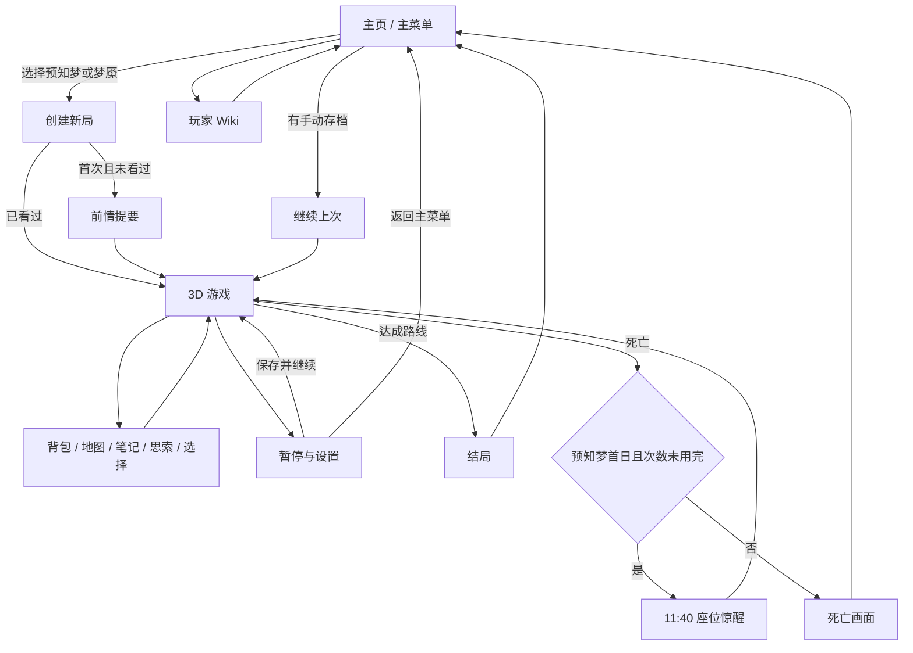

# 《武大附中 · 里世界 3D》产品对齐文档

> **状态：待产品、策划、设计、开发与测试共同确认。** 本文包含完整剧情、异象与结局剧透。它记录当前实现，并提出需要讨论的方案；文中的建议、优先级、目标和待确认项均不代表已经批准、排期或实现。

| 项目 | 说明 |
| --- | --- |
| 文档用途 | 统一产品目标、当前行为、数值口径、交互边界、问题与验收方式，为后续评审和迭代提供共同基线。 |
| 代码基线 | 2026-10-28，`main` 上的 [`1625ab5`](https://github.com/chorusfruit-233/wdfz/commit/1625ab5147fac99ea213f20efa2533befbce7b17)，即玩家 Wiki 上线后的版本。本文提交本身及之后的变更不包含在该基线中。 |
| 信息来源 | 仓库内游戏代码、页面、玩家 Wiki、更新说明和浏览器回归检查。发生冲突时，本文的「现状」按该基线代码描述。 |
| 玩家入口 | [游戏主页](https://chorusfruit-233.github.io/wdfz/)；[玩家 Wiki](https://chorusfruit-233.github.io/wdfz/wiki/)。 |
| 面向读者 | 产品、游戏策划、叙事、交互/视觉、客户端开发、测试和内容维护者。 |
| 本文边界 | 描述现状与待决策，不修改玩法，也不把已有缺陷自动定义为设计意图。 |

**标记约定：**「现状」表示代码中可观察到的行为；「推断」是从内容和结构归纳的产品理解，不是已确认的商业要求；「建议」是供讨论的方向；「待决策」需要有人明确拍板；「验证」说明核查方法及其限制。数值以代码实际逻辑为准，单位分别注明游戏时间与真实时间。

## 目录

1. [产品定位与边界](#positioning)
2. [体验目标与玩家旅程](#journey)
3. [版本范围与能力清单](#scope)
4. [信息架构与状态流转](#flow)
5. [操作、交互与适配](#interaction)
6. [时间、课表与生存系统](#survival)
7. [校园地图、地点与设施](#world)
8. [背包、物品、线索与天赋](#inventory)
9. [异象系统与完整图鉴](#anomalies)
10. [剧情、死亡和结局](#story)
11. [界面、画面、声音与设置](#presentation)
12. [存档、数据和生命周期](#data)
13. [技术、发布与兼容边界](#technical)
14. [现存问题与影响](#issues)
15. [需求与验收清单](#acceptance)
16. [待产品决策事项](#decisions)
17. [迭代建议与衡量方式](#roadmap)
18. [术语、源文件与维护规则](#appendix)

## 1. 产品定位与边界

### 1.1 一句话定义

**现状：**《武大附中 · 里世界 3D》是运行在浏览器中的单人第一人称校园怪谈探索游戏。玩家从一所异常学校的教室醒来，在课表约束、精神状态变化、随机异象与危险区域中探索，搜集物品和线索，尝试抵达四种结局之一。

**推断的核心体验：**让熟悉的学校日常逐渐变得不可信；玩家需要在「遵循规则以维持安全」和「离开规则以探索出口」之间做选择。游戏主要依靠环境、字幕、音效、少量随机遭遇和路线推理建立压力，而非战斗数值成长。

### 1.2 当前产品形态

- 只有一套可玩的 **3D 主游戏**；`index.html` 是主页。原独立 2D 主页已移除；机房内的 2D 贪吃蛇是 3D 游戏中的设施互动，不是另一套主页游戏。
- `3d.html` 是旧入口兼容跳转。启用 JavaScript 时保留查询参数与地址片段，同源时沿用浏览器现有存档；无 JavaScript 时提供跳转和手动链接，但该备用跳转不保留参数。
- 游戏无需账号、付费或服务端游戏会话；当前页面和脚本未发现遥测、排行、多人或联网存档逻辑。
- 画面、地形、材质、人物、事件特效和音频主要由本地脚本生成；Three.js 随仓库提供。首次访问线上页面仍需要网络；完整文件在本地时可以脱离网络运行。当前没有离线缓存服务或安装包保证。
- 面向桌面键鼠与触屏浏览器；触屏提供移动摇杆、视角滑动、交互、奔跑、暂停和功能按钮。设备与浏览器的实际支持情况需逐项验证，不能把模拟测试当成全平台承诺。

### 1.3 产品目标、非目标与待确认假设

| 类型 | 内容 | 状态 |
| --- | --- | --- |
| 基本目标 | 玩家能进入场景、理解主要操作、探索线索、应对风险并得到死亡或结局反馈。 | 与现有玩法一致；具体体验门槛待确认。 |
| 氛围目标 | 保留校园日常、时间表、感官异常和未知感。 | 从现有内容推断，待策划确认。 |
| 可及性目标 | 桌面和触屏都可进行核心游戏；设置允许调节部分画面、声音和镜头反馈。 | 产品建议；当前仍有移动小游戏等缺口。 |
| 内容完整性 | 现有四条结局不应依赖某一随机天赋才能触发。 | 当前有替代路径；仍需覆盖完整正常操作流程。 |
| 非现状 | 云存档、登录、多人、排行榜、成就系统、自动分析系统。 | 未实现；不视为本轮承诺。 |
| 非现状 | 原独立 2D 主游戏、真实学校管理平台、课程或人员信息系统。 | 不属于当前实现。 |
| 目标人群与发行 | 目标年龄、发行渠道、正式命名、是否面向校内、版权与现实学校名称的使用方式。 | 待产品/项目负责人确定；不能从代码推断。 |

### 1.4 建议遵守的体验原则

1. 玩家能识别下一步**可以尝试什么**，但不必提前知道所有正确答案。
2. 危险可以神秘，基本控制、存档结果、关键状态变化应有可理解的反馈。
3. 同一规则在提示、实际判定、Wiki 和验收口径中一致；如果暂时不一致，应明确标注。
4. 随机性可以改变遭遇，但不应因一次不可恢复的拾取失败悄然破坏主要路线。
5. 桌面、触屏和不同画质保留一致的玩法结果；能力受浏览器限制时提供明确说明。
6. 把「可改变的设计取舍」与「已观察到的程序行为」分开讨论。

## 2. 体验目标与玩家旅程

### 2.1 主要玩家任务（产品假设）

| 场景 | 玩家希望完成的任务 | 当前触点 | 产品问题 |
| --- | --- | --- | --- |
| 首次进入 | 知道这是什么游戏，选择合适难度并开始。 | 主菜单、两张难度卡、前情提要。 | 是否需要开局操作引导、内容提示、预计体验时长？当前没有这些约定。 |
| 首次行动 | 起身、转视角、开门并理解交互提示。 | 初始座位、画面中心准星、附近提示、主菜单操作文字。 | 移动端屏幕拥挤；提示靠近目标才出现。 |
| 日常生存 | 理解时间、地点要求、SAN、违规和体力的关系。 | HUD、字幕、课表和环境反应。 | 违规没有固定 HUD 数值；熄灯提示与规则存在冲突。 |
| 寻路与探索 | 找到建筑、走楼梯、定位物件，记下有价值的线索。 | 小地图、全图、建筑门牌、罗盘、笔记、思索。 | 地图、线索和思索的职责容易混淆，线索跨天规则不直观。 |
| 异象求生 | 识别危险，并知道某种行动可能改变结果。 | 声音、视觉特效、字幕、选择界面。 | 难度、提示时间、危险阈值与低帧率体验尚无实测标准。 |
| 暂停与继续 | 安全中断并能回到相同进度。 | 暂停、手动保存、继续上次。 | 单槽位、无自动存档；部分运行状态恢复不完整。 |
| 到达结局 | 确认路线有效，理解结局并返回菜单。 | 结局文本和返回按钮。 | 是否保存已解锁结局、是否提供继续探索或重看，目前未定义。 |
| 求助 | 理解规则或卡关时寻求提示。 | 主菜单的玩家 Wiki。 | Wiki 包含折叠剧透；游戏内是否提供无剧透分级提示待决策。 |

### 2.2 首局的实际步骤

1. 打开主页，游戏加载 WebGL 画面并显示主菜单。
2. 选择「预知梦」或「梦魇」。新局随机分配一个天赋，状态初始化，玩家出现在教学楼一楼座位，游戏时间为第一天 11:40。
3. 首次完成前情提要前，显示逐页文本与画面变化；点击、空格或回车翻页。前情提要结束后保存已看标记，同一浏览器后续新局通常不再显示。
4. 按移动键或交互起身，转动视角、走到门附近交互；从教学楼一楼出口进入室外，或通过楼梯探索楼层。
5. 看时钟和当前时段，按自己的探索意愿平衡 SAN、违规与异象；搜寻容器并记录地点和线索。
6. 打开背包、地图、笔记和思索；在思索中选出的某些方案会直接产生后果，危险方案有一次确认。
7. 进入暂停菜单可手动保存、调整设置或返回主页；结局或死亡也能返回主菜单。旧存档不会因新局或死亡自动删除。

### 2.3 需要明确的体验边界

- 没有已验证的单局时长、完成率、平均帧率、玩家群体规模或留存数据。不要把本文的建议指标当作实际结果。
- 引导是「提示和自行探索」还是「明确教学任务」，需要结合目标玩家决定。现有游戏并没有任务箭头式完整教程。
- 本游戏的惊吓、压抑和死亡是核心内容；强度范围、可选减弱方式和对外描述尚待定义。
- 文档中的四条结局都属于可触发结局；「好结局 / 坏结局 / 真结局」没有由现有代码定义。

## 3. 版本范围与能力清单

下表是基线能力，不表示各能力已满足生产质量标准。优先级为评审建议，不是既定排期。

| 能力 | 当前状态 | 玩家可见价值 | 主要限制 / 对齐点 |
| --- | --- | --- | --- |
| 3D 首页与旧地址跳转 | 已实现 | 打开主页即可进入；旧链接可继续使用。 | 旧地址无脚本跳转不会保留查询参数。 |
| 简体中文界面与文本 | 已实现 | 从菜单到字幕、道具、Wiki 使用中文。 | 未发现语言切换或翻译资源体系。 |
| 两种难度 | 已实现 | 预知梦适合试错，梦魇提高压力。 | 差异并非所有数值都使用同一倍率。 |
| 校园室内外场景 | 已实现 | 可探索教学楼、实验楼、宿舍等地点。 | 可见的「楼层」是场景切换，非无缝垂直世界。 |
| 移动、转向和交互 | 已实现 | 支持键鼠和触屏。 | 真机、不同浏览器的实际体验需补测。 |
| 时间、课表、SAN、违规、体力 | 已实现 | 行为与时段构成压力。 | 违规不直接显示数值，提示与判定存在差异。 |
| 搜索、背包、快捷栏 | 已实现 | 翻找、携带、使用和丢弃道具。 | 八格且不叠加；满包时部分一次性物品可能错失。 |
| 地图、笔记、思索 | 已实现 | 帮助定位并组织探索方向。 | 思索既有提示也可能直接触发死亡或结局。 |
| 23 种随机异象 | 已实现 | 通过多样遭遇改变探索节奏。 | 触发依赖时段和场景；实际强度及可读性未做系统用户测试。 |
| 车库跟随者及危险区 | 已实现 | 建立局部压力和光源用途。 | 硬币虽可扔出，代码中未发现跟随者读取诱饵位置。 |
| 四条结局 | 已实现 | 四种不同路线与文字结局。 | 部分文案细节与实际判定不一致；需要完整通路回归。 |
| 机房贪吃蛇 | 已实现 | 可获取 SAN 的附加活动。 | 已支持触屏方向键和滑动；退出不再额外跳时；小游戏期间世界暂停。 |
| 手动存档与继续 | 已实现 | 本浏览器内继续之前的进度。 | 单槽位，本地存储；部分活动状态恢复不完整。 |
| 全屏与显示设置 | 已实现 | 在支持的浏览器中主动切换，控制画面和声音。 | 浏览器限制、设置恢复及真机表现需要验证。 |
| 调试面板 | 当前公开可进入 | 传送、强制异象、无敌等便于开发测试。 | 生产版是否暴露待决策；部分调试数值不准确。 |
| 玩家 Wiki | 已实现 | 操作与规则说明；异象、结局默认折叠。 | 与代码的持续同步需约定负责人和流程。 |

## 4. 信息架构与状态流转

### 4.1 页面和面板

| 页面 / 面板 | 入口 | 主要内容与操作 | 离开方式 |
| --- | --- | --- | --- |
| 主菜单 | 加载主页、死亡/结局/暂停返回 | 难度、新局、继续存档、画质、亮度、Wiki、全屏。 | 选择新局或继续；Wiki 是独立网页。 |
| 前情提要 | 同一浏览器首次新局 | 11 页文本和过渡演出；世界模拟停止。 | 点击、空格或回车逐页结束；常规 UI 无单独跳过按钮。 |
| 游戏画面 | 开局或载入 | 3D 场景、HUD、小地图、字幕、提示、快捷栏。 | 暂停、死亡、结局。 |
| 背包 | Tab / 触屏「背包」 | 八格、选择、双击使用、丢弃、两个快捷栏。 | Tab、Esc 或关闭按钮。 |
| 笔记 | J / 触屏「笔记」 | 目标、已想到的办法、地点和部分可回忆线索。 | J、Esc 或关闭按钮。 |
| 思索 | H / 触屏「思索」 | 按已发现地点列出办法；可点击执行。 | H、Esc、关闭，或选择某项。 |
| 地图 | M / 触屏「地图」 | 校园平面图、建筑、校门、位置与朝向。 | M、Esc 或关闭按钮。 |
| 选择界面 | 异象、楼梯、危险选项等 | 文本与互斥操作按钮。 | 点击选项；当前通用选择面板无统一取消键。 |
| 暂停 | Esc / 触屏暂停 | 天赋、设置、调试、继续、手动保存、回主菜单。 | 继续、保存后自动继续、回主菜单。 |
| 设置 | 暂停菜单 | 音量、字幕停留、画质、镜头晃动、音乐/环境。 | 返回游戏；Esc 在暂停时返回暂停菜单。 |
| 机房游戏 | 机房电脑互动 | 贪吃蛇画面、方向说明和退出按钮；触屏另有方向键。 | Esc、「退出电脑」或触屏右上角「✕ 退出」。 |
| 死亡 / 结局 | 死亡或满足结局条件 | 死亡描述与墓志铭，或结局文字、日期/时间。 | 返回主菜单。 |
| 玩家 Wiki | 主菜单链接 | 操作、课表、地点、物品与折叠攻略。 | 返回游戏主页；从菜单进入不修改存档。 |

### 4.2 主流程图

### 4.3 模拟时间与操作互斥

| 状态 | 角色移动 / 环视 | 游戏时间、SAN、违规与异象计时 | 说明 |
| --- | --- | --- | --- |
| 正常游戏，无面板 | 可操作 | 正常更新。 | 异象可能继续或触发。 |
| 前情提要 | 不可操作 | 停止。 | 翻页为专用输入。 |
| 背包、地图、笔记、思索或选择面板 | 不可操作 | `update` 提前返回，停止。 | 关闭面板后恢复；异象选择面板也是如此。 |
| 暂停 / 设置 | 不可操作 | 停止。 | 释放移动输入和鼠标锁定。 |
| 机房贪吃蛇 | 主角不可操作 | 游戏世界暂停；小游戏自身在绘制循环中运行。 | 退出不再跳时。 |
| 调试面板 | 主角输入被屏蔽 | 取决于是否同时处于暂停；单独打开调试面板并不等于暂停模拟。 | 避免将调试面板当成安全暂停。 |
| 死亡演出 | 不可操作 | 正常生存和异象更新停止；死亡镜头继续演出。 | 之后惊醒或显示死亡界面。 |
| 结局 / 主菜单 | 不进行该局生存更新。 | 停止。 | 结局返回主菜单不自动保存。 |

**特殊边界：**有些异象代码写了选项超时分支，但通用选择面板打开时模拟停止，因此不能仅凭代码里的秒数认定玩家会被自动选择。产品需决定选项是否允许无限思考。

## 5. 操作、交互与适配

### 5.1 输入映射

| 意图 | 桌面现状 | 触屏现状 | 对齐与边界 |
| --- | --- | --- | --- |
| 前后左右 | WASD 或方向键。 | 左侧虚拟摇杆；轻推可低速移动。 | 二者按相机朝向计算，摇杆手指与视角手指分别跟踪。 |
| 视角 | 点击画面申请鼠标锁定后移动鼠标；不锁定时按住画面拖动。 | 在游戏画面滑动；触摸可接管之前的鼠标输入。 | 锁定被拒绝仍可拖动；全屏/横竖屏导致的大坐标跳变会丢弃该帧。 |
| 奔跑 | 按住 Shift 且体力足够。 | 「奔跑」点按切换；摇杆推到底也会请求奔跑。 | 消耗体力；暂停、失焦和面板切换会清除奔跑状态。 |
| 交互 | E。 | 「交互」。 | 以玩家到目标的距离和目标优先顺序选取，**不是严格按准星射线选择**。 |
| 手电 | F。 | 「手电」。 | 没有手电会提示；手机光源需从背包或快捷栏使用。 |
| 面板 | Tab 背包、H 思索、J 笔记、M 地图。 | 对应按钮。 | 面板打开会释放鼠标锁定与移动状态。 |
| 快捷使用 | 1 / 2；也可点击快捷栏。 | 点击快捷栏或「1 / 2」。 | 背包格上点击 ①/② 绑定；物品失去后下次使用会清理失效绑定。 |
| 丢弃 | G 丢弃当前选中物品；背包格可点「丢」。 | 触屏「丢弃」或背包格「丢」。 | 丢弃通常直接移出背包，当前没有通用的地面物品重新拾取机制。 |
| 暂停和关闭 | Esc 优先退出小游戏 / 调试 / 设置 / 已开面板，然后切换暂停。 | 右上角暂停；面板内有关闭入口。 | 切后台或窗口失焦会清除输入并尝试暂停。 |
| 前情翻页 | 点击、空格、回车。 | 点击文本区域。 | 普通移动键不会翻页。 |
| 全屏 | 右上角按钮，或浏览器自身能力。 | 同一按钮；iPhone 不支持网页全屏时提供添加主屏幕说明。 | 仅在明确用户操作时申请；失败可重试；不是所有环境都提供 API。 |

### 5.2 输入优先级与一致性

1. 文本输入控件优先接收自身输入；Esc 可使其失焦。
2. F2 可切换调试面板。前情提要开启时，游戏按键不应推进角色或游戏世界。
3. 游戏内 Esc 先处理机房、调试和面板，再处理暂停。打开面板会释放鼠标锁定；关闭面板或继续时尝试恢复，失败时可拖动。
4. 触控按钮在手指抬起时触发，并过滤由浏览器生成的重复兼容点击；手势取消、捕获丢失、窗口切换需清理状态。
5. 全屏状态由浏览器事件同步；处理中禁用重复请求。前情、死亡、结局、选择、小游戏和部分面板会隐藏全屏按钮，避免遮挡交互。
6. 屏幕方向变化会重新计算视口并清理输入；界面菜单和面板支持滚动。实际可用尺寸、触控命中区与设备适配仍需真机复核。

### 5.3 待设计定义

- 是否支持键位重绑定、手柄、触屏按钮布局调整、左手模式、鼠标灵敏度与视角反转。现状均未形成完整设置。
- ~~贪吃蛇是否需要触屏方向输入，还是在触屏设备上隐藏/替换该活动。~~ 已决定：添加触屏方向键与滑动。
- 是否提供屏幕阅读器可完成的玩法路径、可配置字号和文本对比度。当前页面具备部分语义标签，但不能据此宣称完整无障碍支持。
- 如何给剧透、安全设置和可能引起不适的视觉/声音效果提供合适的用户控制。现有「镜头晃动」「音量」「音乐/环境」可调，不等于全部演出可关闭。

## 6. 时间、课表与生存系统

### 6.1 时间口径

内部时间 `S.tsec` 实际以**游戏内分钟**表示；显示时按 24 小时格式换算。例如 `700` 是 11:40。正常模拟中每个真实秒推进 `rate / 60` 个游戏分钟，也就是 `rate` 个游戏秒。设施可能直接跳转时间，因此下表不能用作精确真实游玩时长承诺。

| 游戏时间 | 时段 | 课表显示 | 正常推进倍率：游戏秒 / 真实秒 |
| --- | --- | --- | ---: |
| 07:20–08:00 | 早读 | 教室 | 80 |
| 08:00–08:45 | 第 1 节 | 教室 | 80 |
| 08:45–09:00 | 课间 | 自由 | 12 |
| 09:00–09:45 | 第 2 节 | 教室 | 80 |
| 09:45–10:20 | 课间操 | 操场 | 30 |
| 10:20–11:05 | 第 3 节 | 教室 | 80 |
| 11:05–11:30 | 课间 | 自由 | 12 |
| 11:30–12:15 | 第 4 节 | 教室 | 80（11:45:00–11:45:10 例外，见下） |
| 12:15–13:20 | 午饭 | 自由 | 14 |
| 13:20–14:00 | 午休 | 自由 | 14 |
| 14:00–14:45 | 第 5 节 | 教室 | 80 |
| 14:45–14:50 | 课间 | 自由 | 12 |
| 14:50–15:35 | 第 6 节 | 教室 | 80 |
| 15:35–15:45 | 课间 | 自由 | 12 |
| 15:45–16:30 | 第 7 节 | 教室 | 80 |
| 16:30–16:35 | 课间 | 自由 | 12 |
| 16:35–17:20 | 第 8 节 | 教室 | 80 |
| 17:20–17:40 | 课外活动 | 自由 | 37 |
| 17:40–18:10 | 晚饭 | 自由 | 14 |
| 18:10–19:40 | 晚自习一 | 教室 | 17 |
| 19:40–20:00 | 课间 | 自由 | 12 |
| 20:00–21:00 | 晚自习二 | 教室 | 17 |
| 21:00–21:30 | 洗漱 | 自由 | 17 |
| 21:30–次日 01:00 | 熄灯后 | **界面显示自由；实际规则要求宿舍** | 17 |

常规时间推进采用前闭后开区间。内部时间达到 `1500`（显示为 01:00）后跳到 `440`（07:20）。第一天到 `1350`（22:30）时 `day` 从 1 变为 2；现有日数逻辑只处理这一次转变，并非完整无限天数模拟。特殊设施和小游戏直接对 24 小时取模，可能跳过跨日事件或导致回拨，见问题清单。

**时间窗示例：**《先辈》有效区间是 11:45:00 至 11:45:10（代码 `BEAST_T0 <= t < BEAST_T1`）。这 10 个游戏秒的流速被单独放慢到 `10/15` 游戏秒 / 真实秒，约等于 15 个真实秒，每天都一样。11:40 从座位醒来到 11:45:00 约 3.75 个真实秒，跑到厕所刚好赶上这段慢下来的时间。持有「手表」或天赋为「秒表」时，右上角显示精确到秒的时间。

### 6.2 三项基本状态

| 状态 | 初始值和范围 | 对玩家的反馈 | 终止条件 |
| --- | --- | --- | --- |
| SAN / 理智 | 新局 100，范围 0–100。 | 左上颜色条；数值低时画面和声音更紧张，并可能出现边缘幻觉。 | 不大于 0 时死亡。 |
| 违规 | 新局 0，范围 0–100。 | 环境文字、同学反应、字幕与调试面板可提示；常规 HUD 无固定数值条。 | 达到 100 时死亡。 |
| 体力 | 新局 100，范围 0–100。 | 低于接近满值时显示体力条。 | 不直接导致死亡；不足时无法继续跑。 |

### 6.3 SAN 的常规变化

下表的速度以**真实秒**为单位，未叠加危险区和异象效果。难度系数 `d`：预知梦 0.82、梦魇 1.15。该系数只用于表中指定的课表扣减；不是所有异象、危险区和恢复都乘此系数。

| 实际规则所需位置 | 当前状态 | SAN 变化 / 真实秒 |
| --- | --- | ---: |
| 教室 | `S.seated` 为真 | +0.42 |
| 教室 | 未坐下但在教学楼 1–5 楼教室区域 | −0.9 × d |
| 教室 | 其他位置且未坐下 | −2.4 × d |
| 宿舍 | 南或北宿舍 | +0.22 |
| 宿舍 | 不在宿舍 | −1.4 × d |
| 操场 | 在 `onField()` 接受的区域 | +0.5 |
| 操场 | 不在该区域 | −1.2 × d |
| 自由 | 任意位置 | +0.8 |

**实现边界：**上课时 SAN 恢复先检查「是否坐下」，不要求同时在教学楼一楼；违规判断则要求 `teach1` 的教室区域且已坐下。这两者并不完全一致。数值约束到 0–100，但某些危险或设施另行增减。

### 6.4 违规与体力

- 当前不满足教室、宿舍或操场要求时，违规基础增长为 **0.85 / 真实秒**；教室要求时乘 **1.4**。若当时在夜间室外，再乘 **0.5**。满足要求时每真实秒下降 **3.2**，最低为 0。
- 「教室符合」由 `atMySeat()` 判断：教学楼一楼教室区域且 `seated` 为真；当前没有在该函数内核对初始座位的精确坐标。坐下时的字幕可以区分「自己的位子」和其他位子，但不等同于违规判定。
- 操场范围由指定地图对象判断。中央独立篮球场 `court2` 未包含在 `onField()` 列表中；课间操站在其中心不会被计为操场。大操场、跑道和部分羽毛球场包含在判定中。
- 持续移动且奔跑时体力每真实秒 −17；不奔跑时 +11。体力降到 6 或以下会进入「喘气」状态（体力条变红），要恢复到 35 才能再跑，避免按住疾跑时在跑和走之间来回切换。士力架生效的 10 秒内不受体力限制，疾跑也不消耗体力。实际位移受碰撞、输入幅度和视角影响。
- 违规约达到 12 后，错误地点附近可出现手写提示；教学楼同学在更高违规时转头、起身或靠近；约 92 以上可能堵住门。达到 100 才是违规死亡判定。演出表现不能替代精确 HUD 信息。

### 6.5 区域危险与隐性压力

- 车库额外 SAN −0.55 / 真实秒；垃圾房 −0.40；夜间室外 −0.30。夜视天赋使车库和夜间室外的这部分额外扣减乘 0.55；这些效果与课表变化叠加。
- 车库跟随者靠近时还会额外扣 SAN；光源开关有效且照向目标时，持续约 1.6 秒可令其暂时消失，随后会重现。贴近（26 个世界单位内）且未照亮时可致死。它在 220 单位内或听见玩家奔跑时每 0.55–0.95 秒挪一步（34 单位），比奔跑更快；远处每 0.9–1.5 秒一步。它仍在车道上且离玩家 200 单位内时，上车会直接致死，必须先用光把它照走。
- 隐性状态 `tt` 在需要教室且坐下时每真实秒 +1.5；18:10（晚自习开始）后在宿舍时 +1；其他情况下每秒 −0.35，范围 0–100。到 100 后会开启约 3.2 秒的触发窗口；如果未降下来，会出现两个选择，其中「……」导致死亡。另一个选项把值降到 86；文本叫「回教室去」，但实际不自动传送。
- 低 SAN（小于 32）可出现视野边缘幻觉，转头可能消失。此类表现与具备直接致死判定的异象不是同一系统。

### 6.6 考试模式

- 在钟楼顶上撞钟（非「十三下」异象期间、非夜间）后开启，持续到当天熄灯（21:30）。
- 期间所有要求「教室」的时段（上课、晚自习）都显示为「考试 · 第 n 节」。
- 离开座位：SAN 扣减乘 1.8，违规倍率从 1.4 提高到 2.4。
- 异象只从教室类（全体回头、黑板上的字、你作业交了吗、被划掉的名字、窗外的楼在动、广播点名）里选。
- 每场结束时，若坐在自己座位上的时间达到本场的 70%，SAN +15；否则只有一句提示，没有奖励。
- 考试状态写入存档；预知梦惊醒会清除考试状态。

## 7. 校园地图、地点与设施

### 7.1 空间结构

校园是一个室外区域加 **30 个室内场景**：教学楼五层与天台 6、行政楼 5、实验楼 5、南北宿舍共 6、食堂 1、车库 1、垃圾房 1、两段连廊 2、钟楼 1、保安岗 1、体育器材室 1。进入建筑、上下楼或经过连廊会切换室内场景并通过淡入淡出反馈；不是连续加载所有楼层。

| 区域 | 关键内容 | 产品意义 |
| --- | --- | --- |
| 教学楼 1F | 开局教室、座位、课桌、讲台、一楼厕所、两个楼梯、出口。 | 生存规则基准与《先辈》线索。 |
| 教学楼 2–5F / 天台 | 相似教室和走廊；顶端天台。 | 搜索、地点变化及特定异象。 |
| 实验楼 1F | 物理实验室、单摆、显微镜。 | 异象预报和互动。 |
| 实验楼 2F | 化学实验室、离心机和教师台。 | 随机效果、护目镜。 |
| 实验楼 3F | 学生机房；东侧上锁网络中心、货架、机柜和门禁管理终端。 | 小游戏与白名单路线关键点。 |
| 实验楼 4F | 地理实验室、挂图、地球仪。 | 发现未到过的线索点和罗盘。 |
| 实验楼 5F | 音乐教室、钢琴。 | SAN 恢复与氛围。 |
| 行政楼 1–5F | 办公室、课桌和楼梯；3F 有数据终端。 | 白名单同步与搜索。 |
| 两条二楼连廊 | 行政楼—实验楼、实验楼—教学楼。 | 楼间移动、部分室外遮雨。 |
| 北门 / 保安岗 | 北门闸机提示，岗内柜台提供机房钥匙与车钥匙。 | 两条路线的共同前置地点。 |
| 地下车库 | 北侧车道和西侧人行口、车辆、跟随者。 | 车库路线与光源危险。 |
| 西小门 / 南门 | 西小门为白名单出口；南门直接交互只给文本。 | 校园边界与路线差异。 |
| 食堂、南北宿舍 | 食物、床位及室内设施。 | 恢复与晚间生存。 |
| 垃圾房 | 一处可交互垃圾桶，桶上有 17:30 清运提示。 | 《第三个桶》。 |
| 钟楼 | 两张供桌、绕石柱的旋转楼梯、顶层平台上的钟。 | 特定异象应对、固定硬币、开启考试模式。 |
| 场地、花园、车棚、东围墙 | 场地活动、氛围设施、露天遮挡及环境异常。 | 导航、恢复、异象发生条件。 |

### 7.2 交互判定及优先级

- 室内搜索角色附近一定半径内的非空网格，按距离选最近目标；坐下判定和特殊异象名单判定会优先于部分普通物件。
- 室外优先寻找附近建筑入口，再检查所在区域可用活动，最后检查校门及默认反馈。靠近大型建筑、区域边缘或多个目标时，出现的动作不一定与画面中心物件一致。
- 室内门可交互打开；网络中心门要求机房钥匙。进入楼层时尽量落在出口/楼梯附近并处理卡住位置。楼梯在中间楼层会给上、下、取消选择。
- 容器搜过后以房间与网格坐标记录，不会常规刷新；有同学占据的课桌不能搜索。不同楼层有不同随机掉落池。
- 地理挂图最多标记四个尚未记录的线索地点；罗盘在室内指向附近门/出口/楼梯，在室外优先指向尚未记录的地点，全部记录后指向最近的校门。
- 钟楼中间是一座实体旋转楼梯（`spiral.js`）：绕中心石柱两圈，每圈升 3.2 米，顶层平台高 6.4 米，钟挂在平台上。玩家沿楼梯连续走上去，不再用楼层选择。地面上只有朝南的楼梯口能踏上楼梯；楼梯外侧有栏杆，只有最下面一两级能从侧面迈下。
- 钟只能在顶层平台撞。在「十三下」异象进行期间撞钟可抵消异象并回复 8 SAN；平时撞钟会开启当天的**考试模式**（见 6.6），夜间撞钟没有效果。钟楼供桌第一次可获得硬币，但满包时有一次性领取风险。

### 7.3 恢复活动数值

互动后 SAN 上限为 100，体力额外恢复 25，上限为 100。下表「耗时」和「冷却」均为游戏内分钟；代码中冷却按完成时的游戏时间计算，受异常跳时和日数处理影响。

| 活动 | 地点 / 目标 | SAN | 立即跳过 | 冷却 |
| --- | --- | ---: | ---: | ---: |
| 跑两圈 | 室外跑道或大操场 | +14 | 12 分钟 | 90 分钟 |
| 投球 | 室外被识别到的球场对象 | +10 | 8 分钟 | 70 分钟 |
| 吃饭 | 食堂桌子或柜台 | +18 | 20 分钟 | 140 分钟 |
| 躺一会儿 | 宿舍床 | +26 | 45 分钟 | 200 分钟 |
| 洗脸 | 教学楼洗手台 | +8 | 4 分钟 | 50 分钟 |
| 弹琴 | 音乐教室钢琴 | +16 | 10 分钟 | 120 分钟 |
| 玩电脑 | 机房学生机 | +12 | 15 分钟 | 100 分钟 |
| 看远处 | 花园 | +6 | 6 分钟 | 40 分钟 |

**电脑额外规则：**进入后开始贪吃蛇；如果得分大于 0，退出时额外回复 `min(20, 6 + 得分 × 2)` SAN。耗时只按上表的 15 分钟计算，退出不再额外跳时；小游戏期间世界暂停。触屏设备上有方向键，也可以在画面上滑动转向，右上角有「✕ 退出」；蛇不能原地掉头。

## 8. 背包、物品、线索与天赋

### 8.1 物品生命周期

| 环节 | 现状 | 需对齐的问题 |
| --- | --- | --- |
| 获取 | 通过固定交互或随机搜索调用 `addItem`。同类已存在时不重复加入；八格满时获取失败并提示。 | 满包时是否保留待拾取物，是否允许替换、叠加或放到地面？ |
| 查看 | 背包单击选中并显示描述，快速双击 / 连点使用。 | 单击、双击在手机上是否足够清晰？ |
| 快捷栏 | 两个槽位；可在背包分配，数字键或触屏调用。 | 物品被消耗/丢弃时是否立即清除绑定？现状为下次调用时清理。 |
| 使用 | 光源、伞为开关；药片、零食、硬币消耗；部分物品仅提供说明。 | 当前道具说明是否需要标明「自动生效」「情境使用」「仅线索」？ |
| 丢弃 | G、触屏按钮或背包格「丢」。通常仅从背包移除；特定厕所时段可触发路线标志。 | 当前一般情况下不会在地面留下可重新拾取的实体。 |
| 保存 | 保存物品 ID、快捷栏和部分使用开关。 | 保存后的光源标记与实际灯光强度可能不一致。 |

### 8.2 物品总表

表中「获取」说明可确认的路径，不代表每次搜索必得。通用容器和实验楼掉落概率见下节；固定物品仍受背包空间与重复检查影响。

| 名称 | ID | 当前用途 | 获取 / 备注 |
| --- | --- | --- | --- |
| 学生证 | `card` | 有物品名称和剧情描述，无独立主动效果。 | 开场字幕说口袋有学生证，但新局背包为空；未发现常规 `addItem('card')` 路径。 |
| 手机 | `phone` | 切换屏幕光，灯光强度 22；可被车库跟随者的照射判定识别。 | 通用容器或实验楼 3F 的随机池。 |
| 粉笔 | `chalk` | 可处理被划掉的名单；平时显示说明。 | 通用容器、实验楼 1F；教学楼一楼讲台实际添加粉笔，但字幕称红笔。 |
| 平面图 | `map` | 标记保安岗、车库、垃圾房、东围墙并打开地图。 | 实验楼 4F 随机池。 |
| 钥匙 / 车钥匙 | `key` | 满足车库上车条件。 | 保安岗柜台在机房钥匙之后取得；车感好可替代。 |
| 手电筒 | `torch` | F / 使用切换灯光，强度 55；影响车库跟随者。 | 通用容器随机获得。 |
| 雨伞 | `brolly` | 使用切换撑伞状态，算作遮挡；也影响使用相同遮挡判定的影子异象。 | 通用容器随机获得。 |
| 校服外套 | `coat` | 当前使用时显示说明，未见独立主动规则。 | 通用容器随机获得。 |
| 药片 | `pill` | 使用后 SAN +18，消耗。 | 通用容器或实验楼 2F。 |
| 笔记本 | `notebook` | 与笔同时持有时，`hasClue` 允许查看跨天线索。 | 通用容器。 |
| 笔 | `pen` | 与笔记本共同维持线索回忆；可处理名单。 | 通用容器或实验楼 1F。 |
| 士力架 | `snack` | 使用后 10 秒内疾跑不耗体力（体力空了也能跑，体力条变成金色倒计时），消耗。 | 通用容器或实验楼 5F。 |
| 电池 | `battery` | 当前使用时显示说明，未见消耗或补充灯光的规则。 | 通用容器或实验楼 1–3F。 |
| 罗盘 | `compass` | 显示方向及近似距离，目标按室内外变化。 | 地理实验室地球仪固定一次、实验楼 4F 或通用容器。 |
| 节拍器 | `metronome` | 当前使用时显示说明，未见独立主动规则。 | 实验楼 5F 随机池。 |
| 护目镜 | `goggles` | 改变部分实验器材随机采样；当前实现取两次随机值中的较大值，并非笼统的「更安全」。 | 实验楼 2F 讲台或随机池。 |
| 作业本 | `hw` | 「你作业交了吗」选择中可交出，SAN +12 并消耗。 | 教学楼一楼第一次符合条件的课桌搜索会指定。 |
| 硬币 | `coin` | 仅车库内可扔，消耗并发声、记录诱饵位置。 | 通用容器或钟楼供桌；目前未发现跟随者使用该诱饵位置。 |
| U 盘 | `usb` | 无编程社天赋时可操作网络中心门禁终端；不在使用时消耗。 | 网络中心货架固定、实验楼 3F 随机池。 |
| 手表 | `watch` | 持有时右上角显示精确到秒的时间；使用时报告当前时间（含秒）。 | 通用容器。 |
| 纸条 | `memo` | 标记机房、数据终端并给出白名单路线文字。 | 通用容器。 |
| 机房钥匙 | `roomkey` | 打开实验楼 3F 网络中心上锁的门；不消耗。 | 保安岗柜台第一次取得。 |

**光源交叉状态：**手电和手机共享一个灯光对象，但分别维护开关。切换、丢弃或载入后的视觉强度与开关标记可能不一致；车库危险逻辑读取开关标记。需要定义统一优先级与恢复行为。

### 8.3 随机掉落

普通容器按一次随机值决定结果：硬币 16%、粉笔 12%、士力架 8%、电池 8%、药片 6%、笔 6%、笔记本 6%；纸条、雨伞、外套、手电、手机、手表、罗盘各 4%；其余 10% 为空。教学楼一楼第一次符合条件的课桌搜索会覆盖随机结果为作业本。

| 实验楼 | 独立随机池 | 空结果概率 |
| --- | --- | ---: |
| 1F 物理 | 电池 22%、粉笔 18%、笔 12% | 48% |
| 2F 化学 | 护目镜 20%、药片 20%、电池 18% | 42% |
| 3F 机房 | U 盘 20%、电池 20%、手机 12% | 48% |
| 4F 地理 | 罗盘 22%、平面图 14% | 64% |
| 5F 音乐 | 节拍器 22%、士力架 14% | 64% |

这些是**抽中 ID 的概率**，不是成功获得概率：背包已持有同一物品或已满时，实际不会加入新物品。搜索标记先于 `addItem`；所以失败不会自动让容器重试。网络中心固定 U 盘、地球仪罗盘、讲台护目镜、钟楼硬币等也需检查一次性标记与满包的交互。

### 8.4 地点、线索、笔记与思索

- **地点**：保安岗、北门、数据终端、机房、车库、垃圾房、东围墙、攀爬点、第三个隔间、办公室、前台，共 11 个地点定义。接近、使用平面图/纸条或地理挂图可标记；地点保存在存档。
- **线索**：`addClue` 记录首次发现的游戏日。当前持有笔记本和笔时 `hasClue` 可跨天返回真；缺少任一物品时只在首次发现当天返回真。并非所有代码中的线索都逐项展示在笔记中。
- **思索**：根据地点标记解锁 8 个条目：拿车钥匙、开车、走白名单、钻垃圾桶、从正门走、翻墙、等围墙外的人、第三隔间。条目可提供提示，也可能直接执行：白名单条件齐全时可直接进入结局；三个陷阱需要再次确认。
- **存档与线索**：物品、地点、线索、已搜索容器和剧情标志可保存；浏览器数据清除或跨设备不能自动恢复。

### 8.5 随机天赋总表

每次新局从下列 12 个键中等概率随机一个；暂停菜单显示名称和描述。下表的「未发现独立判定」是对基线代码引用的核查，不等于已经获得产品确认。

| 天赋 | 代码 ID | 基线内可确认的作用 |
| --- | --- | --- |
| 编程社 | `code` | 不持 U 盘也可操作门禁管理终端。 |
| 车感好 | `drive` | 不持车钥匙也可使用车库车辆。 |
| 过目不忘 | `map` | 未发现与该天赋绑定的独立玩法判定。 |
| 铁胃 | `stomach` | 食堂盛宴触发惩罚的累计停留阈值从 9 秒延长到 17 秒。 |
| 夜视 | `night` | 车库、夜间室外的区域额外 SAN 扣减乘 0.55；不自动改变课表或异象的所有扣减。 |
| 手稳 | `hand` | 未发现与该天赋绑定的独立玩法判定。 |
| 秒表 | `watch` | 右上角始终显示精确到秒的时间，用于《先辈》的 11:45:00。 |
| 瘦小 | `thin` | 垃圾桶路线即时触发窗由 17:30–17:36 扩为 17:28–17:38 的时间点。 |
| 血冷 | `cold` | 未发现与该天赋绑定的独立玩法判定。 |
| 熟人 | `known` | 未发现与该天赋绑定的独立玩法判定。 |
| 天生免疫 | `immune` | 描述承诺一次要命事件会绕开，但未发现实际消费免疫次数的判定；不能当作安全保障。 |
| 藏在人群里 | `crowd` | 未发现与该天赋绑定的独立玩法判定。 |

## 9. 异象系统与完整图鉴

### 9.1 调度与预告

- 基线定义 23 个随机异象，同一时刻通常只激活一个。候选由玩家当前地点、课表、是否曾下雨及部分冷却条件决定；上课时在候选足够多的情况下倾向小异象。
- 新局第一次倒计时：预知梦 60 秒、梦魇 40 秒。后续基础间隔随机：预知梦 40–64 真实秒、梦魇 24–40 真实秒。
- 后续间隔会按 `0.62 + 0.38 × SAN / 100` 和 `1 − 违规 / 260` 缩短；上一次为较大异象时乘 1.25；最终下限 10 秒。这里的秒数为游戏模拟运行的真实时间，不是游戏内分钟。
- 预知梦第一天的随机池排除围墙行人、天台分身、蛾群、仪式四种；暴雨和操场人群仍可能直接致命。预报和强制调试也应单独测试。
- 暴雨和蛾群各有游戏时间冷却；雨后可产生蛾群和雨点成字。因时钟回拨、日切换和冷却采用当前时刻，跨日边界需要专门验证。
- 临近异象时场景可出现时间预告；物理单摆可给出已安排异象和约略时间。玩家移动到不满足条件的位置、冷却或预告状态恢复后，实际预告一致性需端到端测试，不能只按文案保证。
- 当前选择面板暂停模拟，因此带选择的事件不会按后台计时自动完成。异常总体有 45 秒兜底结束逻辑，但也只在模拟更新时计时。

### 9.2 伤害口径

本表使用「直接致死」表示代码可直接调用死亡；「SAN / 违规」表示本身通常不直接死亡，但可能将资源推至死亡阈值。大部分瞬时惩罚使用 `anHurt`：**列出的基础 SAN 损失 × 0.9（预知梦）或 × 1.25（梦魇）**。持续损失、奖励与部分特例不套用这一倍率。

| 异象 | 典型触发条件 | 当前结果与应对 | 分类 |
| --- | --- | --- | --- |
| 下不完的雨 `rain` | 室外且当前不要求教室。 | 无遮挡时累计暴露并持续掉 SAN；累计超过 14 / 9 秒（预知梦 / 梦魇）直接致死，约 26 秒结束；进室内、柱廊、连廊、车棚或撑伞可缓解。 | 直接致死 |
| 蛾群 `moth` | 已发生过雨；不单独要求露天。 | 距产生位置过近会累计并掉 SAN；累计超过 6.5 / 4.5 秒致死；约 24 秒结束。 | 直接致死 |
| 操场做操 `exercise` | 室外且在 `onField()` 区域。 | 留在起点附近累计超过 5.2 / 3.6 秒致死；约 22 秒结束。 | 直接致死 |
| 实验楼仪式 `rite` | 实验楼内部。 | 进入圈内持续掉 SAN；累计超过 2.2 / 1.4 秒致死；约 20 秒结束。 | 直接致死 |
| 围墙行人 `necker` | 室外接近东侧边界。 | 靠墙持续掉 SAN，更近时累计超过 2.2 / 1.4 秒致死；约 20 秒结束。 | 直接致死 |
| 天台分身 `twin` | 教学楼天台。 | 不看时向玩家移动，接近后致死；离开当前天台场景或约 22 秒后结束。 | 直接致死 |
| 被拍肩 `turn` | 任意位置可候选。 | 不回头等待后 SAN +6；回头基础损失 26，使用安静演出。 | SAN / 选择 |
| 广播点名 `broad` | 室内。 | 累计移动超过 1.6 秒基础损失 18；保持不动约 5.2 秒结束。 | SAN / 行为 |
| 钟敲十三下 `bell13` | 教学楼或北宿舍内部。 | 教学楼一楼坐下或钟楼撞钟可结束；否则持续小额损失并约 15 秒后基础损失 20。 | SAN / 行为 |
| 车棚齐鸣 `bells` | 靠近车棚。 | 太靠近累计超过 2 秒基础损失 15；约 18 秒结束。 | SAN / 位置 |
| 隔间的手 `hand` | 厕所区域。 | 不动后结束；接手基础损失 20，并随机移除一件背包物品。 | SAN / 物品 |
| 你作业交了吗 `repeat` | 教学楼教室区域。 | 交作业本消耗它并 SAN +12；不出声等待后直接 −6；说名字基础损失 20。 | SAN / 物品 / 选择 |
| 黑板上的「下一次」`chalk` | 室内。 | 显示下次时间，持续 −0.25 SAN / 秒，约 16 秒结束。 | SAN / 信息 |
| 无尽走廊 `loop` | 教学楼走廊。 | 持续 −0.3 SAN / 秒；累计 14 后结束，按 Shift、空格或奔跑可加快累计。 | SAN / 行为 |
| 被划掉的名字 `roster` | 室内。 | 笔/粉笔写回可 SAN +6；撕掉违规 +8 且 SAN −5；指甲 SAN −10；不处理约 18 秒后违规 +18。 | SAN / 违规 / 选择 |
| 天花板渗水 `leak` | 室内。 | 在水点累计约 1.5 秒基础损失 12；约 20 秒结束。 | SAN / 位置 |
| 冷库 `cold` | 食堂。 | 开一条缝 SAN +14；转身离开 SAN −16。 | SAN / 选择 |
| 窗外楼在动 `shifting` | 教室。 | 持续 −0.5 SAN / 秒，约 18 秒结束。 | SAN / 演出 |
| 全体回头 `stare` | 教室。 | 不移动累计超过 1.8 秒基础损失 18；持续移动约 12 秒结束。 | SAN / 行为 |
| 熄灯后走廊灯 `lamps` | 夜间教学楼走廊。 | 不移动累计超过 1.6 秒基础损失 16；约 16 秒结束。 | SAN / 行为 |
| 食堂盛宴 `feast` | 食堂且在午饭或晚饭时段。 | 留在食堂累计超过 9 秒（铁胃 17 秒）基础损失 22，并跳过 20 游戏分钟；约 24 秒结束。 | SAN / 位置 |
| 影子慢一拍 `shadow` | 室外操场判定区域。 | 无遮挡时持续 −0.8 SAN / 秒；累计超过 10 秒基础损失 18；约 22 秒结束。 | SAN / 遮挡 |
| 雨点成字 `raindots` | 已发生过雨。 | 持续 −0.4 SAN / 秒，约 14 秒结束并出现文字。 | SAN / 演出 |

数值为静态规则快照。位置、移动、暂停、遮挡和正常 SAN 回复可同时影响最终结果；单凭一个阈值不能推断玩家整局存活时间。

### 9.3 痕迹、环境演出与音频

- 部分异象结束会在场景留下积水、粉笔残圈、飞蛾、脚印、碎纸等痕迹，最多保留最近 40 条；通过 `RT` 跟随手动存档。也存在预置环境痕迹。
- 场景、字幕、音效、镜头效果共同传达异象；「被拍肩」回头走安静处理，不使用通常的闪白和刺耳提示。
- 低画质会减少部分粒子、植被、异象眼睛等视觉复杂度，但玩法判定应保持一致；这是一项建议验收原则，尚需专项覆盖。

## 10. 剧情、死亡和结局

### 10.1 剧情设定与呈现

- 主角是本学期转入高二（二）班的学生；前情从一次语文课、困倦和异常的教室过渡到失色的校园。
- 背景通过前情、字幕、课程安排、楼内道具、同学、异常痕迹和结局片段传递。主角姓名、完整世界观解释、学校如何形成及四个结局的正史关系，没有在当前文本中形成统一的明确答案。
- 叙事不应依赖玩家一定观看 Wiki；游戏内存在少量环境提示和笔记，但目前没有完整提示链覆盖的可用性数据。
- 特别要对齐：现实学校名称与建筑符号是现有内容；正式项目名称、署名、对外介绍和素材授权范围需负责人确认。本文不预设结论。

### 10.2 四条结局：条件、过程与表现

| 结局 | 前置与实际判定 | 正常步骤 | 结果 |
| --- | --- | --- | --- |
| 《闸门》 | 有车钥匙或天赋为车感好；在车库对车辆交互，且跟随者已被光照走或离得够远。 | 保安岗柜台先拿机房钥匙、再拿车钥匙 → 进车库 → 接近车辆交互。车感好可省车钥匙。 | 延时约 1.9 秒触发 `car` 结局。现状 `useCar` 没有核验特定车牌或油量，车旁字幕不等于额外判定。 |
| 《白名单》 | `RT.hacked` 且 `RT.data`。 | 保安岗拿机房钥匙 → 实验楼 3F 打开网络中心 → 以编程社天赋或 U 盘操作门禁 → 行政楼 3F 同步 → 西小门交互。 | `face` 结局；两标记齐全后，思索里对应选项也可直接触发。 |
| 《第三个桶》 | 位于垃圾房；普通 `1050 <= t <= 1056`，瘦小 `1048 <= t <= 1058`。 | 按桶盖 17:30 提示，在有效时段交互；或在窗口开始前 40 个游戏分钟内选择进入等待。 | `trash` 结局。等待使 SAN 减 12 但最低保留 1，时钟跳到窗口开始后 1 分钟；夜间交互直接死亡。垃圾房只有一处 X 交互目标。 |
| 《先辈》 | 在教学楼 1F 厕所、11:45:00–11:45:10（放慢到约 15 个真实秒）内丢下一件物品。 | 取得可丢弃物 → 到教学楼一楼厕所 → 看准 11:45:00（手表或秒表天赋显示秒）丢物。 | 丢下后约 2.2 秒触发 `beast` 结局。隔间刻字为「11:45:00　放下一样东西」，没有表时会提示需要带秒针的表。 |

**边界：**代码比较的结束时间是具体分钟值，`<= 1056` 表示到 17:36:00 的时间点，不是整个 17:36 分钟；11:52、17:38 同理。面板打开时模拟暂停，但路线依然受正常时钟、SAN、违规、场景切换和已持有物品影响。

### 10.3 结局文本摘要

| 结局 | 已出现的关键叙事 |
| --- | --- |
| 《闸门》 | 玩家开车离校；雨刷自己启动，教学楼窗户逐一熄灭；副驾上学生证的照片终于被认出。 |
| 《白名单》 | 闸机亮绿灯，校内仍是黑白；窗后有人目送，玩家名字留在白名单末尾。 |
| 《第三个桶》 | 垃圾车开动又停下；桶外响起敲击，询问里面是否有人的声音是玩家自己的。 |
| 《先辈》 | 多年前校服的背影撞开门，玩家跟随跑出；学校第一次有了颜色。 |

四个结局展示标题、四行文本、当前天数/时间和「回到主菜单」。当前没有已读图鉴、结局解锁列表、结局重播或结局后继续当前局的入口。

### 10.4 陷阱、死亡与惊醒

- 思索中的「从正门走」「翻墙」「去东围墙等一个路过的人」会先显示确认；选「就这么办」分别进入死亡演出，不计入四条结局。
- 死亡来源包括 SAN 归零、违规满值、直接致命异象、车库跟随者、夜间钻桶、陷阱及某些剧情选择。不同死亡有不同视觉/音频和墓志铭。
- **预知梦**：第一天任意原因死亡时，若 `RT.wakes < 3`，播放惊醒流程，时间重置到 11:40、SAN 78、违规 0、体力 100、隐性压力 0；回教学楼一楼座位，背包、地点、线索与大部分剧情标志保留。随后提示剩余次数。
- **梦魇**：不提供惊醒。预知梦第二天或三次机会用完后死亡，也进入死亡界面。
- 死亡 / 惊醒不自动保存；玩家仍可返回主菜单并载入先前手动存档。是否允许通过存档反复规避死亡、是否清理存档，应明确为产品决定。

### 10.5 第二天「假正常」与隐性风险

第一天到 21:30 会出现纸条；若再到 22:30、满足标志且尚未执行该段事件，可进入「假正常」状态。系统从多个按地点筛选的日常事件中选取，提供「笑一下」或「不笑」；最多出现 4 次，间隔约 22–34 模拟秒（首个约 10 秒）。期间 `fn.v < 72` 时异象驱动暂停，但其他生存系统仍可能运行。

代码中的两个选项分别使隐藏值 +14、+5；四次全部选择 +14 也只有 56，低于 72 的表现切换和 100 的死亡阈值。**在正常初始化、只走这四次选择的前提下，后两处阈值无法由这一段到达。**这可能是内容删减后的遗留或设计选择，需确认是否要补足事件、调整阈值、删除不可达分支，或保留为调试内容。

## 11. 界面、画面、声音与设置

### 11.1 HUD 与反馈

| 元素 | 当前内容 | 触发 / 目的 |
| --- | --- | --- |
| 左上 | SAN 条、时钟、当前位置。 | 持续显示核心生存状态。 |
| 右上 | 课表时段与表格中的地点标注。 | 当前显示不直接使用实际 `needWhere()` 结果。 |
| 左下 | 校园小地图、低体力时的体力条。 | 显示当前位置朝向和移动资源。 |
| 下方 | 两格快捷栏。 | 使用已绑定物品。 |
| 中央 | 准星、附近可交互目标标记/提示。 | 告知靠近后可交互；选目标主要按距离。 |
| 下方字幕 | 主角内心、事件与环境文字。 | 多数事件的主要叙事提示；停留时间可调。 |
| Toast / Banner | 获得物品、设置变更、地点切换、短暂状态。 | 短期确认；不构成可追溯事件日志。 |
| 选项弹层 | 文本加按钮。 | 阻止游戏输入并停止正常模拟，直到选中。 |

**不直接显示：**常规 HUD 无违规数值/进度条、隐性 `tt`、异象详细倒计时、当前随机天赋名称（需打开暂停）或背包物品获取概率。

### 11.2 画面与质量

- Three.js 本地脚本渲染校园；室外有地形、建筑、雾、天气与随时间变化的光线，室内有不同空间、灯光和设施；低 SAN、异象、受伤和死亡可影响后处理与镜头。
- 主菜单选项叫「流畅 / 均衡 / 精细」，暂停设置叫「低 / 中 / 高」，对应同一三级。首次使用触屏且没有已存设置时默认低档；其他情况默认中档。
- 渲染像素比上限 1.4；后处理目标分辨率倍率低 / 中 / 高约 0.55 / 0.70 / 1.00。画质还影响植物和特效数量；室外切档会重建场景。
- 当前没有可验证的帧率保障、机型分档或自动降级。游戏页面限制双指缩放；Wiki 页面单独允许常规浏览和滚动。
- 「镜头晃动」设置可减少步行动画和部分镜头抖动；它不是所有视觉演出、画面闪光或恐怖元素的总开关。

### 11.3 声音和设置

| 设置 | 初始值 / 选项 | 保存方式与注意点 |
| --- | --- | --- |
| 音量 | 70，范围 0–100。 | 本地设置；浏览器音频通常依赖用户手势恢复。 |
| 字幕停留 | 标准；短 / 标准 / 长约为 0.6 / 1 / 1.6 倍。 | 影响字幕显示时间，不改变事件判定。 |
| 画质 / 细节 | 常规中，首次触屏低；三级。 | 菜单和设置共用同一值。 |
| 镜头晃动 | 开 / 关。 | 设置持久化；只控制代码接入的晃动。 |
| 音乐 / 环境 | 开 / 关。 | 主要控制持续音乐、环境层；不等同于关闭所有一次性音效。 |
| 亮度 | 主菜单 60–150，初始 100。 | 值写入本地设置，但刷新后当前 shader 和滑块未正确恢复该值，见问题清单。 |

音频由 Web Audio 现场合成：包含脚步、门、楼梯、天气、异响、音乐与环境层、部分互动和异象声音。没有发现语音配音、用户上传音频、外部音频下载或单独的字幕历史页面。

## 12. 存档、数据和生命周期

### 12.1 存储范围

| 本地键 | 内容 | 写入 / 读取时机 |
| --- | --- | --- |
| `wdfz3d` | 一个 JSON 游戏存档，版本字段当前为 `v:1`。 | 暂停菜单手动保存；主菜单检查和继续时读取。 |
| `zw3d_set` | 画质、音量、字幕、亮度、镜头晃动、音乐环境等。 | 设置变化时保存；启动时读取。 |
| `wdfz_pro` | 是否已完成前情提要。 | 前情结束时保存；新局开始时检查。 |

- 存档只有一个键；后一次手动保存覆盖前一次。开始新局并不会立即清除或覆盖旧存档，只有手动保存才写入新状态。
- 保存会记录位置、室内/室外、朝向、时间、天数、难度、SAN、违规、体力、隐性值、背包、快捷栏、天赋、地点、线索、坐姿、部分剧情标志、门、道具开关、异象状态和假正常数据等。
- 写入失败时提示「保存失败」；当前没有导出/导入、云同步、多槽、自动保存、跨浏览器迁移、服务端备份或明确的存档冲突解决界面。
- `localStorage` 受浏览器、域名/协议/端口和隐私模式影响；同一 HTTPS 源下 `3d.html` 跳转到 `index.html` 可沿用同源数据。不同浏览器、设备、主机或站点数据清除后的恢复不受保证。
- 继续游戏使用已存对象恢复部分状态并重建场景；不是完整复刻每一帧。活动冷却 `S.actCool`、跟随者当前状态、部分异象预报/锁定信息、`hiddenWindow` 等没有完整序列化；视觉光源还存在标记与强度不一致。
- 加载坏数据、版本迁移、用户主动删除存档和存储空间不足时的具体交互尚未形成明确产品方案。存档结构里的版本号不是已实现的迁移策略。

### 12.2 重要生命周期场景

| 场景 | 当前行为 | 需要确认 |
| --- | --- | --- |
| 新局前已有存档 | 旧存档保留，新局手动保存时覆盖。 | 是否需要覆盖确认、多个槽位或显式「新局将覆盖」说明？ |
| 暂停后保存 | 写本地数据、提示成功/失败，然后继续游戏。 | 是否希望保存后保持暂停，是否显示最近保存时间？ |
| 切后台 / 失焦 | 清理移动和鼠标锁定；在允许输入时尝试暂停。 | 不同系统锁屏、来电、后台回收是否都可靠？需真机验证。 |
| 面板中继续 | 正常时间暂停，关闭后恢复输入；鼠标锁定尽量恢复，失败时可拖动。 | 恢复锁定失败的提示是否足够明显？ |
| 死亡后 | 第一日预知梦可能惊醒；否则死亡画面。旧手动存档仍可读。 | 死亡是否应该消耗/失效存档？ |
| 结局后 | 返回菜单；未自动保存结局状态或解锁记录。 | 是否记录结局、增加重看/新周目？ |
| 更新代码后读旧存档 | 代码尽力以默认值补齐部分字段，没有完整迁移流程。 | 哪些版本需兼容，遇到无效状态如何提示与恢复？ |
| 同源路径变化 | 旧 3D 地址跳首页时共享存储。 | 以后迁域名、协议或主机时是否提供迁移方案？ |

## 13. 技术、发布与兼容边界

### 13.1 运行结构

- 页面入口为 `index.html`；样式为 `game3d/css/game.css`；本地 Three.js、普通脚本依次加载，脚本共享全局状态；无需 npm 构建步骤。
- 3D 渲染依赖浏览器 WebGL；音频依赖 Web Audio；交互使用 Pointer Events、可选 Pointer Lock 与 Fullscreen / WebKit 前缀接口；存档依赖 `localStorage`。
- 游戏更新以约 1/60 秒固定步长为目标，渲染通过 `requestAnimationFrame`；浏览器节流、掉帧和后台策略可能影响模拟流速。游戏时间并不直接等于真实世界时间。
- 玩家 Wiki 为 `wiki/index.html` + `wiki/wiki.css` 的静态页面；异象与结局内容使用原生折叠元素，适配窄屏，不依赖外部服务。
- 线上当前由 GitHub Pages 发布；提交推送不等于页面立即更新，须检查部署完成及线上 HTML/CSS 与预期版本一致。
- 错误显示包含 `【运行错误】` 和浏览器提供的错误文本；这不是完整崩溃收集系统。权限拒绝类错误部分会作为普通浏览器限制处理。

### 13.2 环境与验证承诺

| 环境 | 当前证据 | 不能推断的内容 |
| --- | --- | --- |
| 桌面 Chromium | 自动回归使用无头 Chromium 与软件 WebGL；覆盖输入、首页、全屏和 Wiki 等。 | 不等于所有显卡、驱动、桌面浏览器或真实帧率均已验证。 |
| 模拟触屏 Chromium | 使用真实触摸事件注入、双指控制、面板及横屏滚动检查。 | 不等于实体 Android/iPhone 所有触控、刘海、浏览器 UI 和系统手势通过。 |
| WebKit 全屏接口 / iOS 主屏幕状态 | 在 Chromium 中模拟接口分支。 | 不等于真实 Safari、iOS 全屏和音频行为已验证。 |
| 本地完整文件 | 脚本、样式、材质生成与 Three.js 均在仓库。 | 不等于线上页面曾访问一次后就有离线缓存；未提供 Service Worker。 |
| 线上 GitHub Pages | 基线 Wiki 提交后检查过主页、Wiki 和 CSS 的线上内容与仓库一致。 | 不等于今后每次提交自动成功部署；每次需核查。 |

### 13.3 非功能项：现状与待设目标

| 维度 | 现状 | 建议评审项 |
| --- | --- | --- |
| 性能 | 提供三级质量、触屏低档默认；没有基于真机的最低帧率保证。 | 选定机型、场景、测量方法及最低可接受帧率后再设目标。 |
| 可访问性 | 触屏、部分 ARIA 与字幕设置已存在；全游戏未做系统无障碍审计。 | 明确键盘闭环、文字可读、动效控制和不同输入需求。 |
| 可恢复性 | 本地单槽手动存档，局部状态重建。 | 确认保存时点、兼容版本、失败反馈与异常恢复。 |
| 可维护性 | HTML + 全局 JS，地图与数值集中在若干文件；Wiki 和本文件均需同步。 | 给规则和内容分配维护责任，并保持可追溯测试。 |
| 可观测性 | 有页面错误提示，无遥测/统计后台。 | 若确有需要，先决定数据用途、采样方式、告知与实现；当前没有数据基线。 |
| 离线 | 文件齐全时可本地运行。 | 若要求线上首次访问后离线，需另行设计缓存和更新策略。 |

## 14. 现存问题与影响

以下问题基于本文代码基线。优先级是**建议的讨论顺序**，不是用户确认的排期；同一现象可能需要先做设计决策再修改代码。标记「浏览器探针」表示在 Chromium 中通过受控游戏状态调用验证，不代表真实设备完整通关。

| 编号 | 建议级别 | 现象与复现 | 玩家影响 | 建议处理 / 验收方向 |
| --- | --- | --- | --- | --- |
| I-01 | **已修复** | 在机房进入并退出贪吃蛇，`PCGAME.stop()` 给内部时间加 `10*60` 游戏分钟。探针从 11:40 退出变为 21:40；开始活动本身还会先加 15 分钟。 | 无意跨越课程、时间窗、夜晚和剧情；可能跳过日切换。 | 产品确认小游戏总耗时与跨日规则，统一实现并在 UI 中可预测地反馈。 |
| I-02 | P0 候选 | 背包满 8 格且没有 U 盘时搜索网络中心固定货架，容器先标记已搜索，`addItem` 失败；空出一格后再次搜索仍无法获取该固定 U 盘。探针已复现。 | 特定路线的稳定获取入口被不可恢复地消耗；玩家可能只能依赖其他随机 U 盘或天赋。罗盘、护目镜、硬币、作业本等一次性标记也需逐一核查。 | 先确认掉落/拾取失败语义；建议失败时不消耗固定来源，或提供可恢复的替换/拾取流程。 |
| I-03 | P1 候选 | 课间操站在独立篮球场 `court2` 中心，`onField()` 返回假；列表包含不存在的 `court` ID，但没有 `court2`。浏览器探针已复现。 | 玩家看到球场却继续积累违规、损失 SAN；玩家 Wiki 中的场地说明可能与判定不一致。 | 明确哪些场地算操场，统一场景、判定与提示；为每个场地添加边界测试。 |
| I-04 | P1 候选 | 21:30 后 HUD 使用课表字段显示「熄灯后 · 自由」，`needWhere()` 却要求宿舍。 | 玩家按照屏幕文字行动可能累积违规。 | 确认晚间规则，并使 HUD、地图/帮助和实际判定一致。 |
| I-05 | P1 候选 | 保存亮度 150 后刷新：`SET.bright` 仍为 150，但 shader 亮度为 1.0，主菜单滑块显示 100。浏览器探针已复现。 | 玩家以为偏好已保留，实际画面与控件不同；过暗场景影响可玩性。 | 渲染初始化后应用已存亮度，并同步控件；增加重载验证。 |
| I-06 | P1 候选 | 开手电保存，刷新并继续：`USE.torch` 为真、背包中有手电，但 `GLR.torch.intensity` 为 0。浏览器探针已复现。 | 画面无光，车库危险逻辑却可能按有光计算；再次切换的结果不直观。 | 从统一光源状态恢复灯光，覆盖手机、手电、同时开关、丢弃与载入。 |
| I-07 | P1 候选 | 12 个天赋仅 5 个有已确认判定；「天生免疫」描述承诺免于一次要命事件，但未见消费免疫判定。 | 随机分到无效果天赋可能产生不公平或错误安全预期。 | 决定补足、重写说明、从随机池移除或明确为叙事特质；重点验证免疫。 |
| I-08 | P1 候选 | 手动存档未序列化活动冷却、车库跟随者当前状态、部分异象预报信息和隐性触发窗口等；重建时只恢复部分标志。 | 读档后状态、危险、可重复活动或演出可能与保存前不同。 | 先确定存档精度与允许恢复的安全边界，再增加版本化数据和恢复测试。 |
| I-09 | **已修复** | 贪吃蛇只有 WASD / 方向键输入和退出按钮；触屏可以退出但没有触屏转向控件。小游戏时主角输入被锁，世界仍更新。 | 手机玩家无法正常控制小游戏，且可能在以为安全时消耗 SAN 或遭遇危险。 | 决定添加触控输入、替代玩法或在触屏不可用；同时定义小游戏期间世界是否暂停。 |
| I-10 | P1/P2 候选 | 游戏自然推进仅将第一天切到第二天一次；01:00 跳回 07:20，但不会持续增加 `day`。部分活动直接对时间取模，跨午夜时可能跳过跨日事件；活动冷却依赖天数/时间。 | 跨日线索、冷却、第二天演出和时间窗可能异常；体验与「多天」直觉不一致。 | 先确定是两阶段循环还是连续天数；统一所有推进、跨日事件和冷却。 |
| I-11 | P2 候选 | 「假正常」正常初始化仅 4 次选择，最高累计 56，但表现切换条件为 >72、死亡条件为 ≥100。 | 部分提示/死亡分支通常无法自然到达，内容设计与实现可能脱节。 | 确认期望危险程度，调整次数/阈值或移除不可达分支，并验证所有选择组合。 |
| I-12 | P2 候选 | 车库投硬币后写入 `RT.lure` 并移除硬币；跟随者逻辑中未发现读取该诱饵位置。 | 物品发声但不能确认有引开效果；玩家可能误判。 | 明确其作用；若设计为引诱，应使跟随者响应并提供可观察反馈。 |
| I-13 | P2 候选 | 开场字幕称口袋里有学生证但新局背包为空；教学楼讲台实际给予粉笔，却说「有一支红笔」。 | 剧情、背包和反馈不一致，影响线索信任。 | 明确学生证是叙事还是可使用物品；统一讲台实际物品与字幕。 |
| I-14 | P2 候选 | 前情、选择面板关闭模拟，而部分事件代码仍设置选择超时分支。 | 产品和测试可能误以为玩家必须限时作答。 | 明确是否限时；若限时定义使用真实时间还是模拟时间，并让界面和实现一致。 |
| I-15 | P2 候选 | 暂停菜单和 F2 可公开打开调试；其中「+30 分」实际执行 `tsec + 30*60` 并对 1440 取模，探针从 11:40 到 17:40。 | 玩家可无敌、传送、强制事件；调试时间操作会误导测试结论。 | 确定是否在公开版暴露；修正调试单位并独立验证。 |
| I-16 | P2 候选 | `anHurt`、持续 SAN 消耗和少数特殊扣减采用不同倍率/路径；部分 UI 文案只提示结果、不展示数值。 | 难度差异和死亡原因不易预期；可能导致产品、Wiki 和测试采用不同口径。 | 明确哪些变化须有反馈、哪些保留神秘，并按事件路径验证。 |

### 14.1 问题复现证据及限制

- **本轮基线检查**：检查了时间、课表、天赋引用、存档字段、异象、道具、路线和菜单逻辑；在本地 Chromium 软件 WebGL 中使用状态探针复现 I-01、I-02、I-03、I-05、I-06、I-15。
- 探针可直接设置时间、位置或物品以验证判定，**不代表从新局自然移动到每个目标的完整玩家路径**。该方法适合确认条件，不替代真机、手工完整通关和性能测试。
- 基线已有 22 项浏览器自动检查；上一轮确认过四个结局在受控场景下可触发。当前文档工作不声称修复了上述问题。
- I-07、I-08、I-10、I-11、I-12、I-13、I-14、I-16 的描述来自代码审阅与计算；真实发生频率、实际玩家影响和期望行为仍需测试/产品确认。

## 15. 需求与验收清单

本节把已有行为与建议的质量门槛放在一起，**状态栏明确区分**。当某项标为「待确认」时，验收内容是评审提案，不代表已实现。

### 15.1 基础进入、输入与界面

| ID | 场景与可验证结果 | 状态 / 证据 |
| --- | --- | --- |
| A-01 | 打开主页出现 3D 主菜单；可选择两个难度。 | 已有首页浏览器检查。 |
| A-02 | 访问 `3d.html?x=1#y` 后，在启用脚本时进入 `index.html?x=1#y`，同源存档可继续读取。 | 已有旧入口回归；无脚本备用路径另测。 |
| A-03 | 首次新局逐页完成前情；之后同浏览器新局按已看标记处理；前情期间时间和输入不推进玩法。 | 有翻页输入回归；跨设备和损坏数据未覆盖。 |
| A-04 | 预知梦/梦魇新局位置、初始数值和随机天赋符合本基线；选择难度的描述与实际生存差异一致。 | 待完整自动化与产品审阅。 |
| A-05 | 键鼠移动、按住奔跑、转视角、交互与各面板快捷键有效；鼠标锁定失败仍可拖动。 | 已有输入回归。 |
| A-06 | 双指同时摇杆移动和滑动视角；抬起其中一指不会中断另一指；取消/丢失捕获后可重新操作。 | 已有模拟触摸回归；需真实设备。 |
| A-07 | 打开背包/地图/笔记/思索/选择/暂停时角色不会继续移动；关闭或继续后可恢复操作。 | 已有部分面板、暂停和指针回归。 |
| A-08 | 切后台/失焦、旋转屏幕、退出全屏后不会残留移动或奔跑；用户可恢复视角。 | 已有模拟分支；需真实系统中断验证。 |
| A-09 | 支持的浏览器可进入和退出全屏；失败后能重试；不支持时有明确说明。 | Chromium 真接口与模拟 WebKit 分支已测；真实 Safari 待测。 |
| A-10 | 菜单、设置、背包和地图在目标屏幕尺寸下可读、可滚动、不遮挡关闭和核心按钮。 | 已有部分模拟屏幕覆盖；尺寸与真机范围待确认。 |
| A-11 | 从桌面或触屏主菜单进入 Wiki；异象/结局默认折叠；返回主页后原存档仍在。 | 已有浏览器回归。 |
| A-12 | 明确无障碍目标后，键盘焦点、语义、对比度、缩放和动效控制达到约定标准。 | 待产品与设计制定目标；当前不能标为通过。 |

### 15.2 时间、生存、地图与物品

| ID | 场景与可验证结果 | 状态 / 证据 |
| --- | --- | --- |
| B-01 | 各时段边界正确切换：尤其 09:50、11:25、12:10、19:10、21:30、22:30、01:00。 | 基线代码已梳理；需要自动化边界测试。 |
| B-02 | 产品确认各时段目标后，HUD、`needWhere`、Wiki 和违规判定给出一致信息。 | **待决策 / 修复**：熄灯后目前不一致。 |
| B-03 | 上课坐下/站立、教室内外、操场内外、宿舍内外在两种难度下按约定变化；SAN 归零及违规满值触发对应死亡。 | 基线公式已列出；当前有坐姿与地点判定差异。 |
| B-04 | 对大操场、跑道、每个篮球/羽毛球场以及边界做课间操判定，结果与地图标注一致。 | **待决策 / 修复**：`court2` 未包含。 |
| B-05 | 奔跑时体力下降，停止后恢复；低体力停止奔跑，输入取消不残留。 | 部分移动回归已有；数值边界需补测。 |
| B-06 | 建筑入口、楼梯、连廊、天台及一楼出口可进可出，出生点不嵌在家具或墙内。 | 更新说明记录过脚本检查；当前自动套件非全楼层通关。 |
| B-07 | 满包、重复物品、空容器和占用课桌给清晰反馈；重要固定物品不会因失败不可恢复。 | **待决策 / 修复**：现有一次性来源可丢失。 |
| B-08 | 背包使用、丢弃、两格快捷栏、失效绑定和消耗品效果符合物品表；无意重复触发。 | 部分触屏按钮已有回归；完整物品矩阵待测。 |
| B-09 | 当笔和笔记本的持有情况及游戏日变化时，线索显示符合产品确认的记忆规则。 | 当前有代码规则；是否符合体验待评审。 |
| B-10 | 平面图、纸条、罗盘、地理挂图能够按约定显示/标记地点；被标记地点与思索条目关系可解释。 | 需对齐地点发现与「已到过」的定义。 |
| B-11 | 活动恢复值、耗时、冷却和跨日行为符合表格及最终产品定义；不能通过加载或时间回拨无限异常重置。 | 当前冷却不完整存档，跨日方案待定。 |
| B-12 | 灯光、雨伞和相关判定在开启、关闭、丢弃、存档、重新载入后保持一致。 | **待决策 / 修复**：载入光源和共享灯光状态存在问题。 |

### 15.3 异象、剧情与结局

| ID | 场景与可验证结果 | 状态 / 证据 |
| --- | --- | --- |
| C-01 | 23 种异象在符合场景的条件下可被触发、展示、结束；离开场景或进入面板时状态符合预期。 | 更新说明曾记录逐项脚本触发；需基线专项回归。 |
| C-02 | 暴雨、蛾群、操场人群、仪式、围墙行人、天台分身在两种难度下，危险区和视觉位置匹配，预警与死亡条件可复现。 | 基线阈值已列出；需完整交互和真机可读性验证。 |
| C-03 | 非致命异象正确处理行动、选择、SAN、违规、物品消耗和特效；SAN 归零仍可死亡。 | 待逐事件测试；不可只断言事件能出现。 |
| C-04 | 面板打开时异象是否暂停、选择是否超时、恢复后如何继续，由产品决定并统一实现。 | **待决策**；现状通用选择面板暂停模拟。 |
| C-05 | 异象预告在移动位置、跨日、保存/载入、候选失效时符合承诺；预告与实际发生一致性有明确范围。 | 待决策及测试；现状不是无条件承诺。 |
| C-06 | 预知梦第一天前三次死亡可惊醒，第四次或第二天死亡结束；重置数值、背包、线索和剩余次数符合约定。 | 已有历史脚本检查；需持续自动覆盖。 |
| C-07 | 梦魇死亡不惊醒；死亡界面、演出和返回菜单可用；先前手动存档按产品策略保留或清理。 | 基线行为存在；存档策略待确认。 |
| C-08 | 《闸门》分别验证普通天赋 + 车钥匙、车感好无钥匙、无资格的反馈；车库跟随者不阻断离开。 | 上轮受控状态触发检查；自然游玩全链路待补。 |
| C-09 | 《白名单》分别验证钥匙、U 盘/编程社、网络终端、行政同步、西门；缺失每一步时反馈正确。 | 上轮关键交互模拟；满包风险待修。 |
| C-10 | 《第三个桶》验证普通与瘦小的边界、提前等待、过早、窗口后、夜间和低 SAN。 | 基线逻辑已列出；边界自动化待补。 |
| C-11 | 《先辈》验证地点、丢弃、时间窗起止、敲门 / 思索、错过后重试；确认提示和判定一致。 | 上轮关键交互模拟；具体隔间判定待决策。 |
| C-12 | 三个陷阱有明确二次确认；取消不死亡，执行按产品设定给出死亡或其他结果。 | 已有实现；体验和提示强度待确认。 |
| C-13 | 第二天假正常事件、选择次数、隐藏值与可能后果满足产品确认的可达性和体验目标。 | **待决策**；当前 4 次选择不达到 72 / 100。 |

### 15.4 存档、设置、发布与测试退出条件

| ID | 场景与可验证结果 | 状态 / 证据 |
| --- | --- | --- |
| D-01 | 成功保存后刷新继续，位置、时间、背包、天赋和已完成路线步骤可恢复；保存失败有可理解反馈。 | 有基础存档复用检查；失败注入及完整字段需补测。 |
| D-02 | 覆盖旧档、开始新局、死亡、结局和浏览器关闭时的保存策略符合已批准方案。 | **待决策**；当前只有手动单槽。 |
| D-03 | 异象、开门、车库、冷却、隐性窗口、光源在保存/载入后的连续性符合产品规定。 | **待决策 / 修复**；当前并非完整帧级恢复。 |
| D-04 | 每项设置在调整、刷新、重新进入和受浏览器限制时表现与显示一致。 | **待修**：亮度未正确恢复；其他项需逐个验证。 |
| D-05 | 机房小游戏在每个承诺平台可操作、可退出，耗时、世界是否暂停与奖励符合方案。 | **已修复**：触屏方向键与滑动、退出不再跳时、小游戏期间世界暂停；有回归测试。 |
| D-06 | 在线发布后，主页、旧链接、Wiki、全部 JS/CSS、本地存档与新版本一致；部署失败可定位并回退。 | 基线线上资源已验证；需作为每次发布清单。 |
| D-07 | 在选定真实设备与浏览器组合中完成至少一次自然操作的关键路径与异象测试，并记录版本、画质和结果。 | 设备矩阵与通过线待产品确认。 |
| D-08 | 每项建议 P0/P1 的结果与决策有记录；未处理风险明确接受人和回退方式。 | 建议发布退出条件；当前未指定责任人。 |

### 15.5 当前可复用的自动测试

仓库提供 `python -m unittest discover -s tests -v`，共 22 项浏览器检查，使用本地 HTTP 服务和 Chromium 软件 WebGL。主要覆盖首页与兼容跳转、Wiki 入口、全屏及模拟 WebKit 分支、鼠标锁定失败、触屏接管、双指、取消捕获、面板和暂停、移动速度、前情、小游戏退出以及移动布局。它**不是**完整玩法平衡、所有结局自然通关、真实 Safari/手机、音效听感或性能认证。执行方法见[测试说明](测试说明.md)。

## 16. 待产品决策事项

以下问题均为开放项；选项与推荐方向仅用于评审，任何选择都需要明确负责人和验收结果。

| 编号 | 决策问题 | 可选方向 | 影响范围 / 建议判断依据 |
| --- | --- | --- | --- |
| Q-01 | 正式产品定位、名称、目标人群和发行渠道是什么？ | 校园怪谈短篇 / 可重复探索 / 更多章节等。 | 决定内容强度、引导、对外介绍与测试设备。现状不足以证明任何一项。 |
| Q-02 | 学校名称、外观、文本与公开署名如何使用？ | 保留现有设定 / 调整为虚构学校 / 其他获确认方案。 | 叙事、视觉、README、页面标题、Wiki 和对外宣传需一致。 |
| Q-03 | 单局期望时长和目标节奏是什么？ | 短局多次尝试 / 较长连续探索；是否提供更长安全期。 | 决定课表流速、时间窗、惊醒、存档和异象间隔。先收集实际体验再定量。 |
| Q-04 | 晚间是否必须回宿舍，教室是否必须坐在精确的「自己座位」？ | 保持当前实际规则并修提示 / 调整规则 / 更细分安全区域。 | HUD、SAN、违规、角色演出、Wiki 和教学均受影响。 |
| Q-05 | 哪些球场属于课间操安全区域？ | 所有运动场地 / 仅大操场及指定场地。 | 需地图视觉、区域判定和异常候选保持一致。 |
| Q-06 | 违规值和隐性压力的可见程度？ | 完全显示 / 分段提示 / 主要通过环境表达。 | 决定神秘感与可理解性；需要明确接近危险时的最低提示。 |
| Q-07 | 游戏时间应如何跨午夜与计数天数？ | 两阶段循环 / 每日递增 / 固定叙事日程。 | 影响「假正常」、线索、冷却、异象冷却、路线和存档兼容。 |
| Q-08 | 机房小游戏耗时、世界是否暂停以及移动端操作如何处理？ | 暂停世界并收取固定耗时 / 世界继续 / 替代或隐藏小游戏。 | 决定现有额外 10 小时是否错误、奖励和手感。 |
| Q-09 | 背包满或重复物品时，固定道具如何处理？ | 留在原地 / 可替换 / 扩容或堆叠 / 其他。 | 所有固定道具、搜索标记、快捷栏和路线可达性。 |
| Q-10 | 12 个天赋是否全部应有实际效果？ | 补全七项 / 降低随机池 / 将部分明确标为叙事标签。 | 难度公平性、开局提示、Wiki、存档兼容；「天生免疫」需优先确定。 |
| Q-11 | 存档是否单槽、手动、允许回档规避死亡？ | 保持并解释 / 多槽 / 自动检查点 / 其他。 | UI、失败反馈、数据模型、死亡惩罚、迁移和隐私预期。 |
| Q-12 | 需要恢复到怎样的精度？ | 安全点恢复 / 局部状态恢复 / 近似完整状态恢复。 | 跟随者、异象、灯光、冷却、隐性窗口和异常存档处理。 |
| Q-13 | 异象是否允许玩家在选择面板无限思考？预报是否为保证？ | 无限思考 / 限时；严格预报 / 只作为不可靠提示。 | 影响暂停、倒计时、浏览器后台、产品文案和测试。 |
| Q-14 | 假正常段落的风险是否应能自然达到高阈值或死亡？ | 补事件 / 调阈值 / 保留短暂氛围而移除不可达分支。 | 台词、异象调度、死亡表现、节奏和难度。 |
| Q-15 | 四种结局的命名、正史关系和通关后的功能是什么？ | 保留开放解释 / 增加结局记录或重看 / 增加继续探索。 | 叙事、存档、玩家目标和重复游玩。 |
| Q-16 | 调试能力在公开版本中的定位？ | 公开辅助 / 明确开发模式 / 从公开构建移除。 | 用户体验、测试、可复现性和统计口径；现有无敌与传送可影响正常玩法。 |
| Q-17 | 质量、最低设备、浏览器支持与可访问性目标？ | 选定有限矩阵后逐步扩展。 | 需要设备、版本、性能测试流程；不能由软件渲染通过推断。 |
| Q-18 | Wiki 与游戏内提示如何分工？ | Wiki 完整攻略 / 多级无剧透提示 / 游戏内日志扩展。 | 新手可理解性、探索感、内容更新维护。 |
| Q-19 | 是否需要任何使用数据？ | 不收集 / 用户同意下收集最少匿名事件 / 其他合规方案。 | 当前没有埋点；先说明用途、受众、保留、告知与退出方式。 |

### 16.1 建议评审顺序

1. 先确认 Q-04、Q-05、Q-07、Q-08、Q-09、Q-10、Q-11、Q-12：它们决定玩家生存、路线可达性和进度可靠性。
2. 再确认 Q-03、Q-06、Q-13、Q-14、Q-15、Q-18：它们决定探索节奏、提示强度与叙事结构。
3. 同步确认 Q-01、Q-02、Q-16、Q-17、Q-19：它们影响对外范围、设备承诺、调试与衡量方式。
4. 每个决定应记录选项、理由、负责人、日期、影响文件和验证方式；未决定的项目不得被当作默认需求。

## 17. 迭代建议与衡量方式

### 17.1 建议工作包

下列顺序基于可预见的玩家影响，尚未由项目负责人排期或承诺交付。

| 工作包 | 建议内容 | 完成依据 |
| --- | --- | --- |
| P0 候选：进度与主要路线 | 确认并修正小游戏跳时、固定物品满包丢失及其导致的路线中断；确定关键物品兜底。 | 先确认 Q-08/Q-09；关键交互的失败、重试、保存/载入和四条正常路线有回归。 |
| P1 候选：规则可信度 | 对齐熄灯、场地、座位、天赋描述与实际判定；统一 Wiki。 | Q-04/Q-05/Q-10 已决定，HUD/文案/代码/测试一致。 |
| P1 候选：跨平台可操作 | 明确移动小游戏方案、真实手机全屏/触摸恢复、屏幕滚动与主要按钮可达。 | 确定设备矩阵，真实双指、系统中断和完整关键路径通过。 |
| P1 候选：恢复与设置 | 修亮度、光源、保存/载入缺漏；按存档策略决定迁移或安全恢复。 | Q-11/Q-12 已决定；重载、多状态、失败和旧存档验证通过。 |
| P2 候选：叙事与机制对齐 | 确认假正常、硬币、选择计时、学生证、讲台字幕及结局判定细节。 | Q-13/Q-14/Q-15 及相关内容定稿，更新玩家提示与测试。 |
| 持续工作：体验与性能 | 建立设备基线、帧率与听感测量；改善可读性和引导。 | 有可重复的测试场景、明确目标和可对比结果。 |

### 17.2 建议的体验研究，不代表现有数据

当前没有自动埋点、参与者样本或实际漏斗结果。若产品希望做评估，可先用经同意的手工观察或测试记录验证以下问题，之后再决定是否需要线上数据：

| 问题 | 建议观察口径 | 需要同时记录的背景 |
| --- | --- | --- |
| 玩家能否独立起身、转向并离开教室？ | 从获得控制到首次离开教室的完成比例与耗时；记录首次误操作。 | 桌面 / 触屏、是否看 Wiki、是否有引导、设备和难度。 |
| 课表与违规是否可理解？ | 在不提示规则的情况下询问玩家为什么当前状态发生变化；记录理解是否与规则一致。 | 当时位置、时段、HUD 文案、是否发生异象。 |
| 异象是否可读且可应对？ | 玩家是否能说出观察到的线索、尝试的动作和结果；记录死亡后是否理解原因。 | 异象种类、难度、帧率、声音/字幕设置。 |
| 是否能找到并完成一条路线？ | 初次找到关键地点、获得关键物、首次达到结局的路径；记录卡点而非只统计结果。 | 随机天赋、搜寻结果、是否满包、存档和时间。 |
| 存档和恢复是否符合预期？ | 玩家能否说明何时保存、最近保存的内容，以及退出后恢复到哪里。 | 使用何种浏览器、是否清理数据、是否中断。 |
| 恐怖演出与舒适度是否适合目标人群？ | 记录自愿反馈、令人困惑或过强的具体时刻与可用设置。 | 音量、镜头晃动、亮度、个人偏好；避免将主观评价当成性能数据。 |

### 17.3 如未来决定采集事件，先对齐定义

以下仅是**未实现的候选事件**，不是要求立即加入数据收集。需要先确定用途、是否必要、数据处理方式和告知；不要收集能直接识别个人身份的内容作为默认设计。

| 候选事件 | 最小字段示例 | 可能回答的问题 | 口径注意 |
| --- | --- | --- | --- |
| `game_start` | 难度、输入类型、版本、画质。 | 新局选择与平台分布。 | 与加载主页、继续旧档分开；不要把测试/调试算进正常玩家。 |
| `first_leave_classroom` | 当前游戏时钟、从获得控制起的耗时。 | 基础操作是否容易理解。 | 前情和暂停时间如何扣除需先定义。 |
| `anomaly_result` | 异象 ID、难度、结果类别。 | 哪些遭遇容易造成损失或退出。 | 将正常选择、死亡、离开场景和未完成区分；不记录自由文本。 |
| `save_result` | 成功/失败、版本。 | 保存能力是否可靠。 | 不上传存档正文；不要用次数推断独立人数。 |
| `ending` / `death` | 路线或死亡类型、难度。 | 路线和失败节点分布。 | 同一玩家重试、多存档和开发调试必须定义去重方式。 |
| `load_error` | 错误类别、浏览器大类、版本。 | 加载失败与兼容问题。 | 明确采样和错误文本脱敏；本地错误展示不等于服务端收集。 |

**暂不设具体 KPI 数值。**先决定是否测量和如何定义分母，再收集基线、分平台分析，最后才讨论目标；否则「通关率」「留存」和「性能达标率」会因口径不同失去比较意义。

### 17.4 建议发布检查单

1. 确认本次变更相对基线的产品决策、风险和回退方式；明确是否涉及存档兼容。
2. 执行现有浏览器回归和本次新增的针对性检查；不要仅依赖调试传送验证路线可达性。
3. 对受影响的难度、设备、时段、背包状态和保存状态做代表性覆盖；记录未测项。
4. 游戏文案、Wiki、产品文档、设置名称和入口链接随规则同步更新。
5. 部署后检查主页、旧入口、Wiki 和关键资源；确认站点实际部署到预期提交。
6. 若线上行为与批准方案不一致，按约定处理与回退；现阶段负责人和时限待确定。

## 18. 术语、源文件与维护规则

### 18.1 术语

| 术语 | 本文含义 |
| --- | --- |
| 游戏内时间 | 用于课表、路线窗口和多数设施冷却；显示为时:分，内部以分钟计。 |
| 真实秒 / 模拟秒 | 模拟持续运行时的更新秒数；与墙钟秒在掉帧、后台、暂停时不必相同。 |
| SAN | 角色理智，0–100；耗尽可能死亡。 |
| 违规 | 角色不符合当前地点要求时累积的隐性数值，100 时死亡。 |
| `tt` | 隐性压力值；长期坐着上课或晚间待在宿舍时上升。名字是代码字段，不等于对玩家展示的产品名称。 |
| 异象 | 由条件与随机调度触发的一次事件；可能只叙事、扣资源或直接致死。 |
| 地点 / `spot` | 已发现的地理位置标记；可由走近、地图或物品标记。 |
| 线索 / `clue` | 由事件或互动记录的事实；部分回忆依赖当日或笔记本 + 笔。 |
| 思索 / `idea` | 根据地点解锁的可点击方案；可能是提示、陷阱或结局触发。 |
| 直接致死 | 该事件自身可调用死亡逻辑；与先扣 SAN 后间接导致死亡区分。 |
| 惊醒 | 预知梦第一天有限次数的死亡回退，不是手动存档恢复。 |
| 现状 / 建议 | 分别指基线可观察实现，以及未经确认的讨论方案。 |

### 18.2 主要事实来源

| 主题 | 仓库文件 |
| --- | --- |
| 页面入口、菜单、HUD、设置与触屏按钮 | [index.html](../index.html)、[game.css](../game3d/css/game.css) |
| 常量、完整课表、物品与天赋定义 | [core.js](../game3d/js/core.js) |
| 当前状态与剧情初始标记 | [state.js](../game3d/js/state.js) |
| 新局、继续、暂停、HUD 和主循环 | [main.js](../game3d/js/main.js) |
| 地图对象、30 个室内场景 | [map.js](../game3d/js/map.js)、[world.js](../game3d/js/world.js) |
| 课表、SAN、违规、危险区与车库跟随者 | [systems.js](../game3d/js/systems.js) |
| 交互、设施、搜索和门禁 | [interact.js](../game3d/js/interact.js) |
| 物品、快捷使用、丢弃与线索记忆 | [items.js](../game3d/js/items.js)、[ui.js](../game3d/js/ui.js) |
| 异象候选、间隔、判定和代价 | [anomaly.js](../game3d/js/anomaly.js) |
| 思索、假正常、结局、死亡和惊醒 | [story.js](../game3d/js/story.js) |
| 机房小游戏 | [pcgame.js](../game3d/js/pcgame.js) |
| 鼠标、触屏、面板输入与全屏 | [input.js](../game3d/js/input.js)、[mobile.js](../game3d/js/mobile.js) |
| 存档与设置 | [save.js](../game3d/js/save.js)、[settings.js](../game3d/js/settings.js) |
| 前情和已看标记 | [prologue.js](../game3d/js/prologue.js) |
| 画面与音频 | [render.js](../game3d/js/render.js)、[lighting.js](../game3d/js/lighting.js)、[audio.js](../game3d/js/audio.js)、[fx/](../game3d/js/fx/) |
| 调试能力 | [dev.js](../game3d/js/dev.js) |
| 玩家文档、历史说明和回归 | [Wiki](../wiki/index.html)、[3D 更新说明](3D更新说明.md)、[测试说明](测试说明.md)、[test_controls.py](../tests/test_controls.py) |

### 18.3 更新规则

1. 每次玩法、数值、入口、存档或平台规则调整时，先在相关决策记录中标出批准状态，再更新本文对应「现状」、问题、验收条目与代码基线。
2. 同步检查玩家 Wiki 是否需要改变；不向玩家文档复制内部假设、调试细节或未经确认的未来承诺。
3. 变更影响旧存档时补充兼容与回退方式，并记录真实设备 / 浏览器的验证范围。
4. 已修复问题不要直接删除：记录修复提交和验证结果，避免团队把旧问题反复当成现状。
5. 若代码与本文冲突，以被评审的目标方案和最新实际实现分别为准，明确登记差异，不通过模糊措辞掩盖。

**变更记录**

| 日期 | 文档变化 | 基线 / 状态 |
| --- | --- | --- |
| 2026-10-28 | 初稿：基于 3D 当前版本梳理完整规则、差异、问题、验收与开放决策。 | 代码基线 `1625ab5`；待评审。 |
