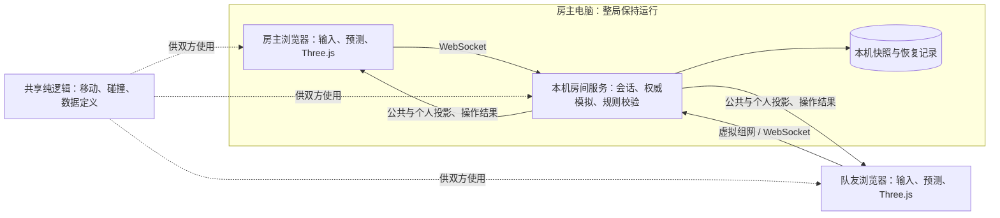

# 多人联机规划

状态：M2 共享探索进行中，M0/M1 的完整验收仍有未完成项，合作通关尚未实现。更新日期：2026-10-29。原型基于 `origin/main` 的 `3d7db17` 及本分支规划；工作分支：`codex/multiplayer-plan`。

本文规划《武大附中 · 里世界 3D》的好友合作模式。当前可发布版本仍是单人游戏，产品现状以[产品对齐文档](产品对齐文档.md)为准。本文中的推荐规则、目录、协议和性能指标均为后续实现依据或验证目标，不代表已经交付。

## 1. 已确认方向与待定边界

| 事项 | 状态 | 约定 |
| --- | --- | --- |
| 首版玩法 | 用户已确认 | 2–4 人好友合作通关，共享校园和剧情，各自保留 SAN 与背包。 |
| 组网条件 | 用户已确认 | 没有云服务器；需要异地联机，成员可以安装虚拟组网工具。 |
| 渲染路线 | 沿用已确认方向 | 保留 Three.js；现有五档画质共用玩法与碰撞，不增加第二套引擎。 |
| 单人入口 | 本计划建议 | 保留离线单人模式、现有存档和操作方式，联机作为独立入口。 |
| 组队方式 | 本计划建议 | 房主地址加房间码的私人房间；暂不做公开匹配、游戏内账号体系、语音和对抗玩法。 |
| 状态权威 | 技术建议，待原型验证 | 一位玩家的电脑运行房间服务，计算世界与玩家状态；浏览器提交操作意图。 |
| 房主设备 | 前提待确认 | 首版建议至少一位成员有可运行房间程序的电脑，并在整局游戏期间保持运行。 |
| 中途加入、死亡、预知梦、结局表决 | 待产品确认 | 见第 4、10、13 节；实现时不得把建议写成已确认规则。 |

首版完整交付的含义：两到四名玩家可以从开局共同探索、交换物品、应对异象、恢复掉线并走完已支持的结局；所有开放路线都有明确的多人规则。仅能互相看到角色的版本属于技术原型。

## 2. 当前代码的关键约束

| 代码位置 | 现状 | 联机前必须处理的边界 |
| --- | --- | --- |
| [state.js](../game3d/js/state.js) | `S` 混合世界、玩家、界面状态，`RT` 保存剧情运行状态。 | 拆出会话、玩家、区域与客户端状态，移除隐含的“唯一玩家”。 |
| [main.js](../game3d/js/main.js) | `update()` 使用固定步长；背包、暂停、电脑界面会直接停止世界更新。`render()` 也包含小游戏更新等副作用。 | 世界由服务端时钟推进；渲染不再决定游戏结果，菜单仅改变本地操作。 |
| [collision.js](../game3d/js/collision.js) | 碰撞查询读取全局玩家、房间、门和楼梯状态。 | 查询显式接收玩家、区域及世界状态，供客户端预测与服务端校验共用。 |
| [model/room.js](../game3d/js/model/room.js)、[model/outdoor.js](../game3d/js/model/outdoor.js) | 部分家具与户外碰撞数据在建立 Three.js 模型时产生。 | 抽取不依赖 DOM、WebGL 的几何与碰撞定义，服务器不能通过渲染场景才能获得碰撞。 |
| [anomaly.js](../game3d/js/anomaly.js)、[patrol.js](../game3d/js/patrol.js) | 异象、车库怪物与巡逻逻辑依赖单人的位置、区域、违规值和手电。 | 改为事件实例、区域实例及多目标选择，服务端更新所有有玩家的区域。 |
| [interact.js](../game3d/js/interact.js)、[items.js](../game3d/js/items.js) | 搜索、拾取和使用物品由本地逻辑直接结算，物品主要以类型标识。 | 物品具有唯一实例 ID；搜索、拾取、丢弃和消耗成为原子操作。 |
| [story.js](../game3d/js/story.js)、[portal.js](../game3d/js/portal.js) | 死亡、预知梦、结局和材料提交直接改变全局状态。 | 明确个人结果与全队结果；防止一个人的死亡重置队友世界。 |
| [save.js](../game3d/js/save.js) | `localStorage` 保存单人状态，包括部分异象及车库追逐状态。 | 联机使用独立版本的服务端快照；不能直接把单人存档当作完整多人快照。 |
| [engine/api.js](../game3d/js/engine/api.js) | 已有 `Engine`、`VisualState` 和 Three.js 后端边界。 | 在现有边界增加远端角色表现；镜头、画质和特效留在客户端。 |

尤其需要区分“网络房间”与“校园场景”：前者是一次 2–4 人会话，后者是教室、楼梯、车库等位置。后续协议建议分别使用 `sessionId` 和 `zoneId`，避免沿用一个 `room` 字段表达两种含义；当前连接原型使用房间码和 `zone`。

## 3. 玩家体验与基本流程

1. 成员加入同一个虚拟组网；一位玩家在自己的电脑上启动房间程序，分享可访问的房主地址和房间码。
2. 所有人用浏览器打开房主地址，选择好友合作并加入；创建者选择难度，所有人准备后开局。房主本人也占一个玩家名额。
3. 玩家进入同一校园、共享时间与剧情事实，独立移动和操作，各自拥有 SAN 与背包。
4. 队友在同一区域内可见；通过拾取、丢下物品完成首版物资协作。直接交易界面可后续增加。
5. 打开背包、地图或设置时显示“联机世界继续运行”，停止本人的移动输入；队友和危险继续活动。
6. 断线后可恢复原角色，不重新抽天赋、不重置危险、不复制背包。房间程序返回恢复结果或清晰的失效原因。
7. 达成结局条件后按明确的集合与确认规则完成结算，不能由一个客户端自行宣告全队通关。

没有中心目录时，单独的房间码无法自动定位房主电脑；加入需要地址加房间码，也可以生成同时包含两者的邀请链接。当前连接原型已有启动程序、邀请链接和联机入口，完整合作玩法仍待开发。

建议首版不启用玩家间硬碰撞，避免多人堵住狭窄门口；角色仍受同一套世界碰撞约束。队友灯光、脚步和模型需要纳入画质预算，四人同屏不能默认给每个人增加一组高成本阴影。

## 4. 状态归属与多人规则

### 4.1 状态归属

下表是完整合作模式的目标。当前房间程序管理成员、公共时间、门、容器搜索、物品实例与背包归属；移动、SAN、剧情和危险尚未统一迁移。药片和士力架的消耗及有效期由房主记录，个人收益仍由本机模拟。

| 状态 | 权威与作用范围 | 客户端取得的信息 |
| --- | --- | --- |
| 日期、时间、天气、难度、世界阶段 | 服务端，会话共享 | 可见时间、天气和必要的阶段表现。 |
| 门、容器、掉落、车辆、传送门、已消耗材料 | 服务端，世界或区域共享 | 当前区域及交互所需的状态和版本。 |
| SAN、体力、违规值、天赋、免疫次数、背包 | 服务端，每名玩家独立 | 自己的完整必要状态；队友仅获得约定公开的信息。 |
| 世界位置、朝向、移动、站立或躲藏状态 | 服务端确认，客户端预测本人移动 | 可见范围内角色的位置和表现状态。 |
| 剧情事实与关键解锁 | 服务端，会话共享 | 已公开的事实与任务进度；个人内心独白单独发送。 |
| 异象实例、怪物、巡逻与随机结果 | 服务端，按共享或个人范围管理 | 可感知事件、预警和结果；不直接公开隐藏倒计时与未发现机制。 |
| 躲藏点占用、搜索进度、交互冷却 | 服务端，关联玩家与实体 | 自身操作状态以及必要的占用提示。 |
| 镜头、FOV、画质、触控、全屏、音量、菜单 | 客户端本地 | 不写入共享世界。 |
| 连接、准备、房主权限、快照版本 | 服务端，会话管理 | 自身连接状态及房间成员公开状态。 |

`RT` 需要逐字段分类，不能整个广播。现有 `SP` 楼梯状态、`HIDE` 躲藏状态、`USE` 使用状态也不能继续作为全体玩家共用的单例。每名玩家可以同时位于不同楼层或场景。

### 4.2 暂停、异象与 AI

- 单人模式保留原有暂停行为。联机中的全队暂停建议仅在全体在线有效成员同意后生效，且不依赖某个浏览器停止绘制。
- 每个异象明确 `scope`、触发条件、目标集合、开始时刻、截止时刻及每名目标的结果。事件开始时固定目标；迟加入或换场景不能无条件重复领奖或消除处罚。
- 共享天气与场景物理变化保持一致；个人幻觉、拍肩、注视判断和选择窗口按目标玩家分别结算。具体每项异象的归类需形成适配表后才能开放。
- 车库怪物根据所有有效目标选择追逐对象，加入切换冷却，避免两名玩家之间反复跳目标。多个手电由服务端共同判断照射，保留“允许暂时照退”的已确认规则。
- 巡逻、怪物和危险在有玩家的区域持续更新，不因房主离开该区域或关闭菜单而停止。不同区域同时有玩家时，不能只运行房主所在区域。
- 对难预防异象的预警沿用现有产品方向；联机不能通过广播完整内部状态泄露全部异象。

### 4.3 死亡与结局适配

药丸、免疫等个人保命资源建议仍归个人。个人死亡后先进入观战，存活队友继续游戏；掉落物与关键任务材料必须可回收。是否提供队友救援、简单难度预知梦的次数及触发条件，仍待确认。

现有简单难度的 `dreamWake()` 会重置时间、门、异象和巡逻。联机不得直接调用该全局流程处理个人死亡。建议将全队失败后的检查点恢复与个人死亡分开设计；只有全队状态机可以重置世界。

| 现有结局 ID | 结局 | 多人适配要点 |
| --- | --- | --- |
| `car` | 闸门 | 车辆占用、材料消耗、集合位置和未上车成员如何处理。 |
| `face` | 白名单 | 个人资格与全队解锁是否等价，队员不满足条件时能否一起离开。 |
| `beast` | 先辈 | 跟随与出口触发范围，防止仅第一个抵达者结算。 |
| `portal` | 门，真结局 | 材料从各自背包原子提交；开门条件共享，结算需明确有效队员集合。 |
| `trash` | 第三个桶，假结局 | 进入者的演出与醒来范围；不能擅自清空队友进度或当作全队正式通关。 |

建议正式离开类结局使用“条件满足 → 发起集合 → 有效成员确认 → 锁定结算 → 演出”状态机。死亡、掉线、拒绝与超时如何计入有效成员必须明示；未确定前只开放验证过的路线，不宣称已完成所有结局联机。

## 5. 推荐架构

建议使用运行在**房主电脑**上的 Node.js LTS 房间服务与 WebSocket；前端继续使用现有 Three.js 和静态资源。这里的“服务端”是游戏进程的角色，不要求租用云服务器。当前原型以 JavaScript 和 `ws` 实现；后续按核心拆分规模评估 TypeScript。



| 方案 | 主要影响 | 本计划选择 |
| --- | --- | --- |
| 房主电脑 + 虚拟组网 + WebSocket | 不需租云服务器；成员安装组网工具，房主电脑需保持开机。组网服务的可用性和费用须实测、核对。 | 首版推荐主线。 |
| 同一 Wi-Fi 或热点 + 房主电脑 | 不依赖虚拟组网；部分校园或公共 Wi-Fi 禁止设备互相访问。 | 本地开发与同网备用方式。 |
| 浏览器房主 + WebRTC | 队友可只用浏览器，但需要信令；部分网络需要 TURN 中继，房主浏览器后台或退出会影响全队。 | 后续可评估的免安装方案。 |
| 租用云服务器 | 可以不依赖玩家电脑保持开机，需部署、维护和承担费用。 | 非首版前提。 |
| 仅同步角色坐标 | 快速验证可见角色，但剧情、物品和危险会各自结算。 | 只能用于早期原型，不能作为合作通关架构。 |

现有 GitHub Pages 可以继续托管单人前端，但不能运行常驻房间服务。首版推荐由房主电脑的程序同时提供游戏页面与 WebSocket，队友访问同一房主地址，无需设置公网端口或购买域名。HTTPS 页面直接连接不安全的 `ws://` 可能被浏览器阻止，不能假定打开 GitHub Pages 就能直接连到房主的本地服务；另行提供公网 HTTPS/WSS 属于可选后续工作。

[Tailscale](https://tailscale.com/) 和 [ZeroTier](https://www.zerotier.com/) 可作为虚拟组网候选；成员是否需要账号、安装方式、地区可用性、流量限制或费用，以所选服务的实际规则与测试为准。虚拟组网使用第三方协调服务，网络条件受限时也可能依赖中继，因此不能保证所有网络都可直连或永久免费。

后续若要免安装，WebRTC 可以通过手动交换连接信息完成信令，不一定需要自建信令服务；但异地连接通常要借助 STUN，部分受限网络还需 TURN 中继。房主浏览器关闭或被后台限制时，仍需单独处理房间中断和存档恢复。

## 6. 代码拆分与模拟时间

建议逐步增加以下目录，具体模块名在首个实现 PR 中确定：

```text
shared/simulation/          不依赖 DOM、Three.js 的规则与移动、碰撞逻辑
shared/content/             地图、实体、碰撞、物品和版本化数据定义
game3d/js/network/          连接、状态投影、预测、插值、远端角色适配
server/                     会话、WebSocket、权威循环、持久化、服务端测试
docs/                       联机规则、协议与验收记录
```

现有前端不要求一次性改写成 TypeScript。先从单人中抽出可复用纯逻辑，再由单人适配器和服务器分别驱动；保持旧入口可运行，避免复制两套逐渐分叉的游戏规则。

1. **数据与碰撞**：把模型尺寸、碰撞体及地图生成所需数据从渲染构建中抽离；用同一份定义生成服务端碰撞与客户端模型。校验 `contentVersion`，版本不匹配时拒绝进入会话。
2. **显式状态**：将移动、交互、物品、危险函数改为接收世界与玩家，不再隐式读取全局 `S`。复杂楼梯使用合法入口和层级状态，不能信任客户端自行上报高度。
3. **明确副作用**：DOM、声音、特效、提示与转场由领域事件触发；`render()` 不结算搜索、小游戏奖励或世界状态。
4. **统一时钟**：服务端固定步长更新，建议以 60 Hz 起步；保留现有移动碰撞所需的细分步进。发送快照和输入的频率独立设置，初值约 20 Hz，依据测量调整。
5. **定时与随机**：规则截止时间使用服务端 tick；现有 `setTimeout`、`performance.now()` 逐项迁移。世界随机与视觉随机分离，抽奖和 AI 结果只由服务端决定；无需不同客户端锁步执行 `Math.random()`。

渲染帧率、浏览器后台节流、不同画质和移动设备性能不得改变共享世界速度。服务端过载时应记录并限制负载，不能无限补帧拖垮所有会话。

## 7. 协议与交互一致性

### 7.1 消息边界

| 方向 | 消息示例 | 关键约束 |
| --- | --- | --- |
| 客户端 → 服务端 | 创建、加入、准备、离开、恢复连接 | 身份由连接绑定；邀请码不等于恢复凭证。 |
| 客户端 → 服务端 | 移动轴、朝向、奔跑、手电、交互、选择 | 发送规范化意图，不发送指针锁定或触屏事件原始流。 |
| 客户端 → 服务端 | 拾取、丢弃、使用、提交材料 | 包含操作 ID 与实体 ID；不直接修改余额、SAN、物品或结局。 |
| 服务端 → 客户端 | 完整快照、增量快照、操作结果、事件 | 公共状态与个人状态分开发送，隐藏规则按可见性过滤。 |
| 双向 | 心跳、版本协商、错误与重同步 | 错误码稳定可解释；断线与游戏失败分开显示。 |

建议公共信封包含 `protocolVersion`、`sessionId`、`epoch`、`seq`；服务端状态包含 `serverTick`、`snapshotId`。玩家操作另有 `inputSeq` 或 `opId`。会话重置后改变 `epoch`，拒绝旧世界的延迟操作。

WebSocket 已提供连接内有序可靠传输。操作序号与幂等 ID 用于恢复连接、重复提交和状态版本管理，不另造一套不必要的 UDP 可靠传输层。

### 7.2 原子操作

- 所有物品有唯一 `itemInstanceId`，同类物品也不能只靠类型名区分；容器和掉落实体有版本。
- 两人同时拾取同一物品时，服务端只允许一次所有权转移，另一人收到明确的失效结果。
- 搜索是有开始、完成、取消条件的服务端任务，完成时只生成一次结果；浏览器动画结束不能作为发奖依据。
- 同一 `opId` 重试返回原结果，避免断线重试重复扣材料或发物品；已完成结果的保留期限与会话恢复窗口对应。
- 服务端校验距离、区域、可见或遮挡条件、存活状态、冷却、物品归属和剧情前置。连接身份决定操作者，不能信任消息中指定的另一名玩家 ID。
- 选择窗口使用服务端截止时间。客户端时间只辅助显示，不能回填任意过去时间逃过处罚；延迟容差需固定且有上限。

### 7.3 移动与表现

本人采用预测移动，服务端返回已处理的输入序号，客户端在权威位置上重放尚未确认的输入；大偏差才明显纠正，并记录原因。其他玩家使用约 100–150 ms 的插值缓冲，参数经原型实测调整。

切换区域、传送或世界重置要显式清理预测与插值缓冲，不能在两个教室之间插值穿墙。协议沿用明确的游戏逻辑坐标与单位，Three.js 的模型缩放不作为权威坐标。

状态发送优先按区域与可见范围裁剪；不能因此停止其他区域的服务端模拟。慢客户端发生积压时合并可替代的状态更新，必要时发完整快照；操作结果不得静默丢弃。

## 8. 掉线、存档与恢复

本节描述完整恢复目标。当前原型仅在房间进程运行时保留公共时间、门、容器、物品归属和短暂断线成员身份；刷新恢复背包与剩余物品效果，但位置、SAN、违规、天赋、个人剧情重新开始。房间进程退出会丢失这些内存状态，尚无联机持久化存档。

- **身份**：每名玩家有会话内稳定 ID 和独立恢复凭证，刷新页面后取回原角色。恢复凭证不可发给其他成员，也不写入公共日志。
- **短暂失联**：建议约 250–500 ms 未收到新输入时停止持续移动；角色暂留世界，不能通过断线获得无敌。具体宽限期建议从 60 秒开始验证。
- **房主浏览器离开**：世界权威在房主电脑上的独立房间进程，浏览器退出后，只要该进程和电脑仍在运行，其他人可继续；房间管理权可转给其他在线成员。
- **房主电脑离线**：休眠、断网、关机或房间进程退出会断开所有人；首版不承诺自动迁移房主。电脑恢复后重新启动房间程序，从本机最近的检查点恢复。
- **长期离开**：预留名额、物品回收与重新加入规则需明确。建议到期后将可回收物品放入合法位置的掉落包，关键材料不能随角色永久消失。
- **全员离线**：房间进程仍运行时，建议停止会话时钟并保存；恢复时从原 tick 继续，不让现实离线时长直接耗尽角色或异象倒计时。本机保存期限与清理方式待确定。
- **服务器重启**：恢复最近一致的持久化检查点，生成新 `epoch` 并让客户端重新同步；不能声称无损恢复尚未落盘的进度。

快照至少覆盖世界时间、门与容器、所有物品归属、玩家位置与属性、剧情、AI 位置与目标、异象实例及剩余窗口、搜索任务、楼梯与躲藏状态、随机流和已处理操作记录。UI 回调、DOM 节点及 Three.js 对象不进入存档。

首版可在房主电脑的用户数据目录采用 SQLite 持久化，使用事务或版本化快照保证一致性；实际写入频率、检查点丢失窗口及清理策略由原型测量后确定。存档属于房主电脑，换电脑时需要明确的导出、导入流程；自动迁移、跨区容灾和无缝扩容不作为首版前提。

单人 `localStorage` 与联机恢复信息使用不同命名空间和格式版本。玩家加入联机、联机失败或退出联机都不能覆盖单人存档；不支持直接把旧单人存档导入多人会话。

## 9. 部署与运行边界

### 9.1 首版操作流程（目标）

1. 选择并安装组网工具，按该工具的流程让 2–4 个成员加入同一个虚拟网络；先确认成员能访问房主设备。
2. 房主在自己的电脑上启动房间程序。开发阶段可用 Node.js 启动；面向玩家时需要提供清晰的安装、启动与停止方式，优先考虑一键启动。
3. 房间程序显示可用的虚拟网地址、端口和房间码；房主把地址与房间码发给朋友。邀请链接能减少手动输入，但不能替代加入虚拟网络。
4. 房主和队友都打开房主程序提供的游戏页面，浏览器与同一地址的 WebSocket 交互。首版要验证桌面和手机，不要求每名队友额外安装游戏或 Node.js。
5. 房主保持电脑与房间进程运行；结束测试后可关闭。房主电脑休眠或进程退出时，其他人收到断线提示；本机检查点恢复仍待开发。

房间程序、房间码和邀请地址已有原型，实际启动命令见[联机测试说明](联机测试.md)；一键安装、完整共享世界和联机存档仍待开发。

### 9.2 网络与浏览器边界

- 房间程序应允许选择监听的虚拟网卡地址，并只提供必要的游戏静态资源，不暴露整个项目目录、`.git`、存档或恢复凭证。
- 虚拟组网的连接依赖各设备安装、授权、网络策略及第三方服务；直连不通时可能走中继，也可能连接失败。首版必须用真实异地网络验证，不能只用本机两个标签页代替。
- 局域网或虚拟网络原型可由房主提供同一来源的 HTTP 页面及 `ws://` 连接；部分浏览器能力要求安全上下文，需实测并提供可行的 HTTPS/WSS 或功能回退方案，不要求玩家关闭浏览器安全限制。
- 如果未来从 GitHub Pages 的 HTTPS 页面连接房主，需解决 WSS 证书、地址可达性和浏览器网络策略；房间码本身无法穿透网络或发现房主地址。
- 前端和房间程序的协议、内容版本需匹配；不兼容时提示更新或返回大厅。成员在虚拟组网提供方的账号与游戏内账号体系是两回事。

服务端限制每房人数、消息大小、操作速率和空闲会话数量；昵称以文本呈现，连接仅允许预期来源。会话日志记录 tick、操作 ID 与错误码，用于排查错位和重复结算，避免记录恢复凭证与完整隐私状态。

首版以玩家自托管的单房间为目标，不以购买云服务器、域名或固定公网 IP 为前提。需要确认房主电脑的系统、安装门槛、睡眠行为、本机存储位置和组网服务在成员所在地的可用性。

## 10. 分阶段实施与退出条件

当前进展：已抽取纯移动数学、区域 ID、房间边界、抽奖表和共享时钟；房主可不依赖 DOM 或 WebGL 加载校园网格。已建立房间、准备、短时重连及远端角色，并增加公共时间、开门、限时搜索、唯一物品实例、独立背包、丢弃与拾取。操作序号用于重连重试去重，交互校验区域、距离、墙和门遮挡及物品归属。完整碰撞数据仍依赖建模，服务端尚不权威计算移动、SAN、剧情或危险，真实异地虚拟组网尚未验证。M0/M1 仍有验收缺口，M2 也尚未达到完整退出条件。

| 阶段 | 工作内容 | 完成标准 |
| --- | --- | --- |
| M0：规则与核心边界 | 补齐状态分类、结局与异象适配表；抽取无 DOM 的地图、碰撞和移动试验。 | 同一地图版本能在浏览器与 Node.js 中产生一致碰撞结果；列清未定产品规则。 |
| M1：连接与同场可见 | 房主电脑启动房间、地址加房间码加入、准备、身份恢复；2 人同区、跨区可见和远端角色。 | 不租云服务器，两台异地真实设备经虚拟组网可独立移动、切换场景；不同画质与输入设备不互相影响。此阶段仅为原型。 |
| M2：权威协作基础 | 服务端移动校验、门、搜索、拾取、丢弃、使用、共享时钟与菜单规则。 | 同时拾取只产生一个所有者；重复请求不重复结算；一个人开菜单时另一人和世界继续运行。 |
| M3：危险适配 | 共享天气、个人限时选择、车库怪物与手电协作；逐项接入异象和巡逻。 | 两人分区时危险都正确运行；目标、预警与处罚一致；未适配事件明确禁用。 |
| M4：首次合作通关闭环 | 建议优先传送门路线，完成材料协作、结局确认、死亡处理、房主本机存档与恢复。 | 两到四人从开局完成该路线，包含队友掉线及房主进程重启后的恢复；开发者改状态触发结局不算通关验收。 |
| M5：完整首版与发布 | 补齐所有开放异象和结局、中途加入规则、房主启动方式、真实设备与异地网络测试、文档。 | 适配表无未处理的开放路线；单人回归通过；不租云服务器完成约定的联机验收。 |

每阶段保持可运行且可评审，避免一次性重写全项目。M1–M4 可用明确标注的测试入口和允许清单，不默认向普通玩家开放尚未完成适配的合作路线。

第一个实现 PR 建议仅覆盖 M0 的移动与碰撞核心，以及最小服务端启动、协议版本校验和双客户端连通验证。后续再接入背包和危险；不在第一个 PR 同时改所有剧情和 UI。

## 11. 验收矩阵

| 范围 | 必须验证的场景 | 通过条件 |
| --- | --- | --- |
| 组队与身份 | 2 人、4 人、异地虚拟组网、地址加房间码、满员加入、错误房间码、刷新恢复。 | 不多占名额、不串角色、不复制物品；无法连通或加入失败时有明确提示。 |
| 输入与设备 | 桌面鼠标捕获、触屏转向、全屏切换、浏览器后台再返回。 | 保留现有修复；不会把鼠标误判为触屏，不会因失去指针锁定失去转向能力。 |
| 移动与区域 | 同门同时通行、关门、楼梯、传送、四人分处不同区域。 | 服务端碰撞一致；不会穿墙插值或错误同步楼梯高度。 |
| 共享交互 | 同时拾取、搜索取消、重复材料提交、丢弃后重连。 | 所有权守恒、只扣一次材料、关键物品可回收。 |
| 世界运行 | 一人开菜单、一人开电脑、一人低帧率、一人后台。 | 全队时钟不被某人的 UI 或帧率暂停，必要输入及时归零。 |
| 危险与事件 | 个人异象、共享天气、双手电、AI 切目标、事件中掉线。 | 仅合法目标受影响；不会用掉线、换区或重复选择重置结果。 |
| 死亡与结局 | 个人保命、个人死亡、全队失败、五个结局 ID 的适配场景。 | 不误重置存活队友；假结局不清空全队；材料与结算不重复。 |
| 恢复 | 单人断线、全员离线、房主电脑休眠或进程退出、旧 epoch 操作重放。 | 全队断线时说明房主不可用；房主重启后按约定检查点恢复，不接受旧世界操作。 |
| 网络 | 不同物理地点的虚拟组网、同网 Wi-Fi、RTT 50/150/300 ms、抖动、WebSocket 积压、移动网络切换。 | 本人操作有反馈；状态可重同步；记录直连或中继及实际失败原因。 |
| 权限与边界 | 非法坐标、伪造玩家、过期实体、超大或畸形消息，访问非游戏文件。 | 拒绝无效操作且不破坏会话；不能读取房主项目目录、存档或凭证。 |
| 单人回归 | 原有入口、存档、暂停、异象、结局和五档画质。 | 单人规则与保存行为不因联机模块改变；运行适用的现有回归。 |

WebSocket 使用 TCP，网络丢包通常体现为延迟和队头阻塞，不能只模拟“丢掉几个状态包”就认为完成了弱网测试。浏览器自动化用于确定性场景，鼠标、触控与后台行为仍需真实设备验证。

## 12. 性能与证据要求

初始目标为房主电脑单会话 4 人、服务端 60 Hz；记录 tick 的 p50/p95/p99 与超时比例，16.7 ms 为单 tick 预算。在房主同时运行游戏浏览器时实测电脑负载、游戏帧率和虚拟组网延迟；多房间容量不作为首版承诺。

分别记录每玩家上下行字节、完整与增量快照大小、状态积压、校正次数、恢复耗时和客户端帧率。20 Hz 快照、预测与插值参数都是初值；接受阈值要结合实际地图、AI 数量、RTT 和设备设定。

验收记录需注明提交、浏览器、设备、人数、网络条件、场景与结果。原有单人测试通过不能替代联机证据，开发者传送或注入材料不能替代自然合作通关证据。本机自动化不能证明真实异地虚拟组网、实体设备或完整合作通关已经通过。

## 13. 仍需决策的事项

| 决策 | 建议起点 | 影响的阶段 |
| --- | --- | --- |
| 个人死亡与救援 | 首版死亡观战、物品可回收；暂不新增复杂救援道具。 | M3–M4。 |
| 简单难度预知梦 | 与全队失败后的检查点恢复分开，不由个人死亡重置世界。具体次数待定。 | M4。 |
| 中途加入 | 原型先仅大厅加入；正式首版是否开放进行中加入需单独确认。 | M1、M5。 |
| 全队暂停 | 在线有效成员一致同意；离线成员不阻塞投票。 | M2。 |
| 结局集合与超时 | 先采用明确集合区和确认流程；各路线资格另行列明。 | M4–M5。 |
| 假结局范围 | 保留假结局性质，个人演出不得默认重置全队；是否要求全队共同进入待定。 | M5。 |
| 线索与隐藏信息 | 共享已解锁剧情事实；个人内心独白与隐藏数值保持个人可见。 | M3–M5。 |
| 断线宽限与会话保留 | 先验证约 60 秒角色宽限；全员离线后保存到房主电脑，保留期限待定。 | M2、M4。 |
| 房主设备与启动方式 | 至少一位成员提供电脑并保持运行；支持的系统、启动器和安装门槛待验证。 | M0–M1。 |
| 虚拟组网工具 | 可先验证 Tailscale 或 ZeroTier；按成员设备、地区可用性、费用和延迟选择。 | M0–M1。 |
| 后续公网托管 | 非首版前提；若以后需要无人值守房间，再评估 WSS、域名、持久磁盘与费用。 | 后续。 |

后续确认应更新本表、相关规则和验收条件。只有实际实现并验证的条目才写入产品现状与玩家 Wiki，规划阶段不提前把联机标为已支持。
